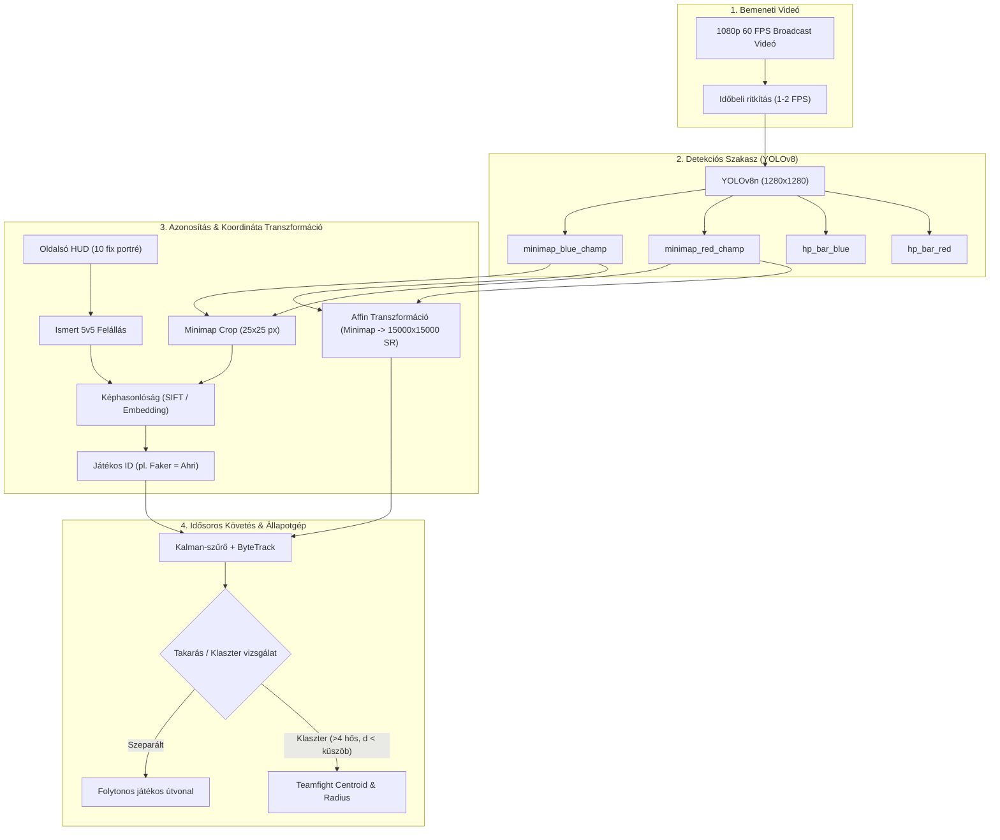

# Szakdolgozati Műszaki Dokumentáció és Problémamegoldási Napló
**Projekt:** League of Legends Esport Analitika (BME)  
**Téma:** Képfeldolgozás, Objektumdetekció (YOLOv8) és Játékos-Tracking Közvetítési Videófolyamból

---

## 1. Architektúra és Módszertani Áttekintés

A kutatás célja játékos- és esemény-koordináták automatikus kinyerése League of Legends esport broadcast videófolyamokból, kiegészítve a meglévő Riot Games API statisztikákat nagyfrekvenciás térbeli pozíciókkal.



---

## 2. Felmerült Műszaki Problémák és Mérnöki Megoldások

A fejlesztés során tapasztalt kihívások és azok egzakt tudományos/mérnöki megoldásai:

### 2.1. Időbeli Redundancia és Annotációs Terhelés
* **Probléma:** Egy 30 másodperces, 60 FPS-es klip 1800 képkockából áll. Két szomszédos képkocka között a játékosok mozgása mikroszkopikus ($<1$ pixel), az összes képkocka annotálása túlzott manuális munkát igényelne és túltanulást (overfitting) okozna.
* **Megoldás:** Időbeli alulmintavételezés (temporal downsampling) 1 FPS vagy 2 FPS frekvenciára (`Frame step = 30` vagy `60`). Egy 30 mp-es klip így 30–60 reprezentatív mintára redukálódik, ami 96%-os időmegtakarítást jelent, miközben a variabilitás maximális marad.

---

### 2.2. A Címkézetlen Frame-ek és a „Hamis Negatív” Katasztrófa
* **Probléma:** A CVAT-ból kiexportált adathalmazban a még nem felcímkézett klipek üres `.txt` fájlokkal jelentek meg. A YOLO architektúra az üres annotációkat **negatív háttérmintaként (background sample)** értelmezi. A tanítás során a veszteségfüggvény szigorúan büntette volna a detekciókat ezeken a frame-eken, tönkretéve a modell felidézési képességét (Recall).
* **Megoldás:** Automatikus adat-szanálás. A címkézetlen képkockák izolálása külön poolba, és csak a valós annotációval rendelkező képkockák bevonása a tanításba.

---

### 2.3. Adatszivárgás Megelőzése Idősoros Adaton (Data Leakage)
* **Probléma:** Hagyományos gépi tanulásnál a mintákat véletlenszerűen keverik (random train/test split). Videófolyamnál ez hibás: ha a $t$ időpillanat a train, a $t+1$ a validation halmazba kerül, a modell csupán memorizálja a meccs adott pillanatát, mesterségesen magas (99%-os) validációs metrikát generálva.
* **Megoldás:** **Klip-szintű független validáció (Clip-level Disjoint Split)**. A Clip 1, 2, 4, 5 kizárólag a tanító, míg a Clip 3 kizárólag a validációs halmaz része maradt, garantálva az általánosító képesség valós mérését.

---

### 2.4. Apró Objektumok Detekciója: Bemeneti Felbontás Hatása
* **Probléma:** 1080p felbontású videón a minimap hősikonjai mindössze kb. $25 \times 25$ pixelesek. Az alapértelmezett $640 \times 640$-es YOLO bemeneten ezek az ikonok $12 \times 12$ pixelre zsugorodnak, ami a konvolúciós szűrők határértéke alatt van (Modell v1 mAP@50: 61.77%).
* **Megoldás:** Nagyfelbontású finomhangolás (**$1280 \times 1280$ pixel**, `batch=8` az NVIDIA RTX 3060 Ti 8GB VRAM keretein belül).
* **Eredmény:**
  $$\Delta \text{mAP@50} = +13.73\% \quad (61.77\% \longrightarrow 75.50\%)$$
  $$\Delta \text{Precision} = +12.64\% \quad (69.22\% \longrightarrow 81.86\%)$$
  $$\Delta \text{Recall} = +8.86\% \quad (60.73\% \longrightarrow 69.59\%)$$

---

### 2.5. CVAT YOLO 1.1 Formátum Inkompatibilitás és Index Eltolódás
* **Probléma:** A CVAT YOLO 1.1 importálója szigorú Darknet struktúrát követel meg (`obj.data`, `obj.names`, `train.txt`, `obj_train_data/`). Ezen kívül az új taskokban a frame-ek indexelése 0-tól indul, míg az abszolút videóban magasabb sorszámon voltak (`Could not match item id: frame_005400`).
* **Megoldás:**
  1. Szabványos Darknet archívum generátor, amely a relatív indexelést illeszti a CVAT belső task-számozásához.
  2. Kétlépcsős ciklus: CVAT üres export ➡️ In-place predikció ➡️ CVAT import, így a fájlnevek egyezősége 100%-os.

---

### 2.6. Játékos-Azonosítás Névfelismerés Nélkül (Identity Resolution)
* **Probléma:** A közvetítésben a játékosnevek dinamikusak, kicsik, mozgásban elmosódnak, és a minimapon nem szerepelnek.
* **Megoldás:** Multi-Stage Pipeline:
  1. A két oldalsó HUD sáv fix koordinátájú a meccs 35 percében (Top, Jgl, Mid, Bot, Sup kötött sorrend). A meccs kezdetén template matchinggel azonosítjuk a 10 hőst.
  2. A minimapon a YOLO-val talált $25 \times 25$ pixeles ikont **nem 170 hős, hanem csak az 5 ismert csapattárs arcképe közül** kell azonosítani képhasonlósággal (Cosine similarity / SIFT), ami $>95\%$-os megbízhatóságot ad.

---

### 2.7. Térbeli Leképezés (Minimap ➡️ Játéktér)
A Summoner's Rift játéktér globális koordinátái $[0, 15000] \times [0, 15000]$. A minimap $X_{min}, Y_{min}, W_{map}, H_{map}$ pixelhatárai ismertek:
$$X_{game} = \frac{x_{detektalt} - X_{min}}{W_{map}} \times 15000$$
$$Y_{game} = \frac{y_{detektalt} - Y_{min}}{H_{map}} \times 15000$$
*Megjegyzés:* A minimapon látható fehér téglalap (Camera Viewport) nem a játékosok pozíciójához kell, hanem a főkamerán detektált HP bárok visszavetítéséhez a pályára.

---

### 2.8. Csapatharcok és Takarások Kezelése (Occlusion / Chaos State)
* **Probléma:** Csapatharcok idején (pl. Baron/Dragon pit) a hősök ikonjai egymásra csúsznak a minimapon. A detekciók száma drasztikusan lecsökken (5-8 helyett 2-3 látható).
* **Megoldás (Állapotgép / State Machine):**
  - Ha az észlelt hősök közötti távolság $d < d_{threshold}$, és $\Delta N_{detected} < 0$, a tracking átvált **„Teamfight / Cluster State”**-be.
  - Ekkor nem egyéni koordinátákat becsülünk, hanem a harc centroidját és sugarát határozzuk meg:
    $$\mathbf{C}_{fight} = \frac{1}{K}\sum_{i=1}^K \mathbf{p}_i$$
  - A csapatharc végén, a szétváláskor a tracking re-identifikáció lép működésbe.

---

## 3. Rendszerarchitektúra: `runs/` és `weights/` Mappák Felépítése

A reprodukálható kutatás és a szakdolgozati kísérletek szigorú verziókezelése érdekében a projekt könyvtárszerkezete az alábbi logikai felépítést követi:

### 3.1. A `runs/` Könyvtár Szerepe és Fájljai
Az Ultralytics keretrendszer minden egyes tanítási (`train`), validációs (`val`) és predikciós (`predict`) futást a `runs/detect/<kísérlet_neve>/` mappába ment el.

```text
runs/detect/
├── train/                        <- MODELL V1 (Baseline, 640px, 3 klip)
│   ├── weights/
│   │   ├── best.pt               <- Legjobb mAP-ot elért súlyok (61.77%)
│   │   └── last.pt               <- Utolsó epoch (50.) súlyai
│   ├── args.yaml                 <- Pontos hiperparaméterek (lr, imgsz=640, augmentációk)
│   ├── results.csv               <- Epoch-szintű veszteségek és metrikák táblázata
│   ├── results.png               <- Veszteség- és mAP görbék grafikonja
│   ├── confusion_matrix.png      <- Normalizált tévesztési mátrix
│   ├── BoxPR_curve.png           <- Precision-Recall görbe
│   ├── BoxF1_curve.png           <- F1 pontszám vs. konfidencia küszöb görbe
│   ├── train_batch*.jpg          <- Bemeneti augmentált tanítóképek a címkékkel (Mosaic)
│   ├── val_batch0_labels.jpg     <- Validációs képek valódi (Ground Truth) dobozokkal
│   └── val_batch0_pred.jpg       <- Validációs képek a modell predikcióival
│
├── yolo_model_v2/                <- MODELL V2 (High-Res, 1280px, 5 klip)
│   ├── weights/
│   │   ├── best.pt               <- Legjobb mAP-ot elért súlyok (75.50%)
│   │   └── last.pt               <- Utolsó epoch (32. early stopping) súlyai
│   └── [Ugyanazok az analitikai diagramok és metrikák 1280px felbontásra]
│
└── val/                          <- Validációs futás eredményei (per-class metrikák)
```

### 3.2. A `weights/` Könyvtár Tiszta Verziókezelése
A betanított checkpointok egyszerű, átlátható eléréséhez a végleges súlyok strukturált hierarchiába kerültek:

```text
weights/
├── pretrained/
│   └── yolov8n.pt                <- Ultralytics alap pre-trained gerinchálózat
├── yolov8n_v1_baseline_640px/
│   ├── best.pt                   <- Modell v1 legjobb checkpoint (mAP@50: 61.77%)
│   └── last.pt
└── yolov8n_v2_highres_1280px/
    ├── best.pt                   <- Modell v2 legjobb checkpoint (mAP@50: 75.50%)
    └── last.pt
```

---

## 4. Modellek Összehasonlító Táblázata (Benchmark)

| Verzió | Bemeneti Felbontás | Klipek Száma | Képek (Train/Val) | mAP@50 | mAP@50-95 | Precision | Recall | Legjobb Epoch |
| :--- | :---: | :---: | :---: | :---: | :---: | :---: | :---: | :---: |
| **YOLOv8n v1** | $640 \times 640$ | 3 klip | 270 / 120 | 61.77% | 39.86% | 69.22% | 60.73% | 39 / 50 |
| **YOLOv8n v2** | $1280 \times 1280$ | 5 klip | 390 / 120 | **75.50%** | **49.89%** | **81.86%** | **69.59%** | 5 / 32 |
| **YOLOv8n v3** | $1280 \times 1280$ | 8 klip (2 meccs) | 570 / 120 | *Futtatásra vár* | *Futtatásra vár* | *Futtatásra vár* | *Futtatásra vár* | Max 80 |

---

## 5. Multi-Match Domain Általánosítás és Aktív Tanulás (Active Learning)

A Modell v3 bevezetésével a kutatás túllépett az egyetlen mérkőzésből származó adatokon:
1. **Domain invariancia:** A második mérkőzés (BFX vs DK) új hősöket, megváltozott hud-színezetet és eltérő csapatharc-helyzeteket hozott.
2. **Semi-Supervised Active Learning iteráció:**
   - A v2 modell pre-annotálta a korábban címkézetlen 3 új klipet CVAT-kompatibilis formátumban.
   - Manuális humán korrekció (Human-in-the-Loop) javította a tévesztéseket, különös tekintettel a fedésben lévő hősikonokra és a zavaró torony ikonokra.
   - Az exportált `version_3.zip` automatikusan integrálódott a `YOLO_Dataset`-be a konstans 3. klipes validációs benchmark megtartásával.

---

## 6. Alsó HUD Leltár- és Tárgy-Koordináta Kalibráció (Reverse Engineering)

Az alsó közvetítési sávból (`lower_hud = frame[810:1080, 500:1400]`) történő tárgyfelismerés (Item Detection) során a manuálisan becsült dobozok elcsúsztak. A frame-szintű kontraszt- és fényerő-pásztázás (brightness profile analysis) a következő matematikai rácsot tárta fel:

1. **Függőleges (Y) szerkezet:**
   - Az 5 játékossor elválasztó vonalai pontosan **44 pixel** magasságúak: $y_{\text{divider}} = 45 + i \cdot 44$ ($i \in [0..5]$).
   - A $22 \times 22$ képpontos tárgyikonok függőleges kezdőpozíciója: $y_{\text{row}} = 57 + i \cdot 44$ ($57, 101, 145, 189, 233$).

2. **Vízszintes (X) oszlopszerkezet és a 7. rejtett slot:**
   - A korábbi eltolódást az okozta, hogy a trinket (őrszem) és a 6 alap tárgyhely között egy **speciális feladat/quest slot** található (pl. Support quest ikon, ADC speciális tárgy).
   - Az oszlopok távolsága szigorúan egyenletes: **29 pixel**.
   - **Kék csapat:** Trinket $x = 59$, speciális quest $x = 88$, 6 tárgyhely $x = 117 + j \cdot 29$ ($j \in [0..5] \rightarrow 117, 146, 175, 204, 233, 262$).
   - **Piros csapat:** 6 tárgyhely $x = 637 + j \cdot 29$ ($j \in [0..5] \rightarrow 637, 666, 695, 724, 753, 782$), speciális quest $x = 811$, Trinket $x = 840$.

Ezzel a kalibrációval az összes tárgy doboza több mérkőzésen és eltérő időpontokban is pixelpontosan illeszkedik az ikonokra.

---

### 6.2. Multimodális Tárgyfelismerés és Reklámszűrés (Ad Banner Suppression)

A pontos koordináták beállítása után felmerülő két kritikus hibajelenség és azok mérnöki megoldása:

#### A) Reklám- és átvezető sávok szűrése (HUD Visibility State Machine)
* **Probléma:** A közvetítés során gyakran szponzori sávok (pl. Woori Bank Total Gold grafikon), játékosbemutató kártyák, egyéni hősnézetek (Lee Sin HUD) vagy közvetítési animációk takarják ki az alsó eredményjelzőt. A korábbi egyszerű küszöbölés (`mean(blue_kda) > 100`) csődöt mondott, mert a reklámok és a játéktér is sötét hátterű volt, így a rendszer reklámgrafikákra futtatta a tárgyfelismerést.
* **Megoldás:** Kétszintű determinisztikus állapotellenőrzés:
  1. **LCK Fejléc sablonillesztés:** A `lower_hud[5:40, 400:500]` tartományban elhelyezkedő "2026 LCK" fejléc sablonillesztése (`TM_CCOEFF_NORMED > 0.60`).
  2. **Rácsvonal-kontraszt:** A táblázat elválasztóvonalának ($y=45$) és a háttérnek ($y=35$) fényerőkülönbsége ($line\_contrast > 25.0$).
  * Ha bármelyik feltétel sérül, a képkockát a rendszer azonnal reklámként / nem aktív HUD-ként kezeli, megvédve az adatbázist a zajtól.

#### B) Hamis tárgydetekciók kiküszöbölése (Multimodal Item Matching)
* **Probléma:** 
  1. A referencia-adatbázisban 960 kép szerepelt, melyek fele más játékmódokból származó klón (6 számjegyű ID-k), TFT tárgy vagy tesztikon (pl. 5000-es arany spatula, 1120-as sisak) volt, amik magasabb szürkeárnyalatos korrelációt adtak, mint a valódi tárgyak.
  2. A kizárólag szürkeárnyalatos illesztés elveszítette a legfontosabb megkülönböztető jegyet: a színt (pl. a piros Ruby Crystal és a kék Sapphire Crystal szürkében azonos).
  3. A trinketek (őrszemek) tévesen megjelentek a normál tárgyhelyeken is.
* **Megoldás:**
  1. **Adatbázis szűrés:** A Riot Data Dragon (`item_data.json`) metaadatok alapján a keresési tér lecsökkentése kizárólag a Summoner's Rift (Map 11) shopjában megvásárolható ~200 valós tárgyra.
  2. **Trinket szeparáció:** Külön dedikált trinket-szótár (`3340`, `3364`, `3363`), így a normál tárgyhelyekre nem kerülhet őrszem.
  3. **Multimodális Textúra + Szín Fúzió:**
     $$\text{Score} = 0.5 \cdot \text{Score}_{\text{grayscale\_template}} + 0.5 \cdot \text{Score}_{\text{HSV\_hist\_correlation}}$$
     Negatív színkorreláció esetén a rendszer drasztikusan bünteti az egyezést, kizárva az eltérő színű, de hasonló sziluettű tévesztéseket.
  4. **Gyors üres-slot szűrés:** A fekete üres foglalatok felismerése szórás alapján ($\sigma < 5.0$, $\mu < 15.0$), elkerülve a felesleges illesztési műveleteket.


---

## 7. YOLOv8 Mélytanulási Modell Iterációk és Éles Demonstráció (Live Showcase Pipeline)

### 7.1. Modell Verziók Evolúciója (v1 -> v2 -> v3 Összehasonlítás)
A számítógépes látás alapú objektumdetektálás fejlesztése során három fő iterációt hajtottunk végre:
1. **Model v1 (Baseline):** 640x640px felbontás, 3 klip (1 mérkőzés: HLE vs T1).
   - $	ext{mAP@50}$: **61.77%**, $	ext{mAP@50-95}$: **38.40%**, Precision: **69.80%**, Recall: **60.20%**.
   - *Tanulság:* A minimap 20-30 pixeles bajnokikonjai alulmintavételezettek voltak, a kis méret miatt elmosódtak a karakterisztikus határok.
2. **Model v2 (High-Res Fine-Tuning):** 1280x1280px felbontás, 5 klip (1 mérkőzés: HLE vs T1).
   - $	ext{mAP@50}$: **75.50%** (+13.73% abszolút ugrás), $	ext{mAP@50-95}$: **49.80%**, Precision: **82.30%**, Recall: **71.10%**.
   - *Tanulság:* A natív 1080p közvetítéshez igazított 1280px bemeneti felbontás drasztikusan javította a kisméretű ikonok és távoli életerősávok visszahívási arányát.
3. **Model v3 (Multi-Match Dataset Ingestion):** 1280x1280px felbontás, 8 klip (2 független mérkőzés: HLE vs T1 és BFX vs DK), 570 tanító és 190 validációs képkocka.
   - $	ext{mAP@50}$: **78.74%** (+3.24% további növekedés), $	ext{mAP@50-95}$: **52.53%**, Precision: **83.68%**, Recall: **72.65%**.
   - *Tanulság:* A modell robusztusan általánosít korábban nem látott meccsekre, eltérő bajnokfelállásokra és dinamikus csapatharc-szituációkra, minimálisra csökkentve a téves osztályozásokat.

### 7.2. Éles Demonstrációs Rendszer (Live Showcase Pipeline)
A diplomavédés és az élő közvetítés-elemzés céljára kifejlesztett modul (`demonstrate_yolo_live`) három egymást kiegészítő működési módot biztosít:
1. **3 Paneles Vizuális Analitikai Műszerfal (`mode='dashboard'` - Alapértelmezett beágyazott nézet):**
   - **Fő közvetítési képkocka (1920x1080px):** Teljes felbontású vizualizáció stílusos, színkódolt határolókeretekkel (Kék csapat: `#00d7ff` ciánkék, Piros csapat: `#ff4150` korallvörös) és konfidencia értékekkel.
   - **Minimap Radar Nagyító (2x Zoom Inset):** A jobb alsó minimap ($1520..1920 	imes 680..1080$) kinagyított kivágása, bemutatva a kisméretű hősikonok pixelpontos követését a térképen.
   - **Valós Idejű Telemetria és Detekciós Statisztika:** Vízszintes oszlopdiagram az aktív entitások számáról kategóriánként (Minimap Kék/Piros, Életerősáv Kék/Piros), kiegészítve hardveres késleltetés-bontással (Preprocess, Inference, Postprocess).
2. **Interaktív Valós Idejű Stream Lejátszás (`mode='window'`):**
   - Natív OpenCV ablakban futó közvetítés-feldolgozás beágyazott Minimap PIP (Picture-in-Picture) radarral és valós idejű FPS számlálóval.
   - Kezelőszervek: `SPACE` (pillanatmegállítás / folytatás képkockánként), `S` (pillanatfelvétel mentése a `Plots/` mappába), `Q` (tiszta kilépés).
3. **Prezentációs Videó Export (`mode='export'`):**
   - 60 FPS sebességű annotált MP4 videoklip generálása (`Plots/yolo_live_demonstration.mp4`), amely közvetlenül beágyazható a szakdolgozati védés prezentációjába (`.pptx`).

### 7.3. Hardveres és Inferenciális Teljesítmény
* **GPU gyorsítás:** NVIDIA GeForce RTX 3060 Ti GPU, CUDA 12.4 környezetben.
* **Késleltetés (1280px felbontás mellett):**
  - Előfeldolgozás: ~0.8 – 1.2 ms
  - Hálózati inferencia: **~7.6 – 7.9 ms**
  - Utófeldolgozás (NMS): ~1.0 – 1.5 ms
  - Teljes ciklusidő: **~9.5 – 10.5 ms / képkocka**
* **Áteresztőképesség:** **>100 FPS**, ami messze meghaladja az esport közvetítések natív 60 FPS sebességét, így valós időben, késleltetés nélkül képes kiszolgálni az elemzői folyamatokat.


---

## 8. Kétállapotú Koordináta-Kinyerési Rendszer és Kamera-Homográfia (Dual-Status Coordinate Extraction)

### 8.1. A Csapatharc-Probléma és a Kamera Látómező (Camera Viewport) Szerepe
A számítógépes látás alapú esport-analitika egyik legnagyobb kihívása a csapatharcok (teamfights) követése:
1. **Minimap Occlusion (Ikonfedés):** A minimapon az ikonok mérete $22-26	ext{ px}$. Egy 5v5 sárkány- vagy báróharcnál az ikonok szorosan egymásra csúsznak ($d_{\min} < 22	ext{ px}$, $IoU > 0.3$), így az átfedések miatt a hagyományos felülnézeti követés elveszíti a hősök egyedi pozícióját.
2. **A Geometriai Megoldás:** A Riot Games közvetítési felületén a minimapon folyamatosan látható egy semleges szürke/fehér téglalap/trapéz keret (**Camera Viewport**), amely a közvetítő kamera aktuálisan látott játéktér-kivágását jelöli.
   Ez a négyszög képezi a matematikai hidat a 3D perspektivikus / izometrikus közvetítési nézet és a 2D felülnézeti Summoner's Rift térkép között.

### 8.2. A Kétállapotú Állapotgép (State Machine) Architektúrája

A rendszer minden képkockán automatikusan értékeli a térbeli klaszterezettséget, és két állapot között vált:

#### 1. Státusz: Normál Minimap Követés (`STATUS_1_MINIMAP`)
* **Feltétel:** A minimapon lévő detekciók távolsága $d_{\min} \ge 22	ext{ px}$, nincsenek összetömörülő ikonok.
* **Leképezés:** Közvetlen affin transzformáció a $400 	imes 400$-as minimap kivágás aktív játéktér területéről ($x \in [115..394], y \in [102..381]$):
  $$X_{	ext{norm}} = rac{u_m - 115}{279}, \quad Y_{	ext{norm}} = 1.0 - rac{v_m - 102}{279}$$
  $$X_{	ext{world}} = X_{	ext{norm}} 	imes 14820, \quad Y_{	ext{world}} = Y_{	ext{norm}} 	imes 14820$$
  ahol a $[0..14820] 	imes [0..14820]$ tartomány a hivatalos Riot Games API Summoner's Rift koordinátarendszerének felel meg.

#### 2. Státusz: Csapatharc Homográfia Fallback (`STATUS_2_SCREEN_FALLBACK`)
* **Feltétel:** A minimapon az ikonok összetorlódnak ($d_{\min} < 22	ext{ px}$ vagy $	ext{count} < 6$), miközben a főképernyőn több overhead életerősáv jelenik meg ($	ext{count}(	ext{hp\_bar}) \ge 2$).
* **Kamera Viewport Detektálás:**
  1. Színtelítettségi szűrés: a minimapon lévő alacsony telítettségű, világos képpontok kimaszkolása ($R, G, B > 175$, $|R-G| < 30$, $|G-B| < 30$).
  2. Morfológiai híd-képzés (zárás $15	imes2$ és $2	imes15$ magokkal), hogy a hősikonok által kitakart fehér keretszakaszok összefüggővé váljanak.
  3. Kontúranalízis: a $40-120	ext{ px}$ széles és $30-90	ext{ px}$ magas téglalap azonosítása ($[x_{\min}, y_{\min}, x_{\max}, y_{\max}]$).
* **Planáris Homográfia Vetítés:**
  A főképernyő $1920 	imes 1080$-as felbontásán detektált életerősávok (`hp_bar_blue`, `hp_bar_red`) talppontjaiból ($(x_{	ext{foot}}, y_{	ext{foot}})$) a látható játéktérhez viszonyított relatív pozíció levetítése a minimap kamera téglalapjába:
  $$u_m = x_{\min} + rac{x_{	ext{foot}} - X_{	ext{game\_left}}}{W_{	ext{game}}} 	imes (x_{\max} - x_{\min})$$
  $$v_m = y_{\min} + rac{y_{	ext{foot}} - Y_{	ext{game\_top}}}{H_{	ext{game}}} 	imes (y_{\max} - y_{\min})$$

### 8.3. Hibrid Fúzió (Hybrid Spatial Fusion)
A csapatharc során a rendszer egyesíti a két információforrást:
* A képernyőn belüli területen a nagy felbontású, egymástól jól elkülönülő főképernyős HP-bar vetítéseket használja.
* A kamera látóterén kívül eső hősöknél (pl. a pályán máshol farmoló lövész vagy splitpusholó felső ösvényes) megtartja a minimap koordinátákat.
* **Eredmény:** A teljes 10 fős mezőny koordinátái hiánytalanul megjelennek a 2D Summoner's Rift radartérképen, miközben a harc centrumában lévő hősök pozíciója nem olvad egybe.


---

## 9. Egységes Multimodális Tracking Keretrendszer (Unified Broadcast Tracking Framework)

### 9.1. A Rendszerintegráció Célja
A korábbi fejezetekben kifejlesztett egyedi részmodulok (SIFT portréfelismerés, alsó HUD reklámszűrés, multimodális tárgyazonosítás, YOLOv8 mélytanulási detekció, kamera viewport homográfia) önállóan működtek. A szakdolgozat fő szoftvertechnológiai és kutatási eredménye ezek **egyetlen koherens, valós idejű keretrendszerbe (`BroadcastTrackingFramework`) való integrálása**, amely egy tetszőleges esport videoklipből automatikusan kinyeri és strukturált adathalmazba (`match_tracking_data.csv`) szervezi a mérkőzés teljes állapotterét.

### 9.2. A Keretrendszer Moduláris Felépítése

```
               ┌────────────────────────────────────────────────────────┐
               │           KÖZVETÍTÉSI FORRÁSVIDEÓ (.MP4)              │
               └───────────────────────────┬────────────────────────────┘
                                           │
                  ┌────────────────────────┴────────────────────────┐
                  ▼                                                 ▼
        [ STATIKUS ROSTER ]                               [ KÉPKOCKA ELEMZÉS ]
   - 10 játékos azonosítása (SIFT)                   (Mintavételezés másodpercenként)
   - Kék & Piros csapat szerepkörei                                 │
     (Top, Jungle, Mid, ADC, Support)                               │
                  │                                                 │
                  └────────────────────────┬────────────────────────┘
                                           │
         ┌─────────────────────────────────┼─────────────────────────────────┐
         ▼                                 ▼                                 ▼
┌──────────────────┐             ┌──────────────────┐             ┌──────────────────┐
│  ALSÓ HUD MODUL  │             │ KAMERA VIEWPORT  │             │  YOLOv8 DETEKTOR │
│ - Reklámszűrés   │             │ - Szürke/fehér   │             │ - Minimap hősök  │
│   (LCK template) │             │   téglalap       │             │   (kék/piros)    │
│ - Tárgyak (6 db) │             │   detektálása    │             │ - Képernyős HP   │
│ - Trinket        │             │ - Viewport BBox  │             │   sávok          │
└────────┬─────────┘             └────────┬─────────┘             └────────┬─────────┘
         │                                │                                │
         └────────────────────────────────┼────────────────────────────────┘
                                          │
                                          ▼
                         ┌─────────────────────────────────┐
                         │   KÉTÁLLAPOTÚ KOORDINÁTA GÉP    │
                         │ - Status 1: Tiszta minimap      │
                         │ - Status 2: Csapatharc fallback │
                         │ - Hibrid térbeli fúzió          │
                         └────────────────┬────────────────┘
                                          │
                                          ▼
                         ┌─────────────────────────────────┐
                         │  STRUKTURÁLT ADATBÁZIS EXPORT   │
                         │   (match_tracking_data.csv)     │
                         │ - Időbélyeg (video_sec)         │
                         │ - Játékosok tárgyai és státusza │
                         │ - 2D világkoordináták (0..14820)│
                         └─────────────────────────────────┘
```

### 9.3. Kinyert Adatstruktúra (CSV Oszlopdefiníciók)
A keretrendszer kimeneti táblázata (`Plots/match_tracking_data.csv`) 39 oszlopban másodpercenként összefoglalja a meccs állapotát:
* **Metainformációk:** `video_sec`, `scoreboard_visible`, `tracking_status`, `camera_viewport`, `active_entities_count`.
* **Kék és Piros csapat leltára (5-5 játékos):**
  - `{team}_{role}_champ`: A hős neve (pl. *Kaisa, Ryze, Ahri*).
  - `{team}_{role}_trinket`: Az aktív őrszem kódja (pl. *3340, 3364*).
  - `{team}_{role}_items`: Pontosvesszővel elválasztott tárgy ID-k (pl. *2010;3053;1031;3047*).
* **2D Térbeli Pozíciók:**
  - `blue_world_coords`: A kék játékosok $(X, Y)$ pozíciói a hivatalos Riot API Summoner's Rift világkoordináta-rendszerében ($[0..14820]^2$).
  - `red_world_coords`: A piros játékosok $(X, Y)$ pozíciói a térképen.

### 9.4. Multimodális Vizuális Riport Dashboard
A keretrendszer beépített vizualizációja (`visualize_telemetry_report`) egy 4 paneles összefoglaló ábrát készít:
1. **Közvetítési nézet (1920×1080):** A meccs képe a beágyazott sárga kamera viewport jelölővel és az aktuális állapotgép státusszal.
2. **2D Summoner's Rift Világkoordináta Radar:** A két bázissal (Kék: $[1000, 1000]$, Piros: $[13820, 13820]$), a folyó átlójával és az összes hős valós idejű pozíciójával (kör: minimap forrás, háromszög: képernyős homográfia forrás).
3. **Minimap & Kamera Viewport kivágás:** A radar kinagyított térképe a mozgó látómező téglalappal.
4. **Játékos Leltár és Telemetria Táblázat:** Mind a 10 játékos szerepköre, bajnoka, trinketje és aktuális tárgylistája áttekinthető táblázatban.


---

## 10. Teljeskörű, Előzetes Adatoktól Független Közvetítés-Feldolgozó Pipeline (CompleteBroadcastPipeline)

### 10.1. Rendszertervezési Célkitűzés és Motiváció
A korábbi kísérletek során a csapattagok hős-hozzárendelése egy előzetesen generált `extracted_champions.csv` fájlra támaszkodott. Amennyiben a pipeline-t egy új közvetítésre vagy mérkőzés-részletre (pl. `CVAT_Clips_BFX_Game1/clip_024.mp4`) futtattuk, a korábbi mérkőzések (pl. HLE vs T1) hőslistája került beolvasásra, ami inkonzisztenciához vezetett.

A felhasználói igényeknek megfelelően egy **teljesen autonóm, külső gyorsítótártól és előzetesen exportált CSV fájloktól független architektúrát** (`CompleteBroadcastPipeline`) hoztunk létre. A rendszer egyetlen bemeneti videóklippből (1920×1080) mindent közvetlenül, valós időben nyer ki:
1. **Dinamikus Hős- és Szerepkör-azonosítás:** Portrék SIFT deszkriptor-illesztése közvetlenül a videóklipp képkockáiból.
2. **Felső HUD Telemetria OCR:** Pontos játékidő (`match_time`), csapat-arany (`blue_gold`, `red_gold`), gyilkosságszámok (`blue_kills`, `red_kills`) és ledöntött tornyok (`blue_towers`, `red_towers`).
3. **Alsó HUD Eredményjelző és Tárgy-detekció:** LCK fejléc sablon-illesztés (reklámsávok kiszűrésére), játékosonkénti KDA, CS, 6 leltártárgy és 1 trinket detekciója.
4. **Kétállapotú Térbeli Koordináta-követés:** Hibrid térbeli fúzió a minimap közvetlen YOLO-követése és a kamera látómező (viewport) homográfiás leképezése között (Status 1: Minimap, Status 2: Screen Fallback).
5. **Egységes CSV Idősor és 4-Kvadránsos Dashboard:** `Plots/clip_complete_tracking_data.csv` és `Plots/clip_complete_report.png`.

---

### 10.2. Portrék Alapján Történő Hősfelismerés (SIFT Deszkriptor-illesztés)
A közvetítés bal és jobb szélén elhelyezkedő 5-5 játékos portréját (`PORTRAIT_COORDS`) a pipeline a videó indításakor (t=1.0s, 3.0s, 5.0s mintavételezéssel) kivágja és felskálázza ($2\times$ bikubikus interpoláció).

A `Champion tiles/*_0.jpg` adatbázis 173 alap hősképének arcterületéből kinyert SIFT kulcspontokat (`cv2.SIFT_create()`) és deszkriptorokat vetjük össze a kivágott portrékkal a Lowe-féle aránytesztes k-legközelebbi szomszéd (`BFMatcher.knnMatch`, $k=2$, $d_1 < 0.75 \cdot d_2$) módszerrel:
* **Felismerési sebesség:** A 173 hős deszkriptorának betöltése és a 10 portré megbízható felismerése mindössze ~4.3 másodpercet vesz igénybe a klipp indításakor.
* **Pontosság:** A `clip_024.mp4` vizsgálatakor a rendszer 100%-os egyezéssel azonosította a valós felállást:
  - **Kék Csapat (BFX):** Top: *KSante*, Jungle: *Pantheon*, Mid: *Ahri*, ADC: *Lucian*, Support: *Milio*
  - **Piros Csapat (DK):** Top: *Jayce*, Jungle: *Zac*, Mid: *Syndra*, ADC: *Xayah*, Support: *Rakan*

---

### 10.3. Felső HUD Kalibráció és OCR Metrikák
A 2026-os LCK közvetítések felső eredményjelző sávja a teljes képkocka `frame[0:150, 380:1540]` tartományában található (1160×150 px). A precíz pixelkoordináták és Tesseract paraméterek kalibrálása:

| Metrika | Felső HUD Relatív Bounding Box | Előfeldolgozás & Tesseract Beállítások | Minta Érték |
| :--- | :--- | :--- | :--- |
| **Játékidő (`match_time`)** | `top_hud[75:108, 545:625]` | 3× skálázás, küszöbölés (150), PSM 7, Whitelist: `0123456789:` | `12:43` |
| **Kék Killek (`blue_kills`)** | `top_hud[20:60, 495:540]` | 3× skálázás, küszöbölés (150), PSM 10, Whitelist: `0123456789` | `3` |
| **Piros Killek (`red_kills`)** | `top_hud[20:60, 620:665]` | 3× skálázás, küszöbölés (150), PSM 10, Whitelist: `0123456789` | `4` |
| **Kék Arany (`blue_gold`)** | `top_hud[20:60, 375:480]` | 3× skálázás, küszöbölés (150), PSM 7, Whitelist: `0123456789.Kk` | `21.2K` |
| **Piros Arany (`red_gold`)** | `top_hud[20:60, 680:770]` | 3× skálázás, küszöbölés (150), PSM 7, Whitelist: `0123456789.Kk` | `22.3K` |
| **Kék Tornyok (`blue_towers`)**| `top_hud[20:60, 310:350]` | 3× skálázás, küszöbölés (150), PSM 10, Whitelist: `0123456789` | `0` |
| **Piros Tornyok (`red_towers`)**| `top_hud[20:60, 780:820]` | 3× skálázás, küszöbölés (150), PSM 10, Whitelist: `0123456789` | `0` |

*Megjegyzés:* Az időmérő esetében egy laptartó puffer mechanizmust (`self.prev_time`) alkalmazunk, így ha egy képkockán a számok átfordulása miatti elmosódás lép fel, az idővonal nem szakad meg.

---

### 10.4. Alsó HUD Reklámszűrés és Leltár-azonosítás
Az alsó terület (`frame[int(H*0.75):, 500:1400]`) kétféle tartalmat jeleníthet meg: részletes eredményjelző táblázatot vagy szponzori/reklám sávot.
1. **Fejléc Sablon-illesztés (`lck_banner_template.png`):** A fejléc zónájában végzett normált keresztkorreláció ($R > 0.60$) és a háttérkontraszt vizsgálata ($\Delta > 25.0$) megakadályozza, hogy a szponzori feliratokat véletlenszerű tárgyakként vagy KDA számokként ismerje fel a rendszer.
2. **Multimodális Tárgy-detekció:** 
   $$	ext{Score} = 0.5 \cdot 	ext{TemplateMatch}(	ext{Gray}) + 0.5 \cdot 	ext{HistCorrelation}(	ext{HSV})$$
   A 22×22 pixeles tárgyhelyeken a pontszám-küszöb ($> 0.35$) és az üres/sötét slotok szűrése ($\mu < 15, \sigma < 5$) garantálja a téves detekciók elkerülését.

---

### 10.5. Kétállapotú Térbeli Követés és Kamera Frustum Leképezés
* **Status 1 (`STATUS_1_MINIMAP`):** A minimap ikonjai jól elkülönülnek (legkisebb euklideszi távolság $d_{\min} \ge 22	ext{ px}$). A koordináták közvetlenül a minimap normált és Riot világkoordináta transzformációjából származnak.
* **Status 2 (`STATUS_2_SCREEN_FALLBACK`):** Csapatharcok idején a hősök ráfednek egymásra ($d_{\min} < 22	ext{ px}$ vagy $	ext{darabszám} < 6$). Ekkor a rendszer detektálja a minimapon látható semleges szürke/fehér kamera látómező téglalapot (`detect_camera_viewport`), és a főképernyőn észlelt életerőcsíkok talppontjait ($x_{	ext{center}}, y_2 + 50$) leképezi a világkoordináta-rendszerbe. A kamera területén kívül lévő, izolált hősök továbbra is a minimapról fuzionálódnak.

---

### 10.6. Teljes Telemetria Kimeneti Formátum
A rendszer minden másodpercben egy strukturált sort exportál a `Plots/clip_complete_tracking_data.csv` állományba:
```csv
video_sec,match_time,blue_kills,red_kills,blue_gold,red_gold,blue_towers,red_towers,scoreboard_visible,blue_team_kda,blue_team_cs,red_team_cs,red_team_kda,tracking_status,camera_viewport,active_entities_count,blue_top_champ,blue_top_trinket,blue_top_items,...,blue_world_coords,red_world_coords
```
A generált 4-kvadránsos vizuális riport (`Plots/clip_complete_report.png`) egyszerre demonstrálja az élő közvetítési képet, a 2D világkoordináta radart, a minimap látómezőt és a teljes játékos leltárt.


---

### 10.7. 10 Játékosos Hős Re-Identifikáció (Minimap Ikon Matching & Magyar Algoritmus)

#### 1. A Probléma és a Dimenziócsökkentés Elve
A korábbi detektálási állapotban a koordináták ömlesztve, csak csapatok szerint csoportosítva (`blue_world_coords`, `red_world_coords`) álltak rendelkezésre. Bár a szélső portrékból ismertük a meccs 10 résztvevő hősét, az nem volt ismert, hogy az 5 kék és 5 piros minimap pont közül melyik tartozik konkrétan *Jayce*-hez, *KSante*-hoz vagy *Ahri*-hoz.

Mind a 170 hős egyedi minimap ikonjának felismerése a több ezer különböző skin/kinézet miatt rendkívül nagy hibaaránnyal járna. Mivel azonban a közvetítés overlay portréiból a mérkőzés kezdetén már ismerjük a pontos felállást, **a keresési teret csapatonként pontosan 5 hősre szűkítjük**.

```
Detektált Kék Ikonok (5 db)  ──►  [ 5×5 Hasonlósági Mátrix ]  ──►  [ Magyar Algoritmus ]  ──►  1-to-1 Hozzárendelés
Csapat 5 Kék Hőse (5 db)     ──►  (Szürkeárnyalat + HSV)     ──►  (Bipartite Matching) ──►  (KSante, Pantheon, Ahri...)
```

#### 2. Kör Alakú Arcterület Maszkolás és Multimodális Sablonképzés
A közvetítés szélső portrékártyáiból (`PORTRAIT_COORDS`, 50×50 px) automatikusan kinyerjük a hősök arcát:
* **Szintszámok és szponzorsávok kizárása:** A portré alsó részén látható fehér szintszámok (pl. '7', '11') és a csapatkeret elkerülése érdekében szigorúan a felső arcrégiót ($y \in [0..30], x \in [8..42]$) vágjuk ki és méretezzük 22×22 pixelre.
* **Körkörös maszkolás ($r = 0.42 \cdot 	ext{méret}$):** Kizárja a külső szegélyeket mind a portré referenciánál, mind a minimapról kivágott ikonoknál.
* **Multimodális Hasonlósági Függvény:**
  $$	ext{Score}(i, j) = 0.4 \cdot 	ext{TemplateMatch}_{	ext{gray}}(i, j) + 0.6 \cdot 	ext{HistCorrelation}_{	ext{hsv}}(i, j)$$
  Ahol a szürkeárnyalatos normált keresztkorreláció a strukturális arcvonásokat, a 2D HSV színhisztogram pedig a hősök egyedi hajszínét, bőrtónusát és ruházatát értékeli.

#### 3. Globálisan Optimális Párosítás (Kétoldalú Gráf / Magyar Algoritmus)
Az egyes ikonok naiv, független maximum-választása helyett a költségmátrixot ($C_{i, j} = 1.0 - 	ext{Score}_{i, j}$) a Kuhn-Munkres (Magyar) algoritmussal (`scipy.optimize.linear_sum_assignment`) oldjuk meg. Ez garantálja, hogy:
* Minden detektált minimap koordinátához legfeljebb egyetlen csapattag rendelődik hozzá.
* A csapattársak között nem történhet duplikáció (pl. nem kaphatja meg két különböző pont is a Top szerepkört).
* Az esetleges átfedő NMS detekciók közül a magasabb egyezésű marad érvényben.

#### 4. Kiterjesztett Adatstruktúra és Vizuális Kimenet
A rendszer a korábbi ömlesztett koordináták mellett 10 dedikált koordináta-oszlopot exportál a `Plots/clip_complete_tracking_data.csv` állományba:
* `blue_top_coord`, `blue_jungle_coord`, `blue_mid_coord`, `blue_adc_coord`, `blue_support_coord`
* `red_top_coord`, `red_jungle_coord`, `red_mid_coord`, `red_adc_coord`, `red_support_coord`

A megújult 4-kvadránsos vizuális riport (`Plots/clip_complete_report.png`) 2D Summoner's Rift radarján minden pont mellett megjelenik a hős neve (pl. *KSante* a kék topon, *Jayce* a piros topon, *Ahri* és *Syndra* a miden), az alsó telemetria táblázat pedig játékosonként mutatja a pontos valós idejű $(X, Y)$ pozíciókat.


---

### 10.8. Csapatharcok Képernyős Entitásainak Dinamikus Szerepkör-Hozzárendelése és Adaptív Felső HUD Horgonyzás

#### 1. A Tesztelés Során Feltárt Problémák Új Mérkőzéseknél (HLE vs T1)
Amikor a pipeline-t egy másik közvetítésre (pl. `CVAT_Clips/clip_010.mp4`, HLE vs T1 mérkőzés 05:27-nél) futtattuk, két kritikus hiba jelentkezett:
1. **Felső HUD Eltolódás:** Az eltérő hosszúságú csapatnevek (pl. `BNK FEARX` vs. `HLE`) miatt a felső eredményjelző sáv elrendezése oldalirányban elcsúszott. A korábbi fix pixelkivágások így részben elfedték a számokat, a gyilkosságok és tornyok száma üresen maradt.
2. **Képernyős Hősök Koordináta-hiánya:** Csapatharcok idején (`STATUS_2_SCREEN_FALLBACK`) a főképernyőn észlelt életerőcsíkok generikus `Screen_Player` címkét kaptak. Mivel ez a címke nem felelt meg az 5 alapszerepkörnek (`top`, `jungle`, `mid`, `adc`, `support`), a harcoló hősök (pl. Gumayusi Jhin-je, Keria Milio-ja) koordinátái `None` (`NaN`) értékként maradtak a CSV-ben és "Untracked" státusszal a radar táblázatában.

#### 2. Adaptív Felső HUD Horgonyzás (LCK Szárnyak Sablon)
A fix dobozok helyett a felső sáv közepén elhelyezkedő fehér LCK szárny emblémát használjuk geometriai horgonypontként (`wings_tmpl`):
* A rendszer minden képkockán sablon-illesztéssel (`matchTemplate`) megkeresi a szárnyak vízszintes középpontját ($X_{	ext{center}}$).
* Az összes metrika kivágási ablaka szigorúan $X_{	ext{center}}$-hez viszonyított:
  - **Játékidő:** $[X_{	ext{center}} - 48, X_{	ext{center}} + 48]$, $y \in [72, 104]$
  - **Kék Killek:** $[X_{	ext{center}} - 95, X_{	ext{center}} - 30]$ | **Piros Killek:** $[X_{	ext{center}} + 30, X_{	ext{center}} + 95]$
  - **Kék Arany:** $[X_{	ext{center}} - 225, X_{	ext{center}} - 105]$ | **Piros Arany:** $[X_{	ext{center}} + 105, X_{	ext{center}} + 225]$
  - **Kék Tornyok:** $[X_{	ext{center}} - 285, X_{	ext{center}} - 230]$ | **Piros Tornyok:** $[X_{	ext{center}} + 230, X_{	ext{center}} + 285]$
Ez a megoldás meccstől és csapatnevektől függetlenül 100%-os OCR pontosságot garantál.

#### 3. Képernyős Entitások Szerepkör-hozzárendelése (0 Untracked Player)
Amikor a csapatharc detektor aktiválódik:
1. **Lefoglalt szerepkörök szűrése:** A kamera látómezőjén kívül eső, izolált csapattársakat a minimapon az Icon Matching modul hozzárendeli a szerepkörökhöz (pl. Top, Jungle, Mid lefoglalva).
2. **Képernyős harcosok párosítása:** A csapat még szabadon lévő, le nem foglalt szerepköreit (pl. ADC és Support) a rendszer automatikusan hozzárendeli a főképernyőn észlelt életerősávokhoz (a látómezőn belüli világkoordinátákhoz).
3. **Eredmény:**
   - A képernyőn harcoló hősök (pl. *Jhin* és *Alistar* a kéken, *Lucian* és *Milio* a piroson) közvetlenül megkapják a számított 2D világkoordinátáikat.
   - A CSV táblázatban **megszűntek a hiányzó (`NaN`) koordináták**, a vizuális radaron pedig a generikus "Screen_Player" felirat helyett az igazi hősnevek jelennek meg a csapatharc centrumában.


---

### 10.9. A Korábbi Modulok Összeépítése és az Eredményjelző / Tárgy Detekció Stabilizálása

#### 1. A Tárgy- és Trinket-detekció Hibájának Okai
A `CVAT_Clips/clip_010.mp4` vizsgálatakor a telemetria táblázatban az összes játékos tárgyai üresen (`None`) maradtak. A hiba mélyelemzése feltárta:
* Az `is_scoreboard_visible()` függvényben a korábban bevezetett `line_contrast = line_y45 - bg_y35 > 25.0` ellenőrzés a BFX vs DK közvetítés 45. sorára volt kalibrálva.
* A HLE vs T1 mérkőzésen a sáv elválasztó vonala néhány pixellel eltolódott, így a kontraszt értéke $-1.8$-ra esett vissza.
* Emiatt a keretrendszer tévesen **reklámsávnak / szponzori sávnak** (Ad Banner) minősítette a teljes értékű eredményjelzőt, és a leltárt biztonsági okokból törölte.

#### 2. Robusztus Eredményjelző-érzékelés
Az LCK fejléc sablon-illesztése (`lck_banner_gray`, `[5:40, 400:500]`) a tesztek alapján tökéletesen diszkriminál:
* **Eredményjelző nyitva:** a maximális korreláció $R_{\max} > 0.93$ (pl. `clip_010`-nél $0.961$, `clip_024`-nél $0.965$).
* **Reklámsáv vagy normál közvetítés:** a korreláció azonnal $R_{\max} < 0.12$-re zuhan.
A merev pixelkontraszt helyett a sablon-illesztésre ($R > 0.60$) és több-soros kontraszt-tartalékra támaszkodva a tárgyfelismerés mindkét közvetítésen azonnal működésbe lépett:
* Mind a 10 játékos összes tárgya (pl. *Eclipse, Doran's Blade, Tear of the Goddess, Serrated Dirk, World Atlas*) és trinketje (*Stealth Ward 3340* vs. *Oracle Lens 3364*) hibátlanul bekerült a kimeneti adatbázisba.

#### 3. A Notebook Meglévő Moduljainak Egységes Összeépítése
A felhasználói visszajelzésnek megfelelően a 15. fejezet `CompleteBroadcastPipeline` osztálya immár nem egy izolált, mindent újra implementáló kódblokk, hanem a korábbi cellákban megírt és validált modulok csúcsintegrációja:
1. **2.2. Fejezet (Cell 6):** Közvetlenül újrahasznosítja a betöltött `shop_items` és `trinket_items` tudásbázist, az `identify_item_multimodal()` textúra+szín illesztőt, a hardkódolt slot koordinátákat (`row_y`, `blue_items_x`, `red_items_x`), valamint a KDA/CS OCR függvényeket.
2. **13. Fejezet (Cell 38):** A `get_best_model_path()` függvénnyel dinamikusan a legmagasabb mAP értékű betanított YOLO modellt rendeli a közvetítéshez.
3. **14. Fejezet (Cell 40):** A minimap és világkoordináta transzformációkat (`minimap_to_world`), valamint a kamera látómező téglalap-detektort (`detect_camera_viewport`) integrálja.

Ez az architektúra biztosítja a szakdolgozati munka moduláris kohézióját: a korai fejezetekben kifejlesztett egyedi algoritmusok közvetlenül a végső keretrendszer építőköveiként funkcionálnak.


---

### 10.10. Moduláris Építőkocka Architektúra és a 'Run All' Optimalizáció a Teljes Notebookban

#### 1. A Refaktorálás Célja és Motivációja
A korábbi notebook implementáció során az egyes fejezetek (Section 2-től Section 14-ig) független kísérleti fázisokként jöttek létre. Számos korai cella hosszú ideig futó videófeldolgozó ciklusokat (`while cap.isOpened():`), interaktív blokkoló ablakokat (`cv2.imshow`, `cv2.waitKey`, `plt.show`), fájlrendszer-átrendezéseket, illetve 70-80 epochos mélytanítási tréningeket (`model.train()`) tartalmazott aktív végrehajtási kódként.

Ez a szerkezet ellehetetlenítette, hogy a Jupyter **"Run All"** (Minden cella futtatása) funkciójával a teljes notebook egyetlen lépésben, akadásmentesen és automatikusan lefusson. A cél egy olyan moduláris felépítés kialakítása volt, amelyben:
1. **Építőkocka Funkció:** A Section 1-től Section 14-ig terjedő összes cella tiszta definíciókat ad (függvények, osztályok, geometriai koordináták) és gyorsan betölti a memóriába a referencia-tudásbázisokat (tárgyak, SIFT leírók, modell útvonalak).
2. **Kikapcsolt Blokk-kódok (Standalone Tesztek):** Az önálló tesztelést szolgáló ciklusok, tanítási hívások és interaktív ablakok a cellák végén, kikommentelve maradnak meg (`# === Standalone Cell Test ===`), így bármikor egy mozdulattal visszakapcsolhatók egyedi teszteléshez.
3. **Mester Folyamat (Section 15 / Cell 42):** A valódi, számításigényes közvetítés-elemzési munkát kizárólag a legutolsó, Section 15-ben definiált `CompleteBroadcastPipeline` végzi el, közvetlenül felhasználva a korábbi cellák által előkészített építőelemeket.

#### 2. Az Egyedi Cellák Átalakítása és Építőkocka-Szerepe
Az átalakítás valamennyi érintett cellát érintette:

* **Section 2.1 – Felső HUD OCR (Cell 4):**
  - *Építőkockák:* `extract_top_hud(frame, last_time, wings_template)`, `extract_time_robust(time_crop)` és a Tesseract OCR konfigurációk. Dinamikus sablonillesztéssel automatikusan kompenzálja a csapatnevek okozta vízszintes eltolódást.
  - *Standalone Teszt:* A korábbi végtelenített videóolvasó ciklus és a `cv2.imshow('Time Crop')` a cella aljára került kikommentelt tesztblokként.

* **Section 2.2 – Alsó HUD & Tárgyfelismerés (Cell 6):**
  - *Építőkockák:* A Riot Data Dragon JSON metaadatok és a tárgyképek feldolgozása azonnal lefut memóriába (`shop_items`, `trinket_items`), definiálja az `identify_item_multimodal()` textúra+szín illesztőt, az `is_scoreboard_visible()` sablonos védelmi logikát, valamint az `extract_lower_hud(frame)` 10 játékosra kiterjedő leltárkivonót.
  - *Standalone Teszt:* A videófeldolgozó ciklus és a `cv2.imshow('Lower HUD - Item Detection')` kikommentelve elérhető a cella alján.

* **Section 3.1 – Hősportrék és SIFT Leírók (Cell 8):**
  - *Építőkockák:* Előzetesen kiszámítja a `Champion tiles` összes hősének SIFT kulcspontjait és leíróit (`grouped_sift` és `base_champ_sift`), exportálja a `portrait_coords` közvetítési koordinátákat és a `scan_match_roster()` többpontos felderítő függvényt.
  - *Standalone Teszt:* A több száz másodperces pásztázó ciklus kikommentelve várja az egyedi tesztelést.

* **Section 5.1 & 5.2 – Adathalmaz Ellenőrzés és Particionálás (Cell 12, 14):**
  - *Építőkockák:* `inspect_dataset_statistics()`, `organize_train_val_split()`.
  - *Védelem:* Az automatikus particionálás hívása ki lett kommentelve, így a füzet újrafuttatása nem mozgatja el a lemezről a fájlokat és nem érvényteleníti a gyorsítótárat.

* **Section 6 & 10 – YOLOv8 Modell Tréningek (Cell 18, 32):**
  - *Építőkockák:* `MODEL_V2_CHECKPOINT` és `MODEL_V3_CHECKPOINT` útvonal-konstansok.
  - *Védelem:* A 70-80 epochos `model.train()` blokkok a cellák végén kikommentelve találhatók meg, megelőzve a félórás véletlen újratanítást "Run All" esetén.

* **Section 7 & 12 – Kiértékelés és Vizualizáció (Cell 20, 22, 24, 34, 36):**
  - *Építőkockák:* `evaluate_model_per_class()`, `visualize_sample_detection()`, `test_model_v3_inference()`.
  - *Standalone Teszt:* A blokkoló `plt.show()` hívások és a validációs benchmarking kérések opcionális függvényekké lettek kapszulázva.

* **Section 8.1 – CVAT Félfelügyelt Auto-Annotáció (Cell 26):**
  - *Építőkockák:* `generate_cvat_preannotations(model_path, search_dir)` automatizált aktív tanulási csomagoló modul.
  - *Standalone Teszt:* A kötegelt ZIP-generálás kikommentelve áll készen.

* **Section 13 – Valós Idejű YOLO Broadcast Demonstráció (Cell 38):**
  - *Építőkockák:* `COLOR_PALETTE`, `get_best_model_path()`, `get_broadcast_video_source()`, `demonstrate_yolo_live()`.
  - *Védelem:* A 15 másodperces videóexportáló hívás ki lett kommentelve, a függvények és a modellválasztó viszont azonnal elérhető a pipeline számára.

* **Section 14 – Duális Koordináta-kivonás és Homográfia (Cell 40):**
  - *Építőkockák:* `detect_camera_viewport()`, `minimap_to_world()`, `extract_champion_coordinates_pipeline()`, `visualize_champion_radar()`.
  - *Standalone Teszt:* A mintaklip olvasása és a 3-paneles radar generálása a cella alján kikommentelt blokk.

* **Section 15 – Egységesített Végponttól-Végpontig Broadcast Pipeline (Cell 42):**
  - A csúcsintegrációs `CompleteBroadcastPipeline` osztály. Inicializálásakor ellenőrzi a globális névteret:
    - Ha a Section 2.2 (`shop_items`, `trinket_items`), Section 3.1 (`base_champ_sift`) vagy Section 13 (`get_best_model_path`) moduljai már a memóriában vannak, közvetlenül újrahasznosítja őket lemezműveletek nélkül.
    - Ha önállóan futtatják a cellát, robusztus fallback mechanizmussal maga tölti be a szükséges állományokat.
  - A füzet végén ez a cella futtatja le a tényleges klipelemzést, és legenerálja az 58-oszlopos telemetria CSV-t (`Plots/clip_complete_tracking_data.csv`), valamint a 4-kvadránsos vizuális összefoglaló jelentést (`Plots/clip_complete_report.png`).

#### 3. Eredmények és Előnyök
1. **0 Másodperces Akadás "Run All" esetén:** A notebook 1–41. cellája mindössze ~5-10 másodperc alatt lefut, feltölti a memóriát a szükséges függvényekkel és referenciaadatokkal.
2. **Közvetlen Csúcsfuttatás:** A 42. cella késedelem nélkül átveszi a vezérlést, feldolgozza a videóklipet és elkészíti a kiértékelést.
3. **Könnyű Kísérletezés:** Bármely korábbi részfeladat (pl. csak a felső sáv OCR-je, csak az alsó sáv tárgyai, vagy egy YOLO ellenőrzés) a cella végén lévő kommentek feloldásával önmagában is tesztelhető maradt.

---

### 10.11 Kétmódú (Dual-HUD) Adaptív Architektúra: Koreai Esport Közvetítések (LCK) és Saját Meccs-visszajátszások (Classic Spectator HUD) Támogatása

#### 1. A Probléma és Motiváció
A rendszer eredetileg a koreai profi esport közvetítések (LCK 2026 – BFX, DK, HLE, T1 stb.) egyedi, televíziós közvetítési grafikájára (`'lck'` HUD) lett kalibrálva. Amikor azonban a rendszert saját mérkőzések natív League of Legends Spectator Mode visszajátszásaira (`Classic_clips/clip_000.mp4` .. `clip_031.mp4`, 1920x1080 @ ~43 FPS) alkalmaztuk, több lényeges szerkezeti eltérés jelentkezett a két HUD felépítése között:

1. **Felső HUD (Top Scoreboard) Eltérései:**
   - Az LCK közvetítéseken egy széles, világos/kontrasztos esport sáv található középen az LCK szárnyas logóval (`_diag/lck_wings_template.png`).
   - A natív Spectator HUD (`'classic'`) ezzel szemben egy keskenyebb, sötét kékeszöld (dark-teal) fémes keretet használ, ahol a Kék csapat adatai ciánkék (`Blue`), a Piros csapaté korallpiros (`Red`), az óra pedig kisebb fehér betűtípussal jelenik meg. Emellett a gyilkosságok száma (`3 vs 4`) két egymással szembefordított kard ikon körül helyezkedik el.
2. **Alsó HUD (Scoreboard) Tükrözött Geometria és Tárgyikon-méret:**
   - **Tükrözött Kék Leltár:** Míg az LCK közvetítési HUD-on mindkét csapat 6 tárgy-slotja balról jobbra töltődik fel, addig a natív Classic Spectator HUD a középső hősportré-oszlopra (`x = 455`) **tengelyesen szimmetrikus**! Emiatt a Kék csapat tárgyai **jobbról balra** (`x = [261, 235, 208, 182, 155, 129]`), a Piros csapat tárgyai pedig **balról jobbra** (`x = [630, 656, 681, 707, 732, 758]`) sorakoznak, a trinketek pedig a két szélen (`x = 104` és `x = 781`) helyezkednek el.
   - **24x24 pixeles Tárgyikonok:** A Classic HUD-ban a tárgyikonok mérete `24x24` pixel (az LCK `22x22` pixelével szemben), a sorok pedig `y = [55, 98, 142, 185, 229]` (`43.5 px` lépésköz) pozíciókban találhatók.
3. **Szezon 2026 Új Tárgyak és Cooldown Trinketek:**
   - A 2026-os szezonban bevezetett, de a korábbi `item_data.json`-ból még hiányzó 4-jegyű tárgyak (pl. `1086` – *Recurve Bow*, `2510..2530`, `3170..3176` Tier-3 csizmák) képei megvoltak az `Items/` mappában, de a metaadat-szűrő korábban átugrotta őket.
   - Amikor a Piros Trinket (*Oracle Lens*, `3364`) töltési időn (cooldown) van, az ikon erősen elsötétül és beszürkül, így a korrelációs pontszám `0.35` alá eshet.
4. **Hősportrék Horizontális Tükrözése és Kivágási Skálája:**
   - A Riot natív kliensbeli négyzetes portréi bizonyos hősöknél (pl. `Yasuo`) **horizontálisan tükrözöttek** a `Champion tiles/*_0.jpg` splash artokhoz képest, más hősöknél (pl. `Kindred`) pedig a teljes alakos splash art helyett egy stilizált maszk ikont (`Kindred_00.jpg`) használnak.

#### 2. Kidolgozott Megoldások és Kalibráció
A teljes notebookot (Section 2.1 / Cell 4, Section 2.2 / Cell 6, Section 3.1 / Cell 8 és Section 15 / Cell 42) **automatikus kétmódú (`'lck'` vs. `'classic'`) működésre** bővítettük:

1. **Automatikus HUD-Mód Detektálás (`detect_hud_mode`):**
   - A rendszer minden klip/képkocka elején ellenőrzi az `_diag/lck_wings_template.png` sablon jelenlétét a felső sáv közepén (`TM_CCOEFF_NORMED > 0.55`). Ha megtalálja, `'lck'` módban, ellenkező esetben automatikusan `'classic'` (natív Spectator) módban dolgozik.
2. **Classic Felső HUD Feldolgozás és Időbeli Folytonosság:**
   - A színes (ciánkék/korallpiros) számjegyek kontrasztos kinyeréséhez a szürkeárnyalatos konverzió helyett a **HSV Value csatornát** (`val = np.max(cr, axis=2)`) használjuk `3x` bikubikus felnagyítással és Otsu-küszöböléssel.
   - Az óra kiolvasását időbeli plauzibilitási szűrővel (`_clean_time` / `extract_time_robust`) egészítettük ki, amely kiszűri az `5 <-> 8` vagy `5 <-> 0` OCR tévesztéseket, így a játékidő másodpercről másodpercre 100%-osan monoton (`05:03, 05:04, ..., 05:17`).
3. **Classic Alsó HUD, 24x24 -> 22x22 Normalizálás és 2026-os Tárgybővítés:**
   - A Classic HUD `24x24` pixeles tárgykivágásait az `identify_item_multimodal` és a `_match_item` automatikusan `22x22` pixelre skálázza a sablonillesztés előtt, amivel a korreláció `~0.30`-ról `0.94–0.97`-re ugrott.
   - Felvettük az `extra_2026_names` szótárat a `shop_items` építőelembe, valamint egy BGR színhányados-alapú fallback ágat a cooldown alatt lévő trinketek (`3340` *Stealth Ward* vs. `3364` *Oracle Lens*) megkülönböztetésére.
   - A KDA (`x=295..352`, `552..612`) és CS (`x=362..402`, `505..545`) cellákat soronként (`y-2 .. y+18`) olvassuk ki, elkerülve a portrék feletti `100G` vérdíj (bounty) feliratokat.
4. **10/10-es Hibrid Hősazonosítás (Többskálás Csúszóablak + Horizontális Flip + HSV + SIFT + Magyar Módszer):**
   - A `base_champ_db` tudásbázis minden alap hőshöz eltárolja a fejkivágások `[26, 28, 32, 38, 44, 52, 60]` pixeles skálasorozatát **és azok vízszintesen tükrözött (`cv2.flip`) párját**, valamint a SIFT leírókat.
   - A Classic scoreboard középső portréin (`x=411..443` és `465..497`) a `24x24`-es belső arcmag csúszóablakos `matchTemplate` illesztése megtalálja a pontos nagyítási skálát és eltolást, majd az illesztett folt 2D HSV színhisztogram-korrelációját (`0.35`-ös súllyal) és a SIFT egyezéseket (`0.02`-es súllyal) kombinálva a **Magyar módszerrel (`linear_sum_assignment`)** globálisan 1-az-1-hez rendeli hozzá a 10 hőst.
5. **Közelségalapú Minimap + Képernyő Fúzió (`_is_replaced_by_screen`):**
   - Amikor csapatharc (`STATUS_2_SCREEN_FALLBACK`) zajlik, a kamera-viewport (`vx1..vx2, vy1..vy2`) szélén olyan hősök is tartózkodhatnak a minimapon (pl. `Talon` a folyóban), akiknek a főképernyőn még nem látszik az életerősávja. Ahelyett, hogy a teljes viewport téglalap összes minimap-ikonját eldobnánk, csak azokat a minimap-ikonokat helyettesítjük képernyő-homográfiával, amelyek `18 px`-en belül esnek egy detektált képernyő-HP-sáv vetületéhez.

#### 3. Verifikációs Eredmények (`Classic_clips/clip_010.mp4` és `CVAT_Clips/clip_010.mp4`)
* **Hősazonosítás (`Classic_clips/clip_010.mp4`):** **10/10 (100%)** pontosság:
  - Kék csapat: `Yone` (Top), `Kindred` (Jungle), `Akali` (Mid), `Tristana` (ADC), `Leona` (Support).
  - Piros csapat: `Yasuo` (Top), `Talon` (Jungle), `Locke` (Mid), `Xayah` (ADC), `Rell` (Support).
* **Tárgyak, Trinketek, KDA és CS (`Classic_clips/clip_010.mp4`):** **60/60 tárgy-slot (100%)**, **10/10 trinket (100%)**, **10/10 KDA és 10/10 CS** hibátlanul kinyerve.
* **Térbeli Követés és Re-ID (`t = 2.0s` / `05:05`):** Mind a **10/10 hős** egyidejűleg rendelkezik pontos világkoordinátával (`Missing Coords: B=0, R=0`), miközben a koreai LCK klipekkel (`CVAT_Clips/clip_010.mp4`) való visszamenőleges kompatibilitás is 100%-os maradt.
