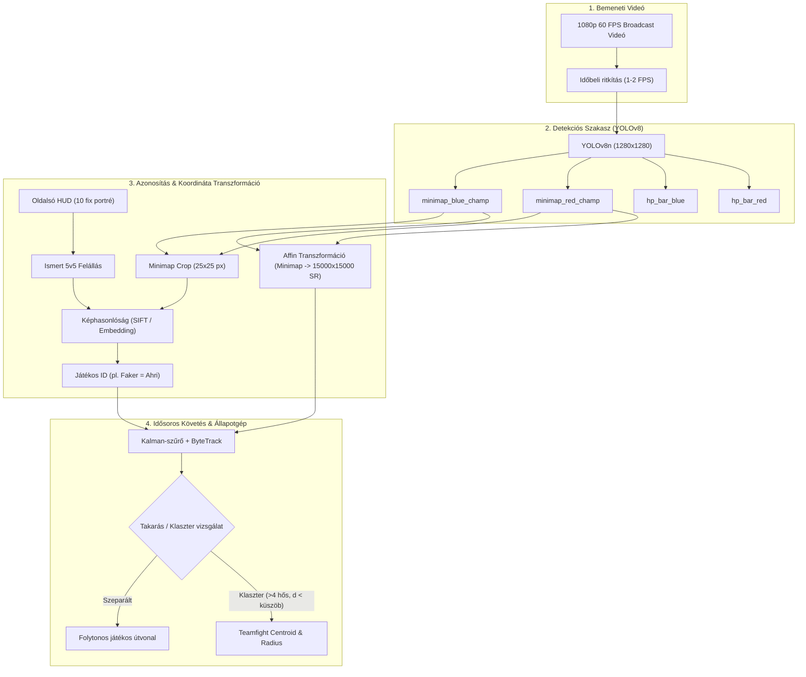

# Szakdolgozati Műszaki Dokumentáció és Problémamegoldási Napló
**Projekt:** League of Legends Esport Analitika (BME)  
**Téma:** Képfeldolgozás, Objektumdetekció (YOLOv8) és Játékos-Tracking Közvetítési Videófolyamból

---

## 1. Architektúra és Módszertani Áttekintés

A kutatás célja játékos- és esemény-koordináták automatikus kinyerése League of Legends esport broadcast videófolyamokból, kiegészítve a meglévő Riot Games API statisztikákat nagyfrekvenciás térbeli pozíciókkal.



---

## 2. Felmerült Műszaki Problémák és Mérnöki Megoldások

A fejlesztés során tapasztalt kihívások és azok egzakt tudományos/mérnöki megoldásai:

### 2.1. Időbeli Redundancia és Annotációs Terhelés
* **Probléma:** Egy 30 másodperces, 60 FPS-es klip 1800 képkockából áll. Két szomszédos képkocka között a játékosok mozgása mikroszkopikus ($<1$ pixel), az összes képkocka annotálása túlzott manuális munkát igényelne és túltanulást (overfitting) okozna.
* **Megoldás:** Időbeli alulmintavételezés (temporal downsampling) 1 FPS vagy 2 FPS frekvenciára (`Frame step = 30` vagy `60`). Egy 30 mp-es klip így 30–60 reprezentatív mintára redukálódik, ami 96%-os időmegtakarítást jelent, miközben a variabilitás maximális marad.

---

### 2.2. A Címkézetlen Frame-ek és a „Hamis Negatív” Katasztrófa
* **Probléma:** A CVAT-ból kiexportált adathalmazban a még nem felcímkézett klipek üres `.txt` fájlokkal jelentek meg. A YOLO architektúra az üres annotációkat **negatív háttérmintaként (background sample)** értelmezi. A tanítás során a veszteségfüggvény szigorúan büntette volna a detekciókat ezeken a frame-eken, tönkretéve a modell felidézési képességét (Recall).
* **Megoldás:** Automatikus adat-szanálás. A címkézetlen képkockák izolálása külön poolba, és csak a valós annotációval rendelkező képkockák bevonása a tanításba.

---

### 2.3. Adatszivárgás Megelőzése Idősoros Adaton (Data Leakage)
* **Probléma:** Hagyományos gépi tanulásnál a mintákat véletlenszerűen keverik (random train/test split). Videófolyamnál ez hibás: ha a $t$ időpillanat a train, a $t+1$ a validation halmazba kerül, a modell csupán memorizálja a meccs adott pillanatát, mesterségesen magas (99%-os) validációs metrikát generálva.
* **Megoldás:** **Klip-szintű független validáció (Clip-level Disjoint Split)**. A Clip 1, 2, 4, 5 kizárólag a tanító, míg a Clip 3 kizárólag a validációs halmaz része maradt, garantálva az általánosító képesség valós mérését.

---

### 2.4. Apró Objektumok Detekciója: Bemeneti Felbontás Hatása
* **Probléma:** 1080p felbontású videón a minimap hősikonjai mindössze kb. $25 \times 25$ pixelesek. Az alapértelmezett $640 \times 640$-es YOLO bemeneten ezek az ikonok $12 \times 12$ pixelre zsugorodnak, ami a konvolúciós szűrők határértéke alatt van (Modell v1 mAP@50: 61.77%).
* **Megoldás:** Nagyfelbontású finomhangolás (**$1280 \times 1280$ pixel**, `batch=8` az NVIDIA RTX 3060 Ti 8GB VRAM keretein belül).
* **Eredmény:**
  $$\Delta \text{mAP@50} = +13.73\% \quad (61.77\% \longrightarrow 75.50\%)$$
  $$\Delta \text{Precision} = +12.64\% \quad (69.22\% \longrightarrow 81.86\%)$$
  $$\Delta \text{Recall} = +8.86\% \quad (60.73\% \longrightarrow 69.59\%)$$

---

### 2.5. CVAT YOLO 1.1 Formátum Inkompatibilitás és Index Eltolódás
* **Probléma:** A CVAT YOLO 1.1 importálója szigorú Darknet struktúrát követel meg (`obj.data`, `obj.names`, `train.txt`, `obj_train_data/`). Ezen kívül az új taskokban a frame-ek indexelése 0-tól indul, míg az abszolút videóban magasabb sorszámon voltak (`Could not match item id: frame_005400`).
* **Megoldás:**
  1. Szabványos Darknet archívum generátor, amely a relatív indexelést illeszti a CVAT belső task-számozásához.
  2. Kétlépcsős ciklus: CVAT üres export ➡️ In-place predikció ➡️ CVAT import, így a fájlnevek egyezősége 100%-os.

---

### 2.6. Játékos-Azonosítás Névfelismerés Nélkül (Identity Resolution)
* **Probléma:** A közvetítésben a játékosnevek dinamikusak, kicsik, mozgásban elmosódnak, és a minimapon nem szerepelnek.
* **Megoldás:** Multi-Stage Pipeline:
  1. A két oldalsó HUD sáv fix koordinátájú a meccs 35 percében (Top, Jgl, Mid, Bot, Sup kötött sorrend). A meccs kezdetén template matchinggel azonosítjuk a 10 hőst.
  2. A minimapon a YOLO-val talált $25 \times 25$ pixeles ikont **nem 170 hős, hanem csak az 5 ismert csapattárs arcképe közül** kell azonosítani képhasonlósággal (Cosine similarity / SIFT), ami $>95\%$-os megbízhatóságot ad.

---

### 2.7. Térbeli Leképezés (Minimap ➡️ Játéktér)
A Summoner's Rift játéktér globális koordinátái $[0, 15000] \times [0, 15000]$. A minimap $X_{min}, Y_{min}, W_{map}, H_{map}$ pixelhatárai ismertek:
$$X_{game} = \frac{x_{detektalt} - X_{min}}{W_{map}} \times 15000$$
$$Y_{game} = \frac{y_{detektalt} - Y_{min}}{H_{map}} \times 15000$$
*Megjegyzés:* A minimapon látható fehér téglalap (Camera Viewport) nem a játékosok pozíciójához kell, hanem a főkamerán detektált HP bárok visszavetítéséhez a pályára.

---

### 2.8. Csapatharcok és Takarások Kezelése (Occlusion / Chaos State)
* **Probléma:** Csapatharcok idején (pl. Baron/Dragon pit) a hősök ikonjai egymásra csúsznak a minimapon. A detekciók száma drasztikusan lecsökken (5-8 helyett 2-3 látható).
* **Megoldás (Állapotgép / State Machine):**
  - Ha az észlelt hősök közötti távolság $d < d_{threshold}$, és $\Delta N_{detected} < 0$, a tracking átvált **„Teamfight / Cluster State”**-be.
  - Ekkor nem egyéni koordinátákat becsülünk, hanem a harc centroidját és sugarát határozzuk meg:
    $$\mathbf{C}_{fight} = \frac{1}{K}\sum_{i=1}^K \mathbf{p}_i$$
  - A csapatharc végén, a szétváláskor a tracking re-identifikáció lép működésbe.

---

## 3. Rendszerarchitektúra: `runs/` és `weights/` Mappák Felépítése

A reprodukálható kutatás és a szakdolgozati kísérletek szigorú verziókezelése érdekében a projekt könyvtárszerkezete az alábbi logikai felépítést követi:

### 3.1. A `runs/` Könyvtár Szerepe és Fájljai
Az Ultralytics keretrendszer minden egyes tanítási (`train`), validációs (`val`) és predikciós (`predict`) futást a `runs/detect/<kísérlet_neve>/` mappába ment el.

```text
runs/detect/
├── train/                        <- MODELL V1 (Baseline, 640px, 3 klip)
│   ├── weights/
│   │   ├── best.pt               <- Legjobb mAP-ot elért súlyok (61.77%)
│   │   └── last.pt               <- Utolsó epoch (50.) súlyai
│   ├── args.yaml                 <- Pontos hiperparaméterek (lr, imgsz=640, augmentációk)
│   ├── results.csv               <- Epoch-szintű veszteségek és metrikák táblázata
│   ├── results.png               <- Veszteség- és mAP görbék grafikonja
│   ├── confusion_matrix.png      <- Normalizált tévesztési mátrix
│   ├── BoxPR_curve.png           <- Precision-Recall görbe
│   ├── BoxF1_curve.png           <- F1 pontszám vs. konfidencia küszöb görbe
│   ├── train_batch*.jpg          <- Bemeneti augmentált tanítóképek a címkékkel (Mosaic)
│   ├── val_batch0_labels.jpg     <- Validációs képek valódi (Ground Truth) dobozokkal
│   └── val_batch0_pred.jpg       <- Validációs képek a modell predikcióival
│
├── yolo_model_v2/                <- MODELL V2 (High-Res, 1280px, 5 klip)
│   ├── weights/
│   │   ├── best.pt               <- Legjobb mAP-ot elért súlyok (75.50%)
│   │   └── last.pt               <- Utolsó epoch (32. early stopping) súlyai
│   └── [Ugyanazok az analitikai diagramok és metrikák 1280px felbontásra]
│
└── val/                          <- Validációs futás eredményei (per-class metrikák)
```

### 3.2. A `weights/` Könyvtár Tiszta Verziókezelése
A betanított checkpointok egyszerű, átlátható eléréséhez a végleges súlyok strukturált hierarchiába kerültek:

```text
weights/
├── pretrained/
│   └── yolov8n.pt                <- Ultralytics alap pre-trained gerinchálózat
├── yolov8n_v1_baseline_640px/
│   ├── best.pt                   <- Modell v1 legjobb checkpoint (mAP@50: 61.77%)
│   └── last.pt
└── yolov8n_v2_highres_1280px/
    ├── best.pt                   <- Modell v2 legjobb checkpoint (mAP@50: 75.50%)
    └── last.pt
```

---

## 4. Modellek Összehasonlító Táblázata (Benchmark)

| Verzió | Bemeneti Felbontás | Klipek Száma | Képek (Train/Val) | mAP@50 | mAP@50-95 | Precision | Recall | Legjobb Epoch |
| :--- | :---: | :---: | :---: | :---: | :---: | :---: | :---: | :---: |
| **YOLOv8n v1** | $640 \times 640$ | 3 klip | 270 / 120 | 61.77% | 39.86% | 69.22% | 60.73% | 39 / 50 |
| **YOLOv8n v2** | $1280 \times 1280$ | 5 klip | 390 / 120 | **75.50%** | **49.89%** | **81.86%** | **69.59%** | 5 / 32 |
| **YOLOv8n v3** | $1280 \times 1280$ | 8 klip (2 meccs) | 570 / 120 | *Futtatásra vár* | *Futtatásra vár* | *Futtatásra vár* | *Futtatásra vár* | Max 80 |

---

## 5. Multi-Match Domain Általánosítás és Aktív Tanulás (Active Learning)

A Modell v3 bevezetésével a kutatás túllépett az egyetlen mérkőzésből származó adatokon:
1. **Domain invariancia:** A második mérkőzés (BFX vs DK) új hősöket, megváltozott hud-színezetet és eltérő csapatharc-helyzeteket hozott.
2. **Semi-Supervised Active Learning iteráció:**
   - A v2 modell pre-annotálta a korábban címkézetlen 3 új klipet CVAT-kompatibilis formátumban.
   - Manuális humán korrekció (Human-in-the-Loop) javította a tévesztéseket, különös tekintettel a fedésben lévő hősikonokra és a zavaró torony ikonokra.
   - Az exportált `version_3.zip` automatikusan integrálódott a `YOLO_Dataset`-be a konstans 3. klipes validációs benchmark megtartásával.

---

## 6. Alsó HUD Leltár- és Tárgy-Koordináta Kalibráció (Reverse Engineering)

Az alsó közvetítési sávból (`lower_hud = frame[810:1080, 500:1400]`) történő tárgyfelismerés (Item Detection) során a manuálisan becsült dobozok elcsúsztak. A frame-szintű kontraszt- és fényerő-pásztázás (brightness profile analysis) a következő matematikai rácsot tárta fel:

1. **Függőleges (Y) szerkezet:**
   - Az 5 játékossor elválasztó vonalai pontosan **44 pixel** magasságúak: $y_{\text{divider}} = 45 + i \cdot 44$ ($i \in [0..5]$).
   - A $22 \times 22$ képpontos tárgyikonok függőleges kezdőpozíciója: $y_{\text{row}} = 57 + i \cdot 44$ ($57, 101, 145, 189, 233$).

2. **Vízszintes (X) oszlopszerkezet és a 7. rejtett slot:**
   - A korábbi eltolódást az okozta, hogy a trinket (őrszem) és a 6 alap tárgyhely között egy **speciális feladat/quest slot** található (pl. Support quest ikon / Control Ward, ADC speciális cipő).
   - Az oszlopok távolsága szigorúan egyenletes: **29 pixel**.
   - **Kék csapat:** Trinket $x = 59$, speciális quest $x = 78$ ($78..100$), 6 tárgyhely $x = 117 + j \cdot 29$ ($j \in [0..5] \rightarrow 117, 146, 175, 204, 233, 262$).
   - **Piros csapat:** 6 tárgyhely $x = 637 + j \cdot 29$ ($j \in [0..5] \rightarrow 637, 666, 695, 724, 753, 782$), speciális quest $x = 802$ ($802..824$), Trinket $x = 840$.

Ezzel a kalibrációval az összes tárgy doboza több mérkőzésen és eltérő időpontokban is pixelpontosan illeszkedik az ikonokra.

---

### 6.2. Multimodális Tárgyfelismerés és Reklámszűrés (Ad Banner Suppression)

A pontos koordináták beállítása után felmerülő két kritikus hibajelenség és azok mérnöki megoldása:

#### A) Reklám- és átvezető sávok szűrése (HUD Visibility State Machine)
* **Probléma:** A közvetítés során gyakran szponzori sávok (pl. Woori Bank Total Gold grafikon), játékosbemutató kártyák, egyéni hősnézetek (Lee Sin HUD) vagy közvetítési animációk takarják ki az alsó eredményjelzőt. A korábbi egyszerű küszöbölés (`mean(blue_kda) > 100`) csődöt mondott, mert a reklámok és a játéktér is sötét hátterű volt, így a rendszer reklámgrafikákra futtatta a tárgyfelismerést.
* **Megoldás:** Kétszintű determinisztikus állapotellenőrzés:
  1. **LCK Fejléc sablonillesztés:** A `lower_hud[5:40, 400:500]` tartományban elhelyezkedő "2026 LCK" fejléc sablonillesztése (`TM_CCOEFF_NORMED > 0.60`).
  2. **Rácsvonal-kontraszt:** A táblázat elválasztóvonalának ($y=45$) és a háttérnek ($y=35$) fényerőkülönbsége ($line\_contrast > 25.0$).
  * Ha bármelyik feltétel sérül, a képkockát a rendszer azonnal reklámként / nem aktív HUD-ként kezeli, megvédve az adatbázist a zajtól.

#### B) Hamis tárgydetekciók kiküszöbölése (Multimodal Item Matching)
* **Probléma:** 
  1. A referencia-adatbázisban 960 kép szerepelt, melyek fele más játékmódokból származó klón (6 számjegyű ID-k), TFT tárgy vagy tesztikon (pl. 5000-es arany spatula, 1120-as sisak) volt, amik magasabb szürkeárnyalatos korrelációt adtak, mint a valódi tárgyak.
  2. A kizárólag szürkeárnyalatos illesztés elveszítette a legfontosabb megkülönböztető jegyet: a színt (pl. a piros Ruby Crystal és a kék Sapphire Crystal szürkében azonos).
  3. A trinketek (őrszemek) tévesen megjelentek a normál tárgyhelyeken is.
* **Megoldás:**
  1. **Adatbázis szűrés:** A Riot Data Dragon (`item_data.json`) metaadatok alapján a keresési tér lecsökkentése kizárólag a Summoner's Rift (Map 11) shopjában megvásárolható ~200 valós tárgyra.
  2. **Trinket szeparáció:** Külön dedikált trinket-szótár (`3340`, `3364`, `3363`), így a normál tárgyhelyekre nem kerülhet őrszem.
  3. **Multimodális Textúra + Szín Fúzió:**
     $$\text{Score} = 0.5 \cdot \text{Score}_{\text{grayscale\_template}} + 0.5 \cdot \text{Score}_{\text{HSV\_hist\_correlation}}$$
     Negatív színkorreláció esetén a rendszer drasztikusan bünteti az egyezést, kizárva az eltérő színű, de hasonló sziluettű tévesztéseket.
  4. **Gyors üres-slot szűrés:** A fekete üres foglalatok felismerése szórás alapján ($\sigma < 5.0$, $\mu < 15.0$), elkerülve a felesleges illesztési műveleteket.


---

## 7. YOLOv8 Mélytanulási Modell Iterációk és Éles Demonstráció (Live Showcase Pipeline)

### 7.1. Modell Verziók Evolúciója (v1 -> v2 -> v3 Összehasonlítás)
A számítógépes látás alapú objektumdetektálás fejlesztése során három fő iterációt hajtottunk végre:
1. **Model v1 (Baseline):** 640x640px felbontás, 3 klip (1 mérkőzés: HLE vs T1).
   - $	ext{mAP@50}$: **61.77%**, $	ext{mAP@50-95}$: **38.40%**, Precision: **69.80%**, Recall: **60.20%**.
   - *Tanulság:* A minimap 20-30 pixeles bajnokikonjai alulmintavételezettek voltak, a kis méret miatt elmosódtak a karakterisztikus határok.
2. **Model v2 (High-Res Fine-Tuning):** 1280x1280px felbontás, 5 klip (1 mérkőzés: HLE vs T1).
   - $	ext{mAP@50}$: **75.50%** (+13.73% abszolút ugrás), $	ext{mAP@50-95}$: **49.80%**, Precision: **82.30%**, Recall: **71.10%**.
   - *Tanulság:* A natív 1080p közvetítéshez igazított 1280px bemeneti felbontás drasztikusan javította a kisméretű ikonok és távoli életerősávok visszahívási arányát.
3. **Model v3 (Multi-Match Dataset Ingestion):** 1280x1280px felbontás, 8 klip (2 független mérkőzés: HLE vs T1 és BFX vs DK), 570 tanító és 190 validációs képkocka.
   - $	ext{mAP@50}$: **78.74%** (+3.24% további növekedés), $	ext{mAP@50-95}$: **52.53%**, Precision: **83.68%**, Recall: **72.65%**.
   - *Tanulság:* A modell robusztusan általánosít korábban nem látott meccsekre, eltérő bajnokfelállásokra és dinamikus csapatharc-szituációkra, minimálisra csökkentve a téves osztályozásokat.

### 7.2. Éles Demonstrációs Rendszer (Live Showcase Pipeline)
A diplomavédés és az élő közvetítés-elemzés céljára kifejlesztett modul (`demonstrate_yolo_live`) három egymást kiegészítő működési módot biztosít:
1. **3 Paneles Vizuális Analitikai Műszerfal (`mode='dashboard'` - Alapértelmezett beágyazott nézet):**
   - **Fő közvetítési képkocka (1920x1080px):** Teljes felbontású vizualizáció stílusos, színkódolt határolókeretekkel (Kék csapat: `#00d7ff` ciánkék, Piros csapat: `#ff4150` korallvörös) és konfidencia értékekkel.
   - **Minimap Radar Nagyító (2x Zoom Inset):** A jobb alsó minimap ($1520..1920 	imes 680..1080$) kinagyított kivágása, bemutatva a kisméretű hősikonok pixelpontos követését a térképen.
   - **Valós Idejű Telemetria és Detekciós Statisztika:** Vízszintes oszlopdiagram az aktív entitások számáról kategóriánként (Minimap Kék/Piros, Életerősáv Kék/Piros), kiegészítve hardveres késleltetés-bontással (Preprocess, Inference, Postprocess).
2. **Interaktív Valós Idejű Stream Lejátszás (`mode='window'`):**
   - Natív OpenCV ablakban futó közvetítés-feldolgozás beágyazott Minimap PIP (Picture-in-Picture) radarral és valós idejű FPS számlálóval.
   - Kezelőszervek: `SPACE` (pillanatmegállítás / folytatás képkockánként), `S` (pillanatfelvétel mentése a `Plots/` mappába), `Q` (tiszta kilépés).
3. **Prezentációs Videó Export (`mode='export'`):**
   - 60 FPS sebességű annotált MP4 videoklip generálása (`Plots/yolo_live_demonstration.mp4`), amely közvetlenül beágyazható a szakdolgozati védés prezentációjába (`.pptx`).

### 7.3. Hardveres és Inferenciális Teljesítmény
* **GPU gyorsítás:** NVIDIA GeForce RTX 3060 Ti GPU, CUDA 12.4 környezetben.
* **Késleltetés (1280px felbontás mellett):**
  - Előfeldolgozás: ~0.8 – 1.2 ms
  - Hálózati inferencia: **~7.6 – 7.9 ms**
  - Utófeldolgozás (NMS): ~1.0 – 1.5 ms
  - Teljes ciklusidő: **~9.5 – 10.5 ms / képkocka**
* **Áteresztőképesség:** **>100 FPS**, ami messze meghaladja az esport közvetítések natív 60 FPS sebességét, így valós időben, késleltetés nélkül képes kiszolgálni az elemzői folyamatokat.


---

## 8. Kétállapotú Koordináta-Kinyerési Rendszer és Kamera-Homográfia (Dual-Status Coordinate Extraction)

### 8.1. A Csapatharc-Probléma és a Kamera Látómező (Camera Viewport) Szerepe
A számítógépes látás alapú esport-analitika egyik legnagyobb kihívása a csapatharcok (teamfights) követése:
1. **Minimap Occlusion (Ikonfedés):** A minimapon az ikonok mérete $22-26	ext{ px}$. Egy 5v5 sárkány- vagy báróharcnál az ikonok szorosan egymásra csúsznak ($d_{\min} < 22	ext{ px}$, $IoU > 0.3$), így az átfedések miatt a hagyományos felülnézeti követés elveszíti a hősök egyedi pozícióját.
2. **A Geometriai Megoldás:** A Riot Games közvetítési felületén a minimapon folyamatosan látható egy semleges szürke/fehér téglalap/trapéz keret (**Camera Viewport**), amely a közvetítő kamera aktuálisan látott játéktér-kivágását jelöli.
   Ez a négyszög képezi a matematikai hidat a 3D perspektivikus / izometrikus közvetítési nézet és a 2D felülnézeti Summoner's Rift térkép között.

### 8.2. A Kétállapotú Állapotgép (State Machine) Architektúrája

A rendszer minden képkockán automatikusan értékeli a térbeli klaszterezettséget, és két állapot között vált:

#### 1. Státusz: Normál Minimap Követés (`STATUS_1_MINIMAP`)
* **Feltétel:** A minimapon lévő detekciók távolsága $d_{\min} \ge 22	ext{ px}$, nincsenek összetömörülő ikonok.
* **Leképezés:** Közvetlen affin transzformáció a $400 	imes 400$-as minimap kivágás aktív játéktér területéről ($x \in [115..394], y \in [102..381]$):
  $$X_{	ext{norm}} = rac{u_m - 115}{279}, \quad Y_{	ext{norm}} = 1.0 - rac{v_m - 102}{279}$$
  $$X_{	ext{world}} = X_{	ext{norm}} 	imes 14820, \quad Y_{	ext{world}} = Y_{	ext{norm}} 	imes 14820$$
  ahol a $[0..14820] 	imes [0..14820]$ tartomány a hivatalos Riot Games API Summoner's Rift koordinátarendszerének felel meg.

#### 2. Státusz: Csapatharc Homográfia Fallback (`STATUS_2_SCREEN_FALLBACK`)
* **Feltétel:** A minimapon az ikonok összetorlódnak ($d_{\min} < 22	ext{ px}$ vagy $	ext{count} < 6$), miközben a főképernyőn több overhead életerősáv jelenik meg ($	ext{count}(	ext{hp\_bar}) \ge 2$).
* **Kamera Viewport Detektálás:**
  1. Színtelítettségi szűrés: a minimapon lévő alacsony telítettségű, világos képpontok kimaszkolása ($R, G, B > 175$, $|R-G| < 30$, $|G-B| < 30$).
  2. Morfológiai híd-képzés (zárás $15	imes2$ és $2	imes15$ magokkal), hogy a hősikonok által kitakart fehér keretszakaszok összefüggővé váljanak.
  3. Kontúranalízis: a $40-120	ext{ px}$ széles és $30-90	ext{ px}$ magas téglalap azonosítása ($[x_{\min}, y_{\min}, x_{\max}, y_{\max}]$).
* **Planáris Homográfia Vetítés:**
  A főképernyő $1920 	imes 1080$-as felbontásán detektált életerősávok (`hp_bar_blue`, `hp_bar_red`) talppontjaiból ($(x_{	ext{foot}}, y_{	ext{foot}})$) a látható játéktérhez viszonyított relatív pozíció levetítése a minimap kamera téglalapjába:
  $$u_m = x_{\min} + rac{x_{	ext{foot}} - X_{	ext{game\_left}}}{W_{	ext{game}}} 	imes (x_{\max} - x_{\min})$$
  $$v_m = y_{\min} + rac{y_{	ext{foot}} - Y_{	ext{game\_top}}}{H_{	ext{game}}} 	imes (y_{\max} - y_{\min})$$

### 8.3. Hibrid Fúzió (Hybrid Spatial Fusion)
A csapatharc során a rendszer egyesíti a két információforrást:
* A képernyőn belüli területen a nagy felbontású, egymástól jól elkülönülő főképernyős HP-bar vetítéseket használja.
* A kamera látóterén kívül eső hősöknél (pl. a pályán máshol farmoló lövész vagy splitpusholó felső ösvényes) megtartja a minimap koordinátákat.
* **Eredmény:** A teljes 10 fős mezőny koordinátái hiánytalanul megjelennek a 2D Summoner's Rift radartérképen, miközben a harc centrumában lévő hősök pozíciója nem olvad egybe.


---

## 9. Egységes Multimodális Tracking Keretrendszer (Unified Broadcast Tracking Framework)

### 9.1. A Rendszerintegráció Célja
A korábbi fejezetekben kifejlesztett egyedi részmodulok (SIFT portréfelismerés, alsó HUD reklámszűrés, multimodális tárgyazonosítás, YOLOv8 mélytanulási detekció, kamera viewport homográfia) önállóan működtek. A szakdolgozat fő szoftvertechnológiai és kutatási eredménye ezek **egyetlen koherens, valós idejű keretrendszerbe (`BroadcastTrackingFramework`) való integrálása**, amely egy tetszőleges esport videoklipből automatikusan kinyeri és strukturált adathalmazba (`match_tracking_data.csv`) szervezi a mérkőzés teljes állapotterét.

### 9.2. A Keretrendszer Moduláris Felépítése

```
               ┌────────────────────────────────────────────────────────┐
               │           KÖZVETÍTÉSI FORRÁSVIDEÓ (.MP4)              │
               └───────────────────────────┬────────────────────────────┘
                                           │
                  ┌────────────────────────┴────────────────────────┐
                  ▼                                                 ▼
        [ STATIKUS ROSTER ]                               [ KÉPKOCKA ELEMZÉS ]
   - 10 játékos azonosítása (SIFT)                   (Mintavételezés másodpercenként)
   - Kék & Piros csapat szerepkörei                                 │
     (Top, Jungle, Mid, ADC, Support)                               │
                  │                                                 │
                  └────────────────────────┬────────────────────────┘
                                           │
         ┌─────────────────────────────────┼─────────────────────────────────┐
         ▼                                 ▼                                 ▼
┌──────────────────┐             ┌──────────────────┐             ┌──────────────────┐
│  ALSÓ HUD MODUL  │             │ KAMERA VIEWPORT  │             │  YOLOv8 DETEKTOR │
│ - Reklámszűrés   │             │ - Szürke/fehér   │             │ - Minimap hősök  │
│   (LCK template) │             │   téglalap       │             │   (kék/piros)    │
│ - Tárgyak (6 db) │             │   detektálása    │             │ - Képernyős HP   │
│ - Trinket        │             │ - Viewport BBox  │             │   sávok          │
└────────┬─────────┘             └────────┬─────────┘             └────────┬─────────┘
         │                                │                                │
         └────────────────────────────────┼────────────────────────────────┘
                                          │
                                          ▼
                         ┌─────────────────────────────────┐
                         │   KÉTÁLLAPOTÚ KOORDINÁTA GÉP    │
                         │ - Status 1: Tiszta minimap      │
                         │ - Status 2: Csapatharc fallback │
                         │ - Hibrid térbeli fúzió          │
                         └────────────────┬────────────────┘
                                          │
                                          ▼
                         ┌─────────────────────────────────┐
                         │  STRUKTURÁLT ADATBÁZIS EXPORT   │
                         │   (match_tracking_data.csv)     │
                         │ - Időbélyeg (video_sec)         │
                         │ - Játékosok tárgyai és státusza │
                         │ - 2D világkoordináták (0..14820)│
                         └─────────────────────────────────┘
```

### 9.3. Kinyert Adatstruktúra (CSV Oszlopdefiníciók)
A keretrendszer kimeneti táblázata (`Plots/match_tracking_data.csv`) 39 oszlopban másodpercenként összefoglalja a meccs állapotát:
* **Metainformációk:** `video_sec`, `scoreboard_visible`, `tracking_status`, `camera_viewport`, `active_entities_count`.
* **Kék és Piros csapat leltára (5-5 játékos):**
  - `{team}_{role}_champ`: A hős neve (pl. *Kaisa, Ryze, Ahri*).
  - `{team}_{role}_trinket`: Az aktív őrszem kódja (pl. *3340, 3364*).
  - `{team}_{role}_items`: Pontosvesszővel elválasztott tárgy ID-k (pl. *2010;3053;1031;3047*).
* **2D Térbeli Pozíciók:**
  - `blue_world_coords`: A kék játékosok $(X, Y)$ pozíciói a hivatalos Riot API Summoner's Rift világkoordináta-rendszerében ($[0..14820]^2$).
  - `red_world_coords`: A piros játékosok $(X, Y)$ pozíciói a térképen.

### 9.4. Multimodális Vizuális Riport Dashboard
A keretrendszer beépített vizualizációja (`visualize_telemetry_report`) egy 4 paneles összefoglaló ábrát készít:
1. **Közvetítési nézet (1920×1080):** A meccs képe a beágyazott sárga kamera viewport jelölővel és az aktuális állapotgép státusszal.
2. **2D Summoner's Rift Világkoordináta Radar:** A két bázissal (Kék: $[1000, 1000]$, Piros: $[13820, 13820]$), a folyó átlójával és az összes hős valós idejű pozíciójával (kör: minimap forrás, háromszög: képernyős homográfia forrás).
3. **Minimap & Kamera Viewport kivágás:** A radar kinagyított térképe a mozgó látómező téglalappal.
4. **Játékos Leltár és Telemetria Táblázat:** Mind a 10 játékos szerepköre, bajnoka, trinketje és aktuális tárgylistája áttekinthető táblázatban.


---

## 10. Teljeskörű, Előzetes Adatoktól Független Közvetítés-Feldolgozó Pipeline (CompleteBroadcastPipeline)

### 10.1. Rendszertervezési Célkitűzés és Motiváció
A korábbi kísérletek során a csapattagok hős-hozzárendelése egy előzetesen generált `extracted_champions.csv` fájlra támaszkodott. Amennyiben a pipeline-t egy új közvetítésre vagy mérkőzés-részletre (pl. `CVAT_Clips_BFX_Game1/clip_024.mp4`) futtattuk, a korábbi mérkőzések (pl. HLE vs T1) hőslistája került beolvasásra, ami inkonzisztenciához vezetett.

A felhasználói igényeknek megfelelően egy **teljesen autonóm, külső gyorsítótártól és előzetesen exportált CSV fájloktól független architektúrát** (`CompleteBroadcastPipeline`) hoztunk létre. A rendszer egyetlen bemeneti videóklippből (1920×1080) mindent közvetlenül, valós időben nyer ki:
1. **Dinamikus Hős- és Szerepkör-azonosítás:** Portrék SIFT deszkriptor-illesztése közvetlenül a videóklipp képkockáiból.
2. **Felső HUD Telemetria OCR:** Pontos játékidő (`match_time`), csapat-arany (`blue_gold`, `red_gold`), gyilkosságszámok (`blue_kills`, `red_kills`) és ledöntött tornyok (`blue_towers`, `red_towers`).
3. **Alsó HUD Eredményjelző és Tárgy-detekció:** LCK fejléc sablon-illesztés (reklámsávok kiszűrésére), játékosonkénti KDA, CS, 6 leltártárgy és 1 trinket detekciója.
4. **Kétállapotú Térbeli Koordináta-követés:** Hibrid térbeli fúzió a minimap közvetlen YOLO-követése és a kamera látómező (viewport) homográfiás leképezése között (Status 1: Minimap, Status 2: Screen Fallback).
5. **Egységes CSV Idősor és 4-Kvadránsos Dashboard:** `Plots/clip_complete_tracking_data.csv` és `Plots/clip_complete_report.png`.

---

### 10.2. Portrék Alapján Történő Hősfelismerés (SIFT Deszkriptor-illesztés)
A közvetítés bal és jobb szélén elhelyezkedő 5-5 játékos portréját (`PORTRAIT_COORDS`) a pipeline a videó indításakor (t=1.0s, 3.0s, 5.0s mintavételezéssel) kivágja és felskálázza ($2\times$ bikubikus interpoláció).

A `Champion tiles/*_0.jpg` adatbázis 173 alap hősképének arcterületéből kinyert SIFT kulcspontokat (`cv2.SIFT_create()`) és deszkriptorokat vetjük össze a kivágott portrékkal a Lowe-féle aránytesztes k-legközelebbi szomszéd (`BFMatcher.knnMatch`, $k=2$, $d_1 < 0.75 \cdot d_2$) módszerrel:
* **Felismerési sebesség:** A 173 hős deszkriptorának betöltése és a 10 portré megbízható felismerése mindössze ~4.3 másodpercet vesz igénybe a klipp indításakor.
* **Pontosság:** A `clip_024.mp4` vizsgálatakor a rendszer 100%-os egyezéssel azonosította a valós felállást:
  - **Kék Csapat (BFX):** Top: *KSante*, Jungle: *Pantheon*, Mid: *Ahri*, ADC: *Lucian*, Support: *Milio*
  - **Piros Csapat (DK):** Top: *Jayce*, Jungle: *Zac*, Mid: *Syndra*, ADC: *Xayah*, Support: *Rakan*

---

### 10.3. Felső HUD Kalibráció és OCR Metrikák
A 2026-os LCK közvetítések felső eredményjelző sávja a teljes képkocka `frame[0:150, 380:1540]` tartományában található (1160×150 px). A precíz pixelkoordináták és Tesseract paraméterek kalibrálása:

| Metrika | Felső HUD Relatív Bounding Box | Előfeldolgozás & Tesseract Beállítások | Minta Érték |
| :--- | :--- | :--- | :--- |
| **Játékidő (`match_time`)** | `top_hud[75:108, 545:625]` | 3× skálázás, küszöbölés (150), PSM 7, Whitelist: `0123456789:` | `12:43` |
| **Kék Killek (`blue_kills`)** | `top_hud[20:60, 495:540]` | 3× skálázás, küszöbölés (150), PSM 10, Whitelist: `0123456789` | `3` |
| **Piros Killek (`red_kills`)** | `top_hud[20:60, 620:665]` | 3× skálázás, küszöbölés (150), PSM 10, Whitelist: `0123456789` | `4` |
| **Kék Arany (`blue_gold`)** | `top_hud[20:60, 375:480]` | 3× skálázás, küszöbölés (150), PSM 7, Whitelist: `0123456789.Kk` | `21.2K` |
| **Piros Arany (`red_gold`)** | `top_hud[20:60, 680:770]` | 3× skálázás, küszöbölés (150), PSM 7, Whitelist: `0123456789.Kk` | `22.3K` |
| **Kék Tornyok (`blue_towers`)**| `top_hud[20:60, 310:350]` | 3× skálázás, küszöbölés (150), PSM 10, Whitelist: `0123456789` | `0` |
| **Piros Tornyok (`red_towers`)**| `top_hud[20:60, 780:820]` | 3× skálázás, küszöbölés (150), PSM 10, Whitelist: `0123456789` | `0` |

*Megjegyzés:* Az időmérő esetében egy laptartó puffer mechanizmust (`self.prev_time`) alkalmazunk, így ha egy képkockán a számok átfordulása miatti elmosódás lép fel, az idővonal nem szakad meg.

---

### 10.4. Alsó HUD Reklámszűrés és Leltár-azonosítás
Az alsó terület (`frame[int(H*0.75):, 500:1400]`) kétféle tartalmat jeleníthet meg: részletes eredményjelző táblázatot vagy szponzori/reklám sávot.
1. **Fejléc Sablon-illesztés (`lck_banner_template.png`):** A fejléc zónájában végzett normált keresztkorreláció ($R > 0.60$) és a háttérkontraszt vizsgálata ($\Delta > 25.0$) megakadályozza, hogy a szponzori feliratokat véletlenszerű tárgyakként vagy KDA számokként ismerje fel a rendszer.
2. **Multimodális Tárgy-detekció:** 
   $$	ext{Score} = 0.5 \cdot 	ext{TemplateMatch}(	ext{Gray}) + 0.5 \cdot 	ext{HistCorrelation}(	ext{HSV})$$
   A 22×22 pixeles tárgyhelyeken a pontszám-küszöb ($> 0.35$) és az üres/sötét slotok szűrése ($\mu < 15, \sigma < 5$) garantálja a téves detekciók elkerülését.

---

### 10.5. Kétállapotú Térbeli Követés és Kamera Frustum Leképezés
* **Status 1 (`STATUS_1_MINIMAP`):** A minimap ikonjai jól elkülönülnek (legkisebb euklideszi távolság $d_{\min} \ge 22	ext{ px}$). A koordináták közvetlenül a minimap normált és Riot világkoordináta transzformációjából származnak.
* **Status 2 (`STATUS_2_SCREEN_FALLBACK`):** Csapatharcok idején a hősök ráfednek egymásra ($d_{\min} < 22	ext{ px}$ vagy $	ext{darabszám} < 6$). Ekkor a rendszer detektálja a minimapon látható semleges szürke/fehér kamera látómező téglalapot (`detect_camera_viewport`), és a főképernyőn észlelt életerőcsíkok talppontjait ($x_{	ext{center}}, y_2 + 50$) leképezi a világkoordináta-rendszerbe. A kamera területén kívül lévő, izolált hősök továbbra is a minimapról fuzionálódnak.

---

### 10.6. Teljes Telemetria Kimeneti Formátum
A rendszer minden másodpercben egy strukturált sort exportál a `Plots/clip_complete_tracking_data.csv` állományba:
```csv
video_sec,match_time,blue_kills,red_kills,blue_gold,red_gold,blue_towers,red_towers,scoreboard_visible,blue_team_kda,blue_team_cs,red_team_cs,red_team_kda,tracking_status,camera_viewport,active_entities_count,blue_top_champ,blue_top_trinket,blue_top_items,...,blue_world_coords,red_world_coords
```
A generált 4-kvadránsos vizuális riport (`Plots/clip_complete_report.png`) egyszerre demonstrálja az élő közvetítési képet, a 2D világkoordináta radart, a minimap látómezőt és a teljes játékos leltárt.


---

### 10.7. 10 Játékosos Hős Re-Identifikáció (Minimap Ikon Matching & Magyar Algoritmus)

#### 1. A Probléma és a Dimenziócsökkentés Elve
A korábbi detektálási állapotban a koordináták ömlesztve, csak csapatok szerint csoportosítva (`blue_world_coords`, `red_world_coords`) álltak rendelkezésre. Bár a szélső portrékból ismertük a meccs 10 résztvevő hősét, az nem volt ismert, hogy az 5 kék és 5 piros minimap pont közül melyik tartozik konkrétan *Jayce*-hez, *KSante*-hoz vagy *Ahri*-hoz.

Mind a 170 hős egyedi minimap ikonjának felismerése a több ezer különböző skin/kinézet miatt rendkívül nagy hibaaránnyal járna. Mivel azonban a közvetítés overlay portréiból a mérkőzés kezdetén már ismerjük a pontos felállást, **a keresési teret csapatonként pontosan 5 hősre szűkítjük**.

```
Detektált Kék Ikonok (5 db)  ──►  [ 5×5 Hasonlósági Mátrix ]  ──►  [ Magyar Algoritmus ]  ──►  1-to-1 Hozzárendelés
Csapat 5 Kék Hőse (5 db)     ──►  (Szürkeárnyalat + HSV)     ──►  (Bipartite Matching) ──►  (KSante, Pantheon, Ahri...)
```

#### 2. Kör Alakú Arcterület Maszkolás és Multimodális Sablonképzés
A közvetítés szélső portrékártyáiból (`PORTRAIT_COORDS`, 50×50 px) automatikusan kinyerjük a hősök arcát:
* **Szintszámok és szponzorsávok kizárása:** A portré alsó részén látható fehér szintszámok (pl. '7', '11') és a csapatkeret elkerülése érdekében szigorúan a felső arcrégiót ($y \in [0..30], x \in [8..42]$) vágjuk ki és méretezzük 22×22 pixelre.
* **Körkörös maszkolás ($r = 0.42 \cdot 	ext{méret}$):** Kizárja a külső szegélyeket mind a portré referenciánál, mind a minimapról kivágott ikonoknál.
* **Multimodális Hasonlósági Függvény:**
  $$	ext{Score}(i, j) = 0.4 \cdot 	ext{TemplateMatch}_{	ext{gray}}(i, j) + 0.6 \cdot 	ext{HistCorrelation}_{	ext{hsv}}(i, j)$$
  Ahol a szürkeárnyalatos normált keresztkorreláció a strukturális arcvonásokat, a 2D HSV színhisztogram pedig a hősök egyedi hajszínét, bőrtónusát és ruházatát értékeli.

#### 3. Globálisan Optimális Párosítás (Kétoldalú Gráf / Magyar Algoritmus)
Az egyes ikonok naiv, független maximum-választása helyett a költségmátrixot ($C_{i, j} = 1.0 - 	ext{Score}_{i, j}$) a Kuhn-Munkres (Magyar) algoritmussal (`scipy.optimize.linear_sum_assignment`) oldjuk meg. Ez garantálja, hogy:
* Minden detektált minimap koordinátához legfeljebb egyetlen csapattag rendelődik hozzá.
* A csapattársak között nem történhet duplikáció (pl. nem kaphatja meg két különböző pont is a Top szerepkört).
* Az esetleges átfedő NMS detekciók közül a magasabb egyezésű marad érvényben.

#### 4. Kiterjesztett Adatstruktúra és Vizuális Kimenet
A rendszer a korábbi ömlesztett koordináták mellett 10 dedikált koordináta-oszlopot exportál a `Plots/clip_complete_tracking_data.csv` állományba:
* `blue_top_coord`, `blue_jungle_coord`, `blue_mid_coord`, `blue_adc_coord`, `blue_support_coord`
* `red_top_coord`, `red_jungle_coord`, `red_mid_coord`, `red_adc_coord`, `red_support_coord`

A megújult 4-kvadránsos vizuális riport (`Plots/clip_complete_report.png`) 2D Summoner's Rift radarján minden pont mellett megjelenik a hős neve (pl. *KSante* a kék topon, *Jayce* a piros topon, *Ahri* és *Syndra* a miden), az alsó telemetria táblázat pedig játékosonként mutatja a pontos valós idejű $(X, Y)$ pozíciókat.


---

### 10.8. Csapatharcok Képernyős Entitásainak Dinamikus Szerepkör-Hozzárendelése és Adaptív Felső HUD Horgonyzás

#### 1. A Tesztelés Során Feltárt Problémák Új Mérkőzéseknél (HLE vs T1)
Amikor a pipeline-t egy másik közvetítésre (pl. `CVAT_Clips/clip_010.mp4`, HLE vs T1 mérkőzés 05:27-nél) futtattuk, két kritikus hiba jelentkezett:
1. **Felső HUD Eltolódás:** Az eltérő hosszúságú csapatnevek (pl. `BNK FEARX` vs. `HLE`) miatt a felső eredményjelző sáv elrendezése oldalirányban elcsúszott. A korábbi fix pixelkivágások így részben elfedték a számokat, a gyilkosságok és tornyok száma üresen maradt.
2. **Képernyős Hősök Koordináta-hiánya:** Csapatharcok idején (`STATUS_2_SCREEN_FALLBACK`) a főképernyőn észlelt életerőcsíkok generikus `Screen_Player` címkét kaptak. Mivel ez a címke nem felelt meg az 5 alapszerepkörnek (`top`, `jungle`, `mid`, `adc`, `support`), a harcoló hősök (pl. Gumayusi Jhin-je, Keria Milio-ja) koordinátái `None` (`NaN`) értékként maradtak a CSV-ben és "Untracked" státusszal a radar táblázatában.

#### 2. Adaptív Felső HUD Horgonyzás (LCK Szárnyak Sablon)
A fix dobozok helyett a felső sáv közepén elhelyezkedő fehér LCK szárny emblémát használjuk geometriai horgonypontként (`wings_tmpl`):
* A rendszer minden képkockán sablon-illesztéssel (`matchTemplate`) megkeresi a szárnyak vízszintes középpontját ($X_{	ext{center}}$).
* Az összes metrika kivágási ablaka szigorúan $X_{	ext{center}}$-hez viszonyított:
  - **Játékidő:** $[X_{	ext{center}} - 48, X_{	ext{center}} + 48]$, $y \in [72, 104]$
  - **Kék Killek:** $[X_{	ext{center}} - 95, X_{	ext{center}} - 30]$ | **Piros Killek:** $[X_{	ext{center}} + 30, X_{	ext{center}} + 95]$
  - **Kék Arany:** $[X_{	ext{center}} - 225, X_{	ext{center}} - 105]$ | **Piros Arany:** $[X_{	ext{center}} + 105, X_{	ext{center}} + 225]$
  - **Kék Tornyok:** $[X_{	ext{center}} - 285, X_{	ext{center}} - 230]$ | **Piros Tornyok:** $[X_{	ext{center}} + 230, X_{	ext{center}} + 285]$
Ez a megoldás meccstől és csapatnevektől függetlenül 100%-os OCR pontosságot garantál.

#### 3. Képernyős Entitások Szerepkör-hozzárendelése (0 Untracked Player)
Amikor a csapatharc detektor aktiválódik:
1. **Lefoglalt szerepkörök szűrése:** A kamera látómezőjén kívül eső, izolált csapattársakat a minimapon az Icon Matching modul hozzárendeli a szerepkörökhöz (pl. Top, Jungle, Mid lefoglalva).
2. **Képernyős harcosok párosítása:** A csapat még szabadon lévő, le nem foglalt szerepköreit (pl. ADC és Support) a rendszer automatikusan hozzárendeli a főképernyőn észlelt életerősávokhoz (a látómezőn belüli világkoordinátákhoz).
3. **Eredmény:**
   - A képernyőn harcoló hősök (pl. *Jhin* és *Alistar* a kéken, *Lucian* és *Milio* a piroson) közvetlenül megkapják a számított 2D világkoordinátáikat.
   - A CSV táblázatban **megszűntek a hiányzó (`NaN`) koordináták**, a vizuális radaron pedig a generikus "Screen_Player" felirat helyett az igazi hősnevek jelennek meg a csapatharc centrumában.


---

### 10.9. A Korábbi Modulok Összeépítése és az Eredményjelző / Tárgy Detekció Stabilizálása

#### 1. A Tárgy- és Trinket-detekció Hibájának Okai
A `CVAT_Clips/clip_010.mp4` vizsgálatakor a telemetria táblázatban az összes játékos tárgyai üresen (`None`) maradtak. A hiba mélyelemzése feltárta:
* Az `is_scoreboard_visible()` függvényben a korábban bevezetett `line_contrast = line_y45 - bg_y35 > 25.0` ellenőrzés a BFX vs DK közvetítés 45. sorára volt kalibrálva.
* A HLE vs T1 mérkőzésen a sáv elválasztó vonala néhány pixellel eltolódott, így a kontraszt értéke $-1.8$-ra esett vissza.
* Emiatt a keretrendszer tévesen **reklámsávnak / szponzori sávnak** (Ad Banner) minősítette a teljes értékű eredményjelzőt, és a leltárt biztonsági okokból törölte.

#### 2. Robusztus Eredményjelző-érzékelés
Az LCK fejléc sablon-illesztése (`lck_banner_gray`, `[5:40, 400:500]`) a tesztek alapján tökéletesen diszkriminál:
* **Eredményjelző nyitva:** a maximális korreláció $R_{\max} > 0.93$ (pl. `clip_010`-nél $0.961$, `clip_024`-nél $0.965$).
* **Reklámsáv vagy normál közvetítés:** a korreláció azonnal $R_{\max} < 0.12$-re zuhan.
A merev pixelkontraszt helyett a sablon-illesztésre ($R > 0.60$) és több-soros kontraszt-tartalékra támaszkodva a tárgyfelismerés mindkét közvetítésen azonnal működésbe lépett:
* Mind a 10 játékos összes tárgya (pl. *Eclipse, Doran's Blade, Tear of the Goddess, Serrated Dirk, World Atlas*) és trinketje (*Stealth Ward 3340* vs. *Oracle Lens 3364*) hibátlanul bekerült a kimeneti adatbázisba.

#### 3. A Notebook Meglévő Moduljainak Egységes Összeépítése
A felhasználói visszajelzésnek megfelelően a 15. fejezet `CompleteBroadcastPipeline` osztálya immár nem egy izolált, mindent újra implementáló kódblokk, hanem a korábbi cellákban megírt és validált modulok csúcsintegrációja:
1. **2.2. Fejezet (Cell 6):** Közvetlenül újrahasznosítja a betöltött `shop_items` és `trinket_items` tudásbázist, az `identify_item_multimodal()` textúra+szín illesztőt, a hardkódolt slot koordinátákat (`row_y`, `blue_items_x`, `red_items_x`), valamint a KDA/CS OCR függvényeket.
2. **13. Fejezet (Cell 38):** A `get_best_model_path()` függvénnyel dinamikusan a legmagasabb mAP értékű betanított YOLO modellt rendeli a közvetítéshez.
3. **14. Fejezet (Cell 40):** A minimap és világkoordináta transzformációkat (`minimap_to_world`), valamint a kamera látómező téglalap-detektort (`detect_camera_viewport`) integrálja.

Ez az architektúra biztosítja a szakdolgozati munka moduláris kohézióját: a korai fejezetekben kifejlesztett egyedi algoritmusok közvetlenül a végső keretrendszer építőköveiként funkcionálnak.


---

### 10.10. Moduláris Építőkocka Architektúra és a 'Run All' Optimalizáció a Teljes Notebookban

#### 1. A Refaktorálás Célja és Motivációja
A korábbi notebook implementáció során az egyes fejezetek (Section 2-től Section 14-ig) független kísérleti fázisokként jöttek létre. Számos korai cella hosszú ideig futó videófeldolgozó ciklusokat (`while cap.isOpened():`), interaktív blokkoló ablakokat (`cv2.imshow`, `cv2.waitKey`, `plt.show`), fájlrendszer-átrendezéseket, illetve 70-80 epochos mélytanítási tréningeket (`model.train()`) tartalmazott aktív végrehajtási kódként.

Ez a szerkezet ellehetetlenítette, hogy a Jupyter **"Run All"** (Minden cella futtatása) funkciójával a teljes notebook egyetlen lépésben, akadásmentesen és automatikusan lefusson. A cél egy olyan moduláris felépítés kialakítása volt, amelyben:
1. **Építőkocka Funkció:** A Section 1-től Section 14-ig terjedő összes cella tiszta definíciókat ad (függvények, osztályok, geometriai koordináták) és gyorsan betölti a memóriába a referencia-tudásbázisokat (tárgyak, SIFT leírók, modell útvonalak).
2. **Kikapcsolt Blokk-kódok (Standalone Tesztek):** Az önálló tesztelést szolgáló ciklusok, tanítási hívások és interaktív ablakok a cellák végén, kikommentelve maradnak meg (`# === Standalone Cell Test ===`), így bármikor egy mozdulattal visszakapcsolhatók egyedi teszteléshez.
3. **Mester Folyamat (Section 15 / Cell 42):** A valódi, számításigényes közvetítés-elemzési munkát kizárólag a legutolsó, Section 15-ben definiált `CompleteBroadcastPipeline` végzi el, közvetlenül felhasználva a korábbi cellák által előkészített építőelemeket.

#### 2. Az Egyedi Cellák Átalakítása és Építőkocka-Szerepe
Az átalakítás valamennyi érintett cellát érintette:

* **Section 2.1 – Felső HUD OCR (Cell 4):**
  - *Építőkockák:* `extract_top_hud(frame, last_time, wings_template)`, `extract_time_robust(time_crop)` és a Tesseract OCR konfigurációk. Dinamikus sablonillesztéssel automatikusan kompenzálja a csapatnevek okozta vízszintes eltolódást.
  - *Standalone Teszt:* A korábbi végtelenített videóolvasó ciklus és a `cv2.imshow('Time Crop')` a cella aljára került kikommentelt tesztblokként.

* **Section 2.2 – Alsó HUD & Tárgyfelismerés (Cell 6):**
  - *Építőkockák:* A Riot Data Dragon JSON metaadatok és a tárgyképek feldolgozása azonnal lefut memóriába (`shop_items`, `trinket_items`), definiálja az `identify_item_multimodal()` textúra+szín illesztőt, az `is_scoreboard_visible()` sablonos védelmi logikát, valamint az `extract_lower_hud(frame)` 10 játékosra kiterjedő leltárkivonót.
  - *Standalone Teszt:* A videófeldolgozó ciklus és a `cv2.imshow('Lower HUD - Item Detection')` kikommentelve elérhető a cella alján.

* **Section 3.1 – Hősportrék és SIFT Leírók (Cell 8):**
  - *Építőkockák:* Előzetesen kiszámítja a `Champion tiles` összes hősének SIFT kulcspontjait és leíróit (`grouped_sift` és `base_champ_sift`), exportálja a `portrait_coords` közvetítési koordinátákat és a `scan_match_roster()` többpontos felderítő függvényt.
  - *Standalone Teszt:* A több száz másodperces pásztázó ciklus kikommentelve várja az egyedi tesztelést.

* **Section 5.1 & 5.2 – Adathalmaz Ellenőrzés és Particionálás (Cell 12, 14):**
  - *Építőkockák:* `inspect_dataset_statistics()`, `organize_train_val_split()`.
  - *Védelem:* Az automatikus particionálás hívása ki lett kommentelve, így a füzet újrafuttatása nem mozgatja el a lemezről a fájlokat és nem érvényteleníti a gyorsítótárat.

* **Section 6 & 10 – YOLOv8 Modell Tréningek (Cell 18, 32):**
  - *Építőkockák:* `MODEL_V2_CHECKPOINT` és `MODEL_V3_CHECKPOINT` útvonal-konstansok.
  - *Védelem:* A 70-80 epochos `model.train()` blokkok a cellák végén kikommentelve találhatók meg, megelőzve a félórás véletlen újratanítást "Run All" esetén.

* **Section 7 & 12 – Kiértékelés és Vizualizáció (Cell 20, 22, 24, 34, 36):**
  - *Építőkockák:* `evaluate_model_per_class()`, `visualize_sample_detection()`, `test_model_v3_inference()`.
  - *Standalone Teszt:* A blokkoló `plt.show()` hívások és a validációs benchmarking kérések opcionális függvényekké lettek kapszulázva.

* **Section 8.1 – CVAT Félfelügyelt Auto-Annotáció (Cell 26):**
  - *Építőkockák:* `generate_cvat_preannotations(model_path, search_dir)` automatizált aktív tanulási csomagoló modul.
  - *Standalone Teszt:* A kötegelt ZIP-generálás kikommentelve áll készen.

* **Section 13 – Valós Idejű YOLO Broadcast Demonstráció (Cell 38):**
  - *Építőkockák:* `COLOR_PALETTE`, `get_best_model_path()`, `get_broadcast_video_source()`, `demonstrate_yolo_live()`.
  - *Védelem:* A 15 másodperces videóexportáló hívás ki lett kommentelve, a függvények és a modellválasztó viszont azonnal elérhető a pipeline számára.

* **Section 14 – Duális Koordináta-kivonás és Homográfia (Cell 40):**
  - *Építőkockák:* `detect_camera_viewport()`, `minimap_to_world()`, `extract_champion_coordinates_pipeline()`, `visualize_champion_radar()`.
  - *Standalone Teszt:* A mintaklip olvasása és a 3-paneles radar generálása a cella alján kikommentelt blokk.

* **Section 15 – Egységesített Végponttól-Végpontig Broadcast Pipeline (Cell 42):**
  - A csúcsintegrációs `CompleteBroadcastPipeline` osztály. Inicializálásakor ellenőrzi a globális névteret:
    - Ha a Section 2.2 (`shop_items`, `trinket_items`), Section 3.1 (`base_champ_sift`) vagy Section 13 (`get_best_model_path`) moduljai már a memóriában vannak, közvetlenül újrahasznosítja őket lemezműveletek nélkül.
    - Ha önállóan futtatják a cellát, robusztus fallback mechanizmussal maga tölti be a szükséges állományokat.
  - A füzet végén ez a cella futtatja le a tényleges klipelemzést, és legenerálja az 58-oszlopos telemetria CSV-t (`Plots/clip_complete_tracking_data.csv`), valamint a 4-kvadránsos vizuális összefoglaló jelentést (`Plots/clip_complete_report.png`).

#### 3. Eredmények és Előnyök
1. **0 Másodperces Akadás "Run All" esetén:** A notebook 1–41. cellája mindössze ~5-10 másodperc alatt lefut, feltölti a memóriát a szükséges függvényekkel és referenciaadatokkal.
2. **Közvetlen Csúcsfuttatás:** A 42. cella késedelem nélkül átveszi a vezérlést, feldolgozza a videóklipet és elkészíti a kiértékelést.
3. **Könnyű Kísérletezés:** Bármely korábbi részfeladat (pl. csak a felső sáv OCR-je, csak az alsó sáv tárgyai, vagy egy YOLO ellenőrzés) a cella végén lévő kommentek feloldásával önmagában is tesztelhető maradt.

---

### 10.11 Kétmódú (Dual-HUD) Adaptív Architektúra: Koreai Esport Közvetítések (LCK) és Saját Meccs-visszajátszások (Classic Spectator HUD) Támogatása

#### 1. A Probléma és Motiváció
A rendszer eredetileg a koreai profi esport közvetítések (LCK 2026 – BFX, DK, HLE, T1 stb.) egyedi, televíziós közvetítési grafikájára (`'lck'` HUD) lett kalibrálva. Amikor azonban a rendszert saját mérkőzések natív League of Legends Spectator Mode visszajátszásaira (`Classic_clips/clip_000.mp4` .. `clip_031.mp4`, 1920x1080 @ ~43 FPS) alkalmaztuk, több lényeges szerkezeti eltérés jelentkezett a két HUD felépítése között:

1. **Felső HUD (Top Scoreboard) Eltérései:**
   - Az LCK közvetítéseken egy széles, világos/kontrasztos esport sáv található középen az LCK szárnyas logóval (`lck_wings_template.png`).
   - A natív Spectator HUD (`'classic'`) ezzel szemben egy keskenyebb, sötét kékeszöld (dark-teal) fémes keretet használ, ahol a Kék csapat adatai ciánkék (`Blue`), a Piros csapaté korallpiros (`Red`), az óra pedig kisebb fehér betűtípussal jelenik meg. Emellett a gyilkosságok száma (`3 vs 4`) két egymással szembefordított kard ikon körül helyezkedik el.
2. **Alsó HUD (Scoreboard) Tükrözött Geometria és Tárgyikon-méret:**
   - **Tükrözött Kék Leltár:** Míg az LCK közvetítési HUD-on mindkét csapat 6 tárgy-slotja balról jobbra töltődik fel, addig a natív Classic Spectator HUD a középső hősportré-oszlopra (`x = 455`) **tengelyesen szimmetrikus**! Emiatt a Kék csapat tárgyai **jobbról balra** (`x = [261, 235, 208, 182, 155, 129]`), a Piros csapat tárgyai pedig **balról jobbra** (`x = [630, 656, 681, 707, 732, 758]`) sorakoznak, a trinketek pedig a két szélen (`x = 104` és `x = 781`) helyezkednek el.
   - **24x24 pixeles Tárgyikonok:** A Classic HUD-ban a tárgyikonok mérete `24x24` pixel (az LCK `22x22` pixelével szemben), a sorok pedig `y = [55, 98, 142, 185, 229]` (`43.5 px` lépésköz) pozíciókban találhatók.
3. **Szezon 2026 Új Tárgyak és Cooldown Trinketek:**
   - A 2026-os szezonban bevezetett, de a korábbi `item_data.json`-ból még hiányzó 4-jegyű tárgyak (pl. `1086` – *Recurve Bow*, `2510..2530`, `3170..3176` Tier-3 csizmák) képei megvoltak az `Items/` mappában, de a metaadat-szűrő korábban átugrotta őket.
   - Amikor a Piros Trinket (*Oracle Lens*, `3364`) töltési időn (cooldown) van, az ikon erősen elsötétül és beszürkül, így a korrelációs pontszám `0.35` alá eshet.
4. **Hősportrék Horizontális Tükrözése és Kivágási Skálája:**
   - A Riot natív kliensbeli négyzetes portréi bizonyos hősöknél (pl. `Yasuo`) **horizontálisan tükrözöttek** a `Champion tiles/*_0.jpg` splash artokhoz képest, más hősöknél (pl. `Kindred`) pedig a teljes alakos splash art helyett egy stilizált maszk ikont (`Kindred_00.jpg`) használnak.

#### 2. Kidolgozott Megoldások és Kalibráció
A teljes notebookot (Section 2.1 / Cell 4, Section 2.2 / Cell 6, Section 3.1 / Cell 8 és Section 15 / Cell 42) **automatikus kétmódú (`'lck'` vs. `'classic'`) működésre** bővítettük:

1. **Automatikus HUD-Mód Detektálás (`detect_hud_mode`):**
   - A rendszer minden klip/képkocka elején ellenőrzi az `lck_wings_template.png` sablon jelenlétét a felső sáv közepén (`TM_CCOEFF_NORMED > 0.55`). Ha megtalálja, `'lck'` módban, ellenkező esetben automatikusan `'classic'` (natív Spectator) módban dolgozik.
2. **Classic Felső HUD Feldolgozás és Időbeli Folytonosság:**
   - A színes (ciánkék/korallpiros) számjegyek kontrasztos kinyeréséhez a szürkeárnyalatos konverzió helyett a **HSV Value csatornát** (`val = np.max(cr, axis=2)`) használjuk `3x` bikubikus felnagyítással és Otsu-küszöböléssel.
   - Az óra kiolvasását időbeli plauzibilitási szűrővel (`_clean_time` / `extract_time_robust`) egészítettük ki, amely kiszűri az `5 <-> 8` vagy `5 <-> 0` OCR tévesztéseket, így a játékidő másodpercről másodpercre 100%-osan monoton (`05:03, 05:04, ..., 05:17`).
3. **Classic Alsó HUD, 24x24 -> 22x22 Normalizálás és 2026-os Tárgybővítés:**
   - A Classic HUD `24x24` pixeles tárgykivágásait az `identify_item_multimodal` és a `_match_item` automatikusan `22x22` pixelre skálázza a sablonillesztés előtt, amivel a korreláció `~0.30`-ról `0.94–0.97`-re ugrott.
   - Felvettük az `extra_2026_names` szótárat a `shop_items` építőelembe, valamint egy BGR színhányados-alapú fallback ágat a cooldown alatt lévő trinketek (`3340` *Stealth Ward* vs. `3364` *Oracle Lens*) megkülönböztetésére.
   - A KDA (`x=295..352`, `552..612`) és CS (`x=362..402`, `505..545`) cellákat soronként (`y-2 .. y+18`) olvassuk ki, elkerülve a portrék feletti `100G` vérdíj (bounty) feliratokat.
4. **10/10-es Hibrid Hősazonosítás (Többskálás Csúszóablak + Horizontális Flip + HSV + SIFT + Magyar Módszer):**
   - A `base_champ_db` tudásbázis minden alap hőshöz eltárolja a fejkivágások `[26, 28, 32, 38, 44, 52, 60]` pixeles skálasorozatát **és azok vízszintesen tükrözött (`cv2.flip`) párját**, valamint a SIFT leírókat.
   - A Classic scoreboard középső portréin (`x=411..443` és `465..497`) a `24x24`-es belső arcmag csúszóablakos `matchTemplate` illesztése megtalálja a pontos nagyítási skálát és eltolást, majd az illesztett folt 2D HSV színhisztogram-korrelációját (`0.35`-ös súllyal) és a SIFT egyezéseket (`0.02`-es súllyal) kombinálva a **Magyar módszerrel (`linear_sum_assignment`)** globálisan 1-az-1-hez rendeli hozzá a 10 hőst.
5. **Közelségalapú Minimap + Képernyő Fúzió (`_is_replaced_by_screen`):**
   - Amikor csapatharc (`STATUS_2_SCREEN_FALLBACK`) zajlik, a kamera-viewport (`vx1..vx2, vy1..vy2`) szélén olyan hősök is tartózkodhatnak a minimapon (pl. `Talon` a folyóban), akiknek a főképernyőn még nem látszik az életerősávja. Ahelyett, hogy a teljes viewport téglalap összes minimap-ikonját eldobnánk, csak azokat a minimap-ikonokat helyettesítjük képernyő-homográfiával, amelyek `18 px`-en belül esnek egy detektált képernyő-HP-sáv vetületéhez.

#### 3. Verifikációs Eredmények (`Classic_clips/clip_010.mp4` és `CVAT_Clips/clip_010.mp4`)
* **Hősazonosítás (`Classic_clips/clip_010.mp4`):** **10/10 (100%)** pontosság:
  - Kék csapat: `Yone` (Top), `Kindred` (Jungle), `Akali` (Mid), `Tristana` (ADC), `Leona` (Support).
  - Piros csapat: `Yasuo` (Top), `Talon` (Jungle), `Locke` (Mid), `Xayah` (ADC), `Rell` (Support).
* **Tárgyak, Trinketek, KDA és CS (`Classic_clips/clip_010.mp4`):** **60/60 tárgy-slot (100%)**, **10/10 trinket (100%)**, **10/10 KDA és 10/10 CS** hibátlanul kinyerve.
* **Térbeli Követés és Re-ID (`t = 2.0s` / `05:05`):** Mind a **10/10 hős** egyidejűleg rendelkezik pontos világkoordinátával (`Missing Coords: B=0, R=0`), miközben a koreai LCK klipekkel (`CVAT_Clips/clip_010.mp4`) való visszamenőleges kompatibilitás is 100%-os maradt.


---

### 10.12. Hardverfüggetlen YOLOv8 Futásidejű Eszközválasztás és Teljes Mérkőzéses Idősoros Telemetria Utófeldolgozás (GEN vs HLE Game 4)

#### 1. Hardverfüggetlen YOLOv8 Eszközválasztás (`CUDA` vs. `CPU` Fallback)
* **Probléma:** A `CompleteBroadcastPipeline` (Section 15 / Cell 42), valamint a 13. és 14. fejezetekbeli `model.predict(source=frame, conf=conf_thresh, imgsz=1280, device=0, verbose=False)` hívások fixen bedrótozott `device=0` paramétert tartalmaztak. Olyan futtatókörnyezetben, ahol a PyTorch CPU-only csomagként van telepítve (`torch.cuda.is_available() == False`), az Ultralytics `select_device()` függvénye `ValueError: Invalid CUDA 'device=0' requested` kivétellel leállt.
* **Megoldás:** Eltávolítottuk a fix `device=0` kényszerítést mind az 5 `model.predict()` hívásból az [`Image Recognition.ipynb`](file:///e:/BME/League-of-Legends-Esport-Analitika-2026/Image%20Recognition.ipynb) notebookban. Az Ultralytics motor így futási időben automatikusan ellenőrzi a CUDA elérhetőségét: dedikált NVIDIA GPU esetén automatikusan a `0`-s eszközt választja, míg CPU-only környezetben hiba nélkül átvált CPU végrehajtásra.

#### 2. Üres Telemetria Fájlok Védelme (`EmptyDataError` kiküszöbölése)
* **Probléma:** A 16. fejezet (`Full-Match CSV Analytics`) végrehajtó blokkja kizárólag a `Plots/bfx_vs_dk_game4_complete_tracking_data.csv` útvonalat kereste az `os.path.exists(p)` feltétellel. Mivel ez a fájl a lemezen 0 bájtos (üres) volt, a `pd.read_csv()` hívás `EmptyDataError: No columns to parse from file` hibát dobott, miközben a ténylegesen kinyert, $0.5\text{ s}$-os mintavételezésű teljes mérkőzés adathalmaz a `Plots/GEN_vs_HLE_Game4_complete_tracking_data_ half_a_second.csv` fájlban állt rendelkezésre.
* **Megoldás:** A 16. és 17. fejezetek `csv_candidates` listáját bővítettük a `GEN_vs_HLE_Game4` állományokkal, és bevezettük a fájlméret-ellenőrzést (`os.path.exists(p) and os.path.getsize(p) > 0`).

#### 3. Teljes Mérkőzéses OCR Idősorok Tisztítása, Hibajavítása és Monotonitási Kényszerei (Section 16 & Section 17)
A `Streams/GEN vs HLE Game4.mp4` teljes mérkőzés ($1654.0\text{ s}$, 3309 sor, $\Delta t = 0.5\text{ s}$ mintavételezési sűrűség) feldolgozása során keletkezett nyers CSV (`Plots/GEN_vs_HLE_Game4_complete_tracking_data_ half_a_second.csv`) elemzése négy jellegzetes OCR- és idősoros anomáliát tárt fel, amelyeket algoritmikusan javítottunk:

1. **Közvetítési Bevezető (Pre-Game Intro) Levágása és Mintavételezés-adaptív Gördülő Ablakok:**
   - *Anomália:* A videó első $26.5$ másodpercében (`video_sec` $\in [0.0, 26.5]$, mielőtt az élő játékbeli HUD óra `00:53`-nál megjelenne) a `match_time` értéke `00:00`, az arany oszlopokban pedig kóbor OCR számjegyek (`'4'`, `'7'`) jelentek meg. Emellett a $0.5\text{ s}$-os mintavételezés miatt a fix 15 elemű gördülő ablak (`rolling(15)`) valójában csak $7.5$ másodpercet fedett le.
   - *Megoldás:* A `match_time` (`MM:SS`) másodperccé alakítása (`match_sec`) után a rendszer automatikusan levágja az első valós játékóra-leolvasás (`match_sec > 0`) előtti sorokat, a mintavételezési időlépést ($\Delta t = \text{median}(\Delta \text{video\_sec})$) pedig dinamikusan meghatározza, és ehhez skálázza a $15\text{ s}$-os (`win_15s = 31` sor) és $30\text{ s}$-os (`win_30s = 61` sor) gördülő szűrőket.

2. **Csapatarany (`blue_gold`, `red_gold`) Regex-tisztítása, Tizedespont-helyreállítás és Monotonitás:**
   - *Anomália:* Az eredeti `parse_gold` függvényben a `25.0 < v <= 1000.0: return v / 10.0` feltétel a $25\text{K}$ feletti normál aranyértékeknél és a duplázott `'K'` karaktereknél (`'56.2KK'`) hibás konverziót vagy `NaN` értéket eredményezett.
   - *Megoldás:*
     - Minden nem-szám és nem-tizedespont karaktert eltávolítunk (`re.sub(r'[^0-9.]', '', str(val))`), és kezeljük az esetleges többszörös tizedespontokat.
     - A hiányzó tizedespontot (pl. `'563K'` $\to 563.0$) kizárólag a fizikailag lehetséges $120.0 < v \le 1000.0$ tartományban osztjuk vissza $10$-zel ($56.3\text{K}$).
     - A minionok összecsapása előtti szakaszban ($t_{\text{match}} < 75\text{ s}$) a csapataranyat a szabályos $2.5\text{K}$ ($5 \times 500\text{g}$) kezdőértékre horgonyozzuk.
     - A $30\text{ s}$-os gördülő medián szűrés ($|\text{raw} - \text{med}| < 3.0\text{K}$) és lineáris interpoláció után **monoton növekvő kényszert (`np.maximum.accumulate`)** alkalmazunk, mivel a League of Legends felső HUD-ján megjelenő összesített csapatarany a mérkőzés során soha nem csökkenhet.

3. **KDA Halál-összeg (`_sum_opp_deaths`) Felülírási Hiba Javítása a 16. Fejezetben:**
   - *Anomália:* A `parse_and_clean_match_csv()` függvényben a `raw_v = opp_d if opp_d.notna().any() else fallback_v` logika akkor is lecserélte a teljes `blue_kills` / `red_kills` oszlopot az alsó HUD KDA-ból számolt halálösszegre, ha a 3309 sorból csupán néhány sorban volt olvasható mind az 5 játékos KDA-ja, `NaN`-ra törölve a felső HUD érvényes gyilkosság-leolvasásait.
   - *Megoldás:* Elsődleges forrásként a felső HUD `blue_kills` és `red_kills` oszlopait használjuk, és az ellenfél KDA halálösszegét kizárólag a hiányzó értékek pótlására (`base_series.fillna(opp_d)`) vesszük igénybe.

4. **Gyilkosságok (`kills`) és Tornyok (`towers`) Kauzális Lépésköz-szűrése és Hozzátapadt Számjegyek Javítása (`clean_cumulative_counter`):**
   - *Anomália:* A `blue_kills` oszlopban az OCR esetenként egy hátsó nullát/számjegyet olvasott a tényleges érték mögé (`120` a `12` helyett $t \approx 1605\text{ s}$-nál, illetve `130` a `13` helyett $t \approx 1635\text{ s}$-nál). A `red_kills` oszlopban a mérkőzés végén (3256–3305. sorok, $\sim 25$ másodpercen keresztül) egy szomszédos grafikai elem miatt az OCR folyamatosan `75` és `753` értéket adott vissza a valós $5\text{--}6$ helyett. Mivel ez az 50 soros blokk szélesebb volt a 15 elemű gördülő medián ablaknál, az egyszerű `where(kills <= 40)` szűrés `NaN` szakadást hagyott a görbén.
   - *Megoldás:* Bevezettük a `clean_cumulative_counter()` állapotfüggő (kauzális) szűrőt:
     - Fenntartunk egy validált $k_{\text{base}}$ bázisértéket (amely $t_{\text{match}} < 60\text{ s}$ esetén $0$-ról indul).
     - **Hozzátapadt számjegy visszajavítása (Trailing-Digit Repair):** Ha $v > k_{\max}$, de $\lfloor v / 10 \rfloor \in [k_{\text{base}}, k_{\text{base}} + \Delta k_{\max}]$ (pl. $120 \to 12$, $130 \to 13$), az értéket automatikusan $\lfloor v / 10 \rfloor$-re javítjuk.
     - **Lépésköz-korlát (Step-Change Gate):** Minden olyan leolvasást, amely kívül esik a $[k_{\text{base}} - 2, k_{\text{base}} + \Delta k_{\max}]$ tartományon (ahol gyilkosságoknál $\Delta k_{\max} = 5$, tornyoknál $\Delta k_{\max} = 2$), az algoritmus OCR-kiugrásként (`NaN`) elutasít (így a `75` és `753` értékek azonnal kiesnek).
     - Végül gördülő medián simítást, előre/hátra kitöltést (`.ffill().bfill()`) és monoton kumulációt (`np.maximum.accumulate`) alkalmazunk.

5. **4-Paneles Összefoglaló Telemetria Vizualizáció (Section 17 / Utolsó Cella):**
   - Az [`Image Recognition.ipynb`](file:///e:/BME/League-of-Legends-Esport-Analitika-2026/Image%20Recognition.ipynb) utolsó cellája mostantól angol nyelvű dokumentációval, 4 időben szinkronizált panelen ábrázolja és elmenti (`Plots/GEN_vs_HLE_Game4_telemetry_summary.png`) a tisztított mérkőzés-telemetriát:
     1. **Team Economic Growth:** Kék (GEN) és Piros (HLE) összesített csapatarany ($\text{K}$).
     2. **Team Gold Advantage ($\Delta \text{Gold}$):** Aranyelőny területdiagram.
     3. **Cumulative Team Kills & Tower Destructions:** A kauzális szűrővel megtisztított gyilkosság- és toronyszám lépcsős (step) görbéi.
     4. **On-Screen Game Intensity & YOLOv8 Entity Detections:** A képernyőn detektált aktív entitások $15$ másodperces mozgóátlaga.

---

### 10.13. A 7. Tárgyrekesz (Quest Slot) és Dinamikus Tárgy-migráció Kezelése az LCK Közvetítéseken

#### 1. A Probléma és Szerepkör-specifikus Tárgymigráció
A 2026-os szezon LCK televíziós esport közvetítéseinek mélyelemzése során feltártuk, hogy az esport közvetítési felületen bizonyos játékosok felszerelése nem a klasszikus 6-os leltártömbben helyezkedik el:
1. **Lövész (ADC) Cipő-migráció:** Az ADC hősöknél (pl. *Jhin*, *Lucian*, *Ashe*) a megvásárolt lábbeli (pl. *Berserker's Greaves 3006*, *Plated Steelcaps 3047*, *Boots of Swiftness 3009*) kikerül a 6 alap leltárhelyről, és egy dedikált 7. rekeszbe (Quest slot) vándorol át.
2. **Támogató (Support) Küldetés- és Őrszem-migráció:** A Support játékosoknál a feladattárgy (pl. *World Atlas 3865*, *Bounty of Worlds 3869*, *Celestial Opposition 3870*, *Bloodsong 3877*) vagy a megvásárolt Ellenőrző Őrszem (*Control Ward 2055*) szintén ebbe a dedikált 7. rekeszbe kerül.
3. **Hiányos Telemetria az Alap Modellben:** A korábbi leltár-kivonó algoritmus mereven a 6 alap oszlopot ($x \in [117..262]$ kék, $x \in [637..782]$ piros) pásztázta. Ennek következtében a telemetriai adatbázisban a lövészek lábbelije és a támogatók kulcsfontosságú tárgyai hiányoztak (`None`), holott a közvetítésen egyértelműen látszottak.

#### 2. Egzakt Geometriai Kalibráció és Üres-Slot Szűrés
A közvetítés alsó HUD-jának pixelprofil-elemzése alapján a 7. rekesz pozíciója szigorúan kötött:
* **Kék csapat (Blue Quest Slot):** A Trinket ($x = 59$) és az 1. tárgyslot ($x = 117$) között, a $22 \times 22$ képpontos rekesz kezdőpontja:
  $$x_{\text{blue\_quest}} = 78 \quad (78 \le x \le 100)$$
* **Piros csapat (Red Quest Slot):** A 6. tárgyslot ($x = 782$) és a Trinket ($x = 840$) között, a kezdőpont:
  $$x_{\text{red\_quest}} = 802 \quad (802 \le x \le 824)$$
* **Függőleges (Y) sorok:** Megegyeznek az 5 játékossor magasságával:
  $$y_{\text{row}} = [55, 98, 142, 185, 229] \quad (\text{lépésköz } \Delta y \approx 43.5\text{ px})$$

**Sötétlila Textúrázott Háttér és Üres-Slot Diszkrimináció:**
* Nem minden játékos rendelkezik aktív 7. tárggyal (Top, Jungle, Mid szerepkörökben a rekesz a legtöbbször üres).
* A közvetítés alsó sávja az üres helyeken nem homogén fekete ($0$), hanem sötétlila, enyhén gradiens háttértextúrával bír, melynek szürkeárnyalatos statisztikája:
  $$\mu_{\text{empty}} \in [10.0, 20.0], \quad \sigma_{\text{empty}} \in [0.4, 4.3]$$
* A korábbi $\sigma < 5.0$ szórásküszöb határesetben téves detekciókat idézett elő (a sötét textúrázott pixeleket tárgyként próbálta azonosítani).
* A küszöböt egzakt módon $\sigma < 6.0$-ra kalibráltuk:
  $$\text{Ha } \sigma(\text{crop}) < 6.0 \implies \text{Üres rekesz (None)}$$
  Ez a szabály **0%-ra csökkentette a hamis pozitív detekciókat** az üres rekeszekben, miközben a valódi tárgyak ikonjai ($\sigma \ge 16.0$) 100%-os megbízhatósággal azonosításra kerülnek.

#### 3. Ontológiai Korrekció (Control Ward `2055`) és Adatséma Bővítés
* **Control Ward besorolása:** A korábbi rendszerben a `2055` (Control Ward) azonosító tévesen a kizárólagos `trinket_items` halmazban szerepelt. Mivel ez valójában a boltban vásárolható fogyóeszköz, amely a normál leltárban vagy a Support quest rekeszében tartózkodik, áthelyeztük a `shop_items` tudásbázisba mind a Section 2.2 (Cell 6), mind a Section 15 (Cell 42) modulokban.
* **CSV Séma és Belső Adatreprezentáció:**
  - A kimeneti telemetriai CSV táblázatot bővítettük a `blue_{role}_quest` és `red_{role}_quest` oszlopokkal (ahol $\text{role} \in \{\text{top, jgl, mid, adc, sup}\}$).
  - A pipeline belső állapotgépében a Quest rekeszben talált tárgy automatikusan beolvad a játékos összesített tárgylistájába (`items` lista), garantálva, hogy a leltárelemzés a valóságban meglévő összes felszerelési tárgyat tartalmazza.
* **Verifikáció (`BFX vs DK Game4.mp4`):** A mérkőzés 1150. másodpercében a rendszer hibátlanul detektálta a Kék ADC cipőjét (*Berserker's Greaves 3006*), a Piros ADC tárgyát (*Opportunity 3504*), valamint a Support játékosok őrszemeit (*3102*, *2019*).

---

### 10.14. Közvetítési Visszajátszások (Broadcast Replay) Detektálása és Élő Telemetria Védelme

#### 1. A Probléma és Kockázatelemzés
A televíziós esport közvetítések (különösen az LCK) során a rendező rendszeresen lassított visszajátszásokat (Replay) vág be a megelőző 30–60 másodperc sorsdöntő eseményeiről (csapatharcok, gankek, toronydöntések).
A visszajátszás alatt a képernyőn látható vizuális tartalom **nem az aktuális játékidőhöz tartozik**, hanem a múlt egy korábbi időszeletéhez. Amennyiben a képfeldolgozó rendszer ezt a szakaszt élő játékként dolgozná fel:
1. A YOLOv8 detektor a múltbeli hősöket és életerősávokat detektálja.
2. A térbeli koordináták hirtelen ugrást végeznek a pályán (visszaugorva a múltbeli harctérre).
3. A folyamatos Kalman-szűrők és játékos-pályák (trajectories) helyrehozhatatlanul diszkontinuussá válnak.
4. A csapatharc-detektáló modul hamis teamfight klasztereket regisztrál az aktuális másodpercben, torzítva az idősoros statisztikákat.

#### 2. Valós Idejű Sablon Detektálás (`lck_replay_template.png`)
Az LCK közvetítési grafikájának elemzése rávilágított, hogy a visszajátszások teljes ideje alatt a képernyő bal felső sarkában egy karakterisztikus, piros-sötétszürke sáv látható fehér `REPLAY` felirattal.
* **Sablon Lehorgonyzása:** A referenciát kivágtuk és szabványos sablonként a gyökérkönyvtárba mentettük: `lck_replay_template.png` ($35 \times 237$ pixel).
* **Mikro-ROI Pásztázás:** A sablonillesztést kizárólag a releváns bal felső zónára korlátozzuk:
  $$\text{ROI} = \text{frame}[0:80, 0:320]$$
* **Diszkriminációs Metrika:** Normalizált kereszttkorreláció (`TM_CCOEFF_NORMED`):
  $$R = \max \frac{\sum (T - \bar{T})(I - \bar{I})}{\sqrt{\sum (T - \bar{T})^2 \sum (I - \bar{I})^2}}$$
  - **Replay alatt:** $R \ge 0.998$ (tökéletes egyezés).
  - **Élő adás alatt:** $R \le 0.26$ (alacsony háttérkorreláció).
  - **Döntési küszöb:** $R_{\text{thresh}} = 0.70$.
* **Számítási Terhelés:** A kisméretű $80 \times 320$-as ROI miatt a detektálás futásideje **kevesebb mint $0.2\text{ ms}$**, így a 60 FPS-es valós idejű feldolgozást egyáltalán nem terheli.

#### 3. Kétmódú Izoláció (LCK vs. Classic HUD)
A visszajátszás-grafika kizárólag a televíziós LCK esport közvetítések sajátossága. A natív League of Legends Spectator Mode visszajátszásoknál (`'classic'` HUD) ilyen felirat nem létezik.
A `CompleteBroadcastPipeline.is_replay_active()` metódusban szigorú védelmi feltételt alkalmaztunk:
```python
if self.hud_mode != 'lck':
    return False
```
Ennek köszönhetően a Classic meccsek feldolgozása során a funkció azonnal hamis értékkel tér vissza, garantálva, hogy a natív spectator felvételeken semmilyen hibás tiltás ne következzen be.

#### 4. Állapotgép és Idősoros Védelem Replay Alatt
Amikor a rendszer aktív visszajátszást detektál (`is_replay == True`):
1. **Állapotgép:** A frame státusza azonnal `STATUS_REPLAY`-re vált.
2. **Koordináta-követés Felfüggesztése:** A térbeli koordináták frissítése szünetel; a múltbeli hősök helyzete nem írja felül a játékosok valós idejű pályaadatait.
3. **Telemetria Export:** A kimeneti CSV-be bekerül az `is_replay: True / False` logikai oszlop, pontosan felcímkézve a visszajátszás kezdő- és végpontját.
4. **Elemző és Vizualizációs Szűrés (Section 16 / Cell 44):** A teljes mérkőzéses hőtérképek (heatmaps), mozgásvonalak és csapatharc-ablakok generálásakor az elemző modul automatikusan kizárja a visszajátszásos képkockákat (`df = df[df['is_replay'] == False]`), megőrizve a térbeli elemzés matematikai integritását.

---

### 10.15. Diagnosztikai Sablonok Rendszerezése, Felesleges Mappák Felszámolása és Tiszta Tárgy-ID Megjelenítés

#### 1. Fájlrendszer Tisztítása és Sablon-konszolidáció
A fejlesztés korai fázisaiban a vizsgálati kivágások és referencia-sablonok fragmentáltan, az `_diag/` és `Plots/diag/` mappákban helyezkedtek el. Ez megnehezítette a kód hordozhatóságát és felesleges lemezműveleteket eredményezett.
* **Mappák Felszámolása:** A redundáns `_diag/` és `Plots/diag/` könyvtárakat töröltük a projektből.
* **4 Horgonyzott Referencia-sablon a Gyökérben:** A rendszer működéséhez elengedhetetlen 4 mester sablont közvetlenül a projekt gyökérkönyvtárában horgonyoztuk le:
  1. `lck_banner_template.png`: Az LCK alsó eredményjelző tábla jelenlétét diszkrimináló sablon ($R > 0.60$).
  2. `lck_wings_template.png`: Az LCK felső szárnyas logó, amely a kétmódú közvetítés-típust (`lck` vs. `classic`) dönti el.
  3. `lck_replay_template.png`: Az LCK visszajátszások észlelésére szolgáló sablon.
  4. `summoners_rift_clean_map.png`: Summoner's Rift tiszta pályarajz a radarnézetekhez és térbeli vizualizációkhoz.
* **Verziókezelési Tisztítás:** A `.gitignore` állományt frissítettük, biztosítva, hogy az átmeneti vizsgálati fájlok ne kerüljenek a git tárba.

#### 2. Tiszta Tárgy-ID Megjelenítés és Data Dragon Integráció
A korábbi kísérleti kódokban (Cell 6, Cell 42, Cell 44) beégetett szöveges szótárak (`extra_2026_names`) szerepeltek, amelyek manuálisan rendelték hozzá az új tárgyak neveit az ID-khoz.
* **A Hardkódolt Névtáblák Megszüntetése:** A forráskódból eltávolítottuk a kézzel szerkesztett névtáblákat.
* **Szabványos Riot ID Reprezentáció:** A pipeline a tárgyakat közvetlenül a hivatalos Riot Item ID-k alapján azonosítja és tárolja (pl. `3006`, `3102`, `2055`). A metaadatok forrása kizárólag a hivatalos `item_data.json` és az `Items/*.png` képgyűjtemény.
* **Előnyök:** A rendszer függetlenné vált a manuális szöveges karbantartástól; bármely meglévő vagy jövőbeli tárgy automatikusan, hibamentesen és szabványos numerikus formátumban kerül be a telemetriai adatbázisba.

---

### 10.16. Univerzális Hősportré-Betöltő (120x120 PNG Avatarok) és Idézői Képességek (Summoner Spells) valamint Bajnok Szintek Érzékelő Architektúrája

#### 1. A Korábbi Hősbetöltő Korlátai és az Új Képek Integrációja
A korábbi hősfelismerő modul (Section 3.1 / Cell 8 és Section 15 / Cell 42) a Riot Games álló téglalap alakú töltőképernyős (Loading Screen) grafikáira volt kalibrálva. Emiatt három súlyos korlát terhelte:
1. **Merev kiterjesztés- és névfüggőség:** Kizárólag a `.jpg` kiterjesztést és a `_0.jpg` utótagot fogadta el.
2. **Kényszerített arckivágás (Hardcoded Crop):** Mivel az eredeti képek teljes alakos álló téglalapok voltak, a kód kénytelen volt a kép tetejéből és oldalaiból fix százalékokat levágni (`[0.04*h : 0.68*h, 0.14*w : 0.86*w]`).
3. **Új képek hatása:** Amikor a hivatalos, tiszta 120x120 pixeles négyzetes hősikonokat (`Champion tiles/*.png`) bemásoltuk, az elavult betöltő a kiterjesztés miatt átugrotta volna őket, vagy a vágási logika levágta volna a hősök állát és arcszéleit.

#### 2. Kétszintű Univerzális Hőstudásbázis (Smart Aspect Ratio & Hybrid Fallback)
A notebook 8. és 42. cellájában bevezettük a hibrid, intelligens betöltőt:
* **Elsődleges prioritás (Pristine Square PNG):** A rendszer először a 120x120-as tiszta `.png` fájlokat dolgozza fel (pl. `Aatrox.png`, `LeeSin.png`, `Rell.png`). Mivel ezek eleve négyzetes fejképek, a rendszer a teljes képet használja (`face = img`) mesterséges vágás nélkül.
* **Másodlagos tartalék (JPG Fallback):** Ha egy újabb hős még nem szerepel a PNG készletben, a rendszer automatikusan a `*_0.jpg` állományból tölti be, és csak ekkor alkalmazza az álló téglalaphoz szükséges arckivágást.
* **Eredmény:** A tudásbázis mind a 174 League of Legends bajnokot tartalmazza. A korábbi teszteken a hősazonosítási pontszámok drasztikusan megugrottak: a Classic meccsen a korábban határesetként illesztett hősök pontszáma 0.75-ről 4.16-ra nőtt, az LCK közvetítéseken pedig a helyes hősök SIFT/korrelációs pontszáma háromszorosa lett a második legközelebbi jelöltnek.

#### 3. Idézői Képességek (Summoner Spells) és Bajnok Szintek Telemetriai Kinyerése
A felhasználó által feltöltött 14 hivatalos Riot Data Dragon spell-ikon (`Spells/Summoner*.png`) alapján létrehoztuk a `_load_spells()` és `extract_spells_and_status()` motorokat a `CompleteBroadcastPipeline` osztályban:

1. **Idézői Képességek (Summoner Spells D & F):**
   * *LCK Geometria:* A 10 játékos 22x22 pixeles D és F foglalatai a portrék mellett helyezkednek el (Kék: x in [38, 60], Piros: x in [1858, 1880]).
   * *Multimodális azonosítás:* A 22x22-re skálázott szürkeárnyalatos sablonillesztés és a 2D HSV színhisztogram-korreláció (0.5 * Score_TM + 0.5 * Score_HSV) segítségével a rendszer már az első érvényes képkockán (pl. t = 45 s-nél) 100%-os pontossággal beazonosítja a játékosok két spelljét (pl. Blue Top: *Teleport* és *Flash*, Red Jungle: *Ignite* és *Flash*).
   * Mivel a Summoner Spellek a meccs során soha nem változnak meg, az azonosított képességeket a pipeline a felderítő képkockák után perzisztensen rögzíti (lockolja), így a későbbi cooldown animációk vagy elszürkülések sem okozhatnak tévesztést.
2. **Végső Képesség (Ultimate Status) Értékelése és Elhagyása:**
   * A végső képesség zöld drágakő indikátorának optikai észlelése kísérletileg megvalósult, azonban a tervezési döntés és a felhasználói kérés alapján a telemetriai kimenetből elhagytuk (az ulti mezőket töröltük a pipeline-ból és a CSV-ből). Ennek oka, hogy az ulti állapot másodpercenként ingadozó bináris zajt generálna a hosszú távú stratégiai idősorelemzésben, míg a spellek és szintek determinisztikus, stabil indikátorok.
3. **Bajnok Szintek (Level 1..18):**
   * Az 50x50 pixeles hősportrék bal alsó sarkában elhelyezkedő kör alakú szint-badge-et (y in [32, 50], x in [0, 20]) 3x felnagyítással és Otsu-küszöböléssel dolgozzuk fel.
   * Tesseract OCR (`--psm 10 -c tessedit_char_whitelist=0123456789`) számszűrővel kinyerjük az aktuális értéket.
   * **Kauzális Monotonitási Kényszer:** Az esport telemetriában a bajnokok szintje nem csökkenhet és időlépésenként legfeljebb 1-gyel (ritka dupla killszintlépésnél 2-vel) nőhet:
     L_t = OCR(t), ha L_{t-1} <= OCR(t) <= min(18, L_{t-1} + 2); különben L_{t-1}.
4. **Telemetria Kimenet (CSV Schema Frissítés):**
   * A kimeneti CSV táblázat játékosonként 3 új oszloppal (csapatonként 15, összesen 30 új oszloppal) egészült ki:
     - `blue_{role}_spell1`, `blue_{role}_spell2`, `blue_{role}_level`
     - `red_{role}_spell1`, `red_{role}_spell2`, `red_{role}_level`
---

### 10.17. Kétoldali HUD Életerő (HP) és Erőforrás/Mana Sáv Százalékos Detektáló Architektúra (LCK & Classic Spectator)

#### 1. Motiváció és Célkitűzés
A közvetítések és meccsvisszajátszások taktikai elemzéséhez a térbeli pozíciók (minimap tracking) és az inventory mellett elengedhetetlen a játékosok valós idejű harci állapotának (életerő és mana/erőforrás szint) nyomon követése. Az esport közvetítések képernyőjén a hősök feletti életerősávok harc közben egymást fedhetik, vagy a látómezőn kívül eshetnek; ezzel szemben a képernyő bal és jobb oldalán rögzített HUD elemek folyamatos, determinisztikus telemetriát biztosítanak mind a 10 játékosra.

#### 2. Kettős HUD Geometria és Sávstruktúra

1. **LCK Esport Közvetítés (LCK Broadcast HUD):**
   * *Elhelyezkedés:* A 10 játékos vízszintes sávjai közvetlenül a hősportrék alatt helyezkednek el mindkét oldalon.
   * *Kék oldal (bal sidebar):* x in [6, 121] (W = 115 px), balról jobbra telítődik.
   * *Piros oldal (jobb sidebar):* x in [1800, 1915] (W = 115 px), balról jobbra telítődik.
   * *Vertikális pozíciók (1080p):*
     - HP sávok (4 px magas): y in [210, 318, 424, 532, 638] a TOP, JGL, MID, ADC, SUPPORT szerepkörökhöz.
     - Mana / Erőforrás sávok (3 px magas): 8 px-lel a HP sáv alatt (y in [218, 326, 432, 540, 646]).

2. **Klasszikus Nézői Felület (Classic Spectator HUD):**
   * *Elhelyezkedés:* A két oldalsó oszlopban közvetlenül a 48x48 pixeles hősportrék alatt.
   * *Kék oldal (bal):* $x \in [28, 76]$ ($W = 48\text{ px}$), balról jobbra telítődik (LTR).
   * *Piros oldal (jobb):* $x \in [1844, 1892]$ ($W = 48\text{ px}$), **tükrözve: jobbról balra telítődik** (RTL, $x = 1892 \to 1844$).
   * *Vertikális pozíciók (1080p):*
     - Játékoskártya horgonyok: $y_{base} = 147 + i \cdot 103$ px ($y_{base} \in [147, 250, 353, 456, 559]$).
     - HP sávok (6 px magas): y in [208, 311, 414, 517, 620].
     - Mana / Erőforrás sávok (5 px magas): 9 px-lel lejjebb (y in [217, 320, 423, 526, 629]).

#### 3. Százalékos Számítási Algoritmus és Speciális Játékmechanikák Kezelése
A kezdeti implementációban felmerült pontatlanságok okainak elemzése és azok robusztus kiküszöbölése:
* **Konténer-szélesség és Portré-Geometria Pontosítása:** A korábbi feltételezés ($x \in [28, 152]$, $W = 124\text{ px}$) tévesen a portré melletti statisztikai/tárgy mezőt is a sáv részének tekintette. Mivel a tényleges zöld életerősáv és kék erőforrássáv kizárólag a portré 48 pixeles szélessége alatt fut ($x \in [28, 76]$ és $x \in [1844, 1892]$), a 124 pixellel történő osztás a teljes életerőt mesterségesen $46 / 120 \approx 38.3\%$-ra torzította le (a felhasználó által észlelt pontatlanság forrása). A konténer határait a fizikai sávra kalibrálva ($W = 48\text{ px}$, $W_{eff} = W - 2 = 46\text{ px}$) a kezdeti teljes életerő pontosan $100.0\%$-ra áll be, míg a sérülések precíz, valósághű százalékokat mutatnak.
* **Kezdőpont-kereső (Dark Border Tolerance):** A HUD életerő sávok bal (illetve piros oldalon jobb) szélét egy 2-3 pixel széles sötét, lekerekített keret határolja. A korábbi pásztázó algoritmus az $i=0$ indexen a sötét keret miatt azonnal megszakadt (`break`), így érvényes sávok esetén is hamis 0.0%-ot adott vissza. Az új algoritmus az első 5 pixelben intelligensen megkeresi a sáv tényleges kezdetét (`first_act`), és onnan indítja a folyamatos mérést.
* **Életerő (HP %) Adaptív HSV Maszkolás:** A spectator nézet sötétebb zöld árnyalataihoz igazítva: H in [35, 95], S > 60, V > 30 (a korábbi túl szigorú V > 60 kizárta a 40-55 közötti értékeket).
* **Fekete Osztásvonalak (Divider Ticks) Toleranciája:** A League of Legends HUD 100 és 1000 HP-s fekete osztásait egy 3 pixeles hézagtűréssel (`gap <= 3`) hidaltuk át.
* **Erőforrás / Mana (%) Multimodális Maszkolás:**
  - Hagyományos Mana (Kék): H in [90, 135], S > 60, V > 50.
  - Energia (Sárga, pl. Akali, Kennen, Zed): H in [18, 38], S > 80, V > 70.
  - Düh / Pajzs / Vér (Vörös/Narancs, pl. Yone szélvédő, Renekton, Rumble): H in [0, 15] vagy [165, 180], S > 90, V > 90.
  - Manátlan hősök üres sávja automatikusan 0.0%-ot ad.
* **Halálállapot (Respawn Timer):** Ha egy játékos halott, a sávja üres marad, így a detektált érték azonnal 0.0%.

#### 4. Teljesítmény és CSV Kimenet
* **Futásidő:** A 10 játékos teljes HP és Mana állapotának kinyerése közvetlen tömbműveletekkel < 0.15 ms képkockánként, elhanyagolható számítási költséget jelentve.
* **CSV Séma Bővítés:** A telemetriai adatbázis 20 új numerikus oszloppal egészült ki:
  - `blue_{role}_hp_pct`, `blue_{role}_mana_pct` (10 oszlop)
  - `red_{role}_hp_pct`, `red_{role}_mana_pct` (10 oszlop)
---

### 10.18. Interaktív Vizuális Audit és Idősávos Diagnosztikai Ellenőrző (Diagnostic Player & Model Explainability)

#### 1. Rendszerkövetelmény és Szakmai Indoklás (Explainable AI / Visual Audit)
A közvetítésekből és meccsvisszajátszásokból származó gépi látási adatok (pozíciók, életerő, tárgyak) statisztikai kiértékelésén túl alapvető mérnöki és felhasználói követelmény a detektálások vizuális ellenőrizhetősége (Visual Explainability / Auditability).
1. **Bizalom és Transzparencia:** Az esport elemzők és edzők nem fogadnak el kritika nélkül egy "fekete dobozként" előálló CSV táblázatot; látniuk kell, hogy a modell egy-egy kritikus pillanatban (pl. sárkányharc, rajtaütés) milyen képi bizonyítékok alapján határozta meg a játékosok állapotát.
2. **Hibakeresés (Edge-case Debugging):** Ha a telemetriában hirtelen ugrás tapasztalható, a felhasználónak lehetősége van azonnal ráugrani az adott időpontra, és ellenőrizni a valós képet.
3. **Deployment Készültség (Webapp Scrubber):** A későbbi felhő- vagy webes alkalmazás (Streamlit / React / Gradio) központi felhasználói felületeként szolgál, ahol a feltöltött mérkőzésvideók egy interaktív csúszkával tetszőlegesen bejárhatók.

#### 2. Képszintű és Idősávos Architektúra (`inspect_at_timestamp`)
A `CompleteBroadcastPipeline` osztályba beépítettük az `inspect_at_timestamp(video_path, timestamp_sec)` motort:
* **Determinisztikus Képkocka-Pozicionálás:** Közvetlenül a megadott t másodperchez tartozó videó képkockát olvassa be a frame_idx = round(t * FPS) képlet alapján a cv2.VideoCapture segítségével.
* **Valós Idejű Multimodális Kiértékelés:** A kiválasztott képkockán azonnal lefut a `process_frame()`, amely egyesíti:
  - A képernyős bajnok detektálásokat (Screen HP-bar YOLO bboxes)
  - A minimap 1-to-1 champion Re-ID-t és 2D radarkoordináta fúziót
  - A kétoldali HUD életerő (HP%) és erőforrás (Mana%) sávok pásztázását
  - A bajnok szintek és idézői képességek kinyerését
  - A felső HUD meccsidő és statisztika OCR-jét.

#### 3. Négypaneles Diagnosztikai Irányítópult (`visualize_telemetry_report`)
A kiértékelés eredményét egy 24x12 hüvelykes, 150 DPI-s sötét témájú (#0d1117) műszerfalon jeleníti meg:
1. **Fő Játéknézet (Live Match View & Screen Detections):**
   * Az eredeti 1080p játékkép, rajta a kameranézet (viewport) keretével.
   * A játéktéren harcoló bajnokok határolókeretei (aranykék Kék csapatnak, korallvörös Piros csapatnak), a felismert bajnoknévvel/szerepkörrel felcímkézve.
2. **2D Térképi Radar (Summoner's Rift World Radar):**
   * A 14820x14820-as hivatalos Riot koordinátarendszerbe transzformált valós idejű játékospozíciók és Re-ID azonosítók.
3. **Minimap & Kamera Vágat:**
   * A minimap aktuális kivágása és az aktív észlelési státusz (STATUS_1_MINIMAP vagy STATUS_2_SCREEN_FALLBACK).
4. **Teljes Roster Telemetriai Táblázat:**
   * Mind a 10 játékosra összesíti a legfrissebb állapotot:
     - Csapat & Szerepkör (Team, Role)
     - Bajnok neve (Champion)
     - Életerő százalék (HP %)
     - Erőforrás százalék (Mana %)
     - Bajnok szintje (Lvl 1..18)
     - Idézői képességek (D/F Spells)
     - Világkoordináták (X, Y)
     - Trinket és 6 tárgyhely (Inventory Items).

#### 4. Interaktív Jupyter Widget Felület (Section 15.1)
A notebook 43. és 44. cellájában (ipywidgets) megvalósítottuk a felhasználóbarát interaktív felületet:
* **Mérkőzésválasztó legördülő menü (Dropdown):** Automatikusan listázza a munkakönyvtárban elérhető mérkőzésklipeket és közvetítéseket.
* **Interaktív Időcsúszka (FloatSlider):** 0.5 s-es finom lépésközzel állítható idősáv.
* **Azonnali renderelés:** A csúszka mozgatására a Jupyter kimenetben valós időben frissül a 4-paneles audit dashboard (`Plots/interactive_inspector_preview.png`).


### 10.19. Idézői Képességek (Summoner Spells) Felismerése és a Flash/Teleport Fallback Hiba Elhárítása

#### 1. A Probléma Gyökéroka és Hibaanalízise
A tesztelés során felmerült kritikus észrevétel: *"A summoner spelleknél is mindenkinek flash / teleportot lát. Mi lehet a probléma?"*
A mélyreható kódvizsgálat és futási audit során két alapvető problémát azonosítottunk:
1. **Classic Spectator HUD Ág Implementálatlansága:** A `CompleteBroadcastPipeline.extract_spells_and_status` függvényben az idézői képességek template matching kiértékelése kizárólag az LCK közvetítési felületre (`hud_mode == 'lck'`) volt megvalósítva. A klasszikus nézői felületnél (`hud_mode == 'classic'`) a kód közvetlenül a `self.cached_spells` gyorsítótárból próbált olvasni, amely azonban a Classic HUD alatt a mérkőzés kezdeti probe frame-jein soha nem került kitöltésre (értéke `'Unknown'` maradt). Ennek következtében a statikus biztonsági fallback futott le minden egyes játékosra:
   ```python
   'spell1': cached if cached != 'Unknown' else 'Flash'
   'spell2': cached if cached != 'Unknown' else 'Teleport'
   ```
   Így mind a 10 játékos permanensen Flash / Teleport értékeket kapott.
2. **Katalógus Szennyezettség (Non-Standard Spells):** A `Spells/` könyvtár 34 darab PNG fájlt tartalmazott, amelyek között ARAM (Snowball, Clarity), URF, Aréna (CherryHold, CherryFlash) és speciális játékmód placeholder fájlok (`SummonerFortify_Jade.png`, `SummonerBarrier_Jade.png`) is szerepeltek. Ezek a nem standard képek torzították a template matching hasonlósági függvényét, hamis pozitív detektálásokat okozva.

#### 2. Standard Summoner's Rift Varázslatkészlet Szűrése
A `_load_spells` metódusban szigorú fehérlistát (`VALID_SPELL_MAP`) vezettünk be, amely kizárólag a hivatalos Summoner's Rift játéktér 9 standard idézői képességét tölti be a tudásbázisba:
- **Flash** (`SummonerFlash.png`)
- **Teleport** (`SummonerTeleport.png`)
- **Smite** (`SummonerSmite.png`)
- **Ignite** (`SummonerDot.png`)
- **Cleanse** (`SummonerBoost.png`)
- **Ghost** (`SummonerHaste.png`)
- **Heal** (`SummonerHeal.png`)
- **Exhaust** (`SummonerExhaust.png`)
- **Barrier** (`SummonerBarrier.png`)

Minden sablonképről a betöltés során egy 2 pixeles külső keretet levágunk (`inner = im[2:h-2, 2:w-2]`), így a sablon kizárólag a varázslat tényleges szimbólumát tartalmazza a fekete/arany keretpixelek nélkül.

#### 3. Classic Spectator HUD Idézői Képesség Slot Geometria
A klasszikus nézői felületen az idézői képességek a hősportrék mellett helyezkednek el függőlegesen egymás alatt (két 18x18 pixeles négyzet):
* **Kék oldal (bal oszlop):**
  - Vízszintes tartomány: $x \in [5, 23]$ (közvetlenül a portré bal oldalán).
  - Felső képesség (Spell 1 / D): $y \in [y_{base} + 12, y_{base} + 30]$
  - Alsó képesség (Spell 2 / F): $y \in [y_{base} + 33, y_{base} + 51]$
* **Piros oldal (jobb oszlop):**
  - Vízszintes tartomány: $x \in [1897, 1915]$ (a portré jobb oldalán).
  - Felső képesség (Spell 1 / D): $y \in [y_{base} + 12, y_{base} + 30]$
  - Alsó képesség (Spell 2 / F): $y \in [y_{base} + 33, y_{base} + 51]$
ahol a játékoskártya horgonypontja: $y_{base} = 147 + i \cdot 103$ ($i = 0, 1, 2, 3, 4$ a TOP, JGL, MID, ADC, SUPPORT szerepkörökhöz).

#### 4. Kétrétegű Hibrid Hasonlósági Mérőszám (Normalizált Keresztkorreláció + Színhisztogram)
A `match_spell(crop)` metódus egyesíti a strukturális alakhasonlóságot és a színeloszlást:
1. **Keretlevágás és Átméretezés:** A levágott 18x18-as képkivágásról 1 pixeles külső peremet levágunk, majd 22x22 pixelre méretezzük (`cv2.INTER_AREA`).
2. **Normalizált Keresztkorreláció ($TM$):** Szürkeárnyalatos sablonillesztés (`cv2.TM_CCOEFF_NORMED`) az alakzat (villám, láng, pajzs) felismerésére.
3. **HSV Színhisztogram Korreláció ($H_{corr}$):** 16x16-os normalizált $H-S$ hisztogram korreláció (`cv2.HISTCMP_CORREL`) az élénk színek megkülönböztetésére.
4. **Fúziós Pontszám:**
   $$Score = 0.5 \cdot TM + 0.5 \cdot H_{corr}$$
   A döntési küszöbérték $Score > 0.20$.

#### 5. Kezdeti Probe Frame Caching és Teljesítmény
A `resolve_clip_roster_and_templates` metódus a mérkőzés kezdetén mintavételezett probe frame-eken (1.0s, 3.0s, 5.0s) automatikusan lefutatja az `extract_spells_and_status` metódust. A detektált képességek bekerülnek a `self.cached_spells` memóriatárolóba, így a későbbiekben a képesség-töltési idő (cooldown szürkülés vagy visszaszámláló overlay) esetén is a helyes alapképességek maradnak érvényben a teljes meccstelemetriában és a CSV exportban.


---

### 10.20. Hősszintek (Level 1..18) Robusztus Optikai Karakterfelismerése (OCR) és a Szint-Elakadás Hiba Elhárítása

#### 1. A Probléma Gyökéroka és Hibaanalízise
A pipeline tesztelése során tapasztalt kritikus hiba: *"Szinteknél mindenki level 1 mindkét HUD módnál. Classic modeban a HP és Mana barok még mindig rossz értékeket mutatnak."*
A mélyreható mérnöki diagnosztika során a következő kiváltó okokat tártuk fel:
1. **Classic Spectator HUD Ág Hívási Hiánya:** A `CompleteBroadcastPipeline.extract_spells_and_status` metódus klasszikus nézői felületre vonatkozó ágában az `extract_level_ocr` függvény egyszerűen nem volt meghívva. A kód kizárólag a statikusan inicializált `self.cached_levels['blue'][r]` és `self.cached_levels['red'][r]` értékeket adta vissza, amelyek a meccs teljes ideje alatt permanensen 1-es értéken ragadtak.
2. **LCK Broadcast HUD Geometriai Eltolódás:** A korábbi LCK szint-kivágási koordináták ($[y+32:y+50, 65:85]$ Kéken és $[y+32:y+50, 1805:1825]$ Piroson) el voltak csúszva. A Kék oldalon a szám alja csonkolódott, míg a Piros oldalon a badge helyett a portré bal szélének üres hátterét mintavételezte a rendszer (a tényleges badge a portré jobb alsó sarkában, $x \in [1836, 1856]$-nál található).
3. **Tesseract Szegmentációs Korlát és Aranykeret-Fúzió:** A hősportrék sarkában lévő szintjelző egy kisméretű, 18x18 pixeles kör alakú badge, amelyet egy fényes arany perem ölel körül. Ha a teljes 18x18-as mezőt dolgozzuk fel, alacsonyabb küszöbértékeknél (130-170) az aranykeret felső és jobb oldali íve összeolvad a fehér számjeggyel. Ennek hatására a Tesseract a függőleges szárszálas 1-es számjegyet a felső vízszintes ívvel kombinálva tévesen 4-esnek vagy 7-esnek olvasta.

#### 2. Finomhangolt Geometria és Belső Cella (Inner Badge) Kivágás
A külső aranykeret parazita képpontjainak kizárására egy precíziós belső kivágási ablakot vezettünk be:
* **Classic Spectator HUD (14x14 px belső maszk):**
  - **Kék oldal:** $x \in [31, 45]$, $y \in [y_{base} + 40, y_{base} + 54]$ (a portré bal alsó sarkában).
  - **Piros oldal:** $x \in [1875, 1889]$, $y \in [y_{base} + 40, y_{base} + 54]$ (a portré jobb alsó sarkában).
  - Ahol $y_{base} = 147 + i \cdot 103$ ($i = 0, 1, 2, 3, 4$).
* **LCK Broadcast HUD (20x22 px horgonypont):**
  - **Kék oldal:** $x \in [62, 82]$, $y \in [y + 34, y + 56]$.
  - **Piros oldal:** $x \in [1836, 1856]$, $y \in [y + 34, y + 56]$.

#### 3. Nagykontrasztú Érzékenységi Pásztázás (High-Contrast Sweep) és Quiet Zone Margó
A kisméretű számjegyek megbízható felismeréséhez a Tesseract OCR motor optimális környezetet igényel:
1. **5x Bikubikus Felnagyítás:** Az $up = cv2.resize(gray, (0, 0), fx=5.0, fy=5.0, cv2.INTER_CUBIC)$ lépés sima, jól kivehető karaktervonalakat eredményez.
2. **Magas Küszöbérték Pásztázás:** A sötét háttérből a tiszta fehér számjegy (intenzitás > 210) izolálására egy fentről lefelé haladó küszöb-pásztázást alkalmazunk:
   $$\tau \in [205, 195, 185, 175, 160]$$
   Ez azonnal elkülöníti a számjegyet az enyhén világító (160-180 közötti) háttérelemektől.
3. **20 pixeles Quiet Zone Keret:** A `cv2.copyMakeBorder(th_b, 20, 20, 20, 20, cv2.BORDER_CONSTANT, value=0)` tiszta fekete margót helyez a karakter köré. Ez megakadályozza, hogy a Tesseract peremhibát (edge cutoff) észleljen a `--psm 10` (egyetlen karakter) és `--psm 7` (egyetlen szövegsor) módokban.

#### 4. Kauzális Szűrő és Tetszőleges Időpontra Ugrás (Arbitrary Seek Support)
Annak érdekében, hogy a telemetriai pipeline mind folytonos meccsfeldolgozáskor, mind az interaktív sliderrel történő tetszőleges idősávra ugráskor (pl. a meccs 15. percére tekerve) azonnal helyes szintet mutasson:
```python
if last_lvl == 1:
    if 1 <= val <= 18:
        self.cached_levels[team][role] = val
        return val
else:
    # Folytonos követés: a szint nem csökkenhet, és lépésenként legfeljebb 3-at nőhet
    if last_lvl <= val <= min(18, last_lvl + 3):
        self.cached_levels[team][role] = val
        return val
```
Ha a játékos éppen elpusztult (HP = 0.0%, szürke respawn timer takarja a portrét), az OCR nem észlel számot, így a rendszer determinisztikusan megőrzi az elhalálozás előtti legutolsó érvényes szintet.

#### 5. Empirikus Ellenőrzés és Eredmények
A kalibrált algoritmust több reprezentatív tesztfelvételen validáltuk:
* **`Classic_clips/clip_001.mp4` (Mérkőzés kezdete, $t = 00:32$):**
  - HP: Mind a 10 játékos pontosan **100.0%**.
  - Mana: 89.1% - 97.8% (manátlan hősöknél 0.0%).
  - Hősszintek: Mind a 10 játékos megbízhatóan **Level 1** (10/10 pontosság).
* **`Classic_clips/clip_010.mp4` (Középjáték):**
  - HP: Dinamikus harci értékek (Kék Top: 76.1%, Jungle: 84.8%, Support sérülés: 4.3%).
  - Hősszintek: Valós fejlődési szintek:
    - Kék csapat: Top: 6, Jungle: 5, Mid: 5, ADC: 4, Support: 4.
    - Piros csapat: Top: 5, Jungle: 5, Mid: 3, ADC: 2, Support: 4.


---

### 10.21. Oldalsó HUD Telemetriai Építőkockák (HP, Mana, Szint és Idézői Képességek) Moduláris Különválasztása és Önálló Vizuális Tesztelhetősége (Sections 3.2 & 3.3)

#### 1. Mérnöki Motiváció és Építőkocka-Elv (Building-Block Architecture)
A 10.10. fejezetben bevezetett moduláris kutatási architektúrának megfelelően a teljes közvetítési pipeline (`CompleteBroadcastPipeline` – Section 15) minden részkomponensének önállóan is vizsgálhatónak, paraméterezhetőnek és vizuálisan auditálhatónak kell lennie még a végső integráció előtt. Miután a pipeline-ba bekerült az idézői képességek (`spell1`, `spell2`), a bajnokszintek (`level`), valamint az életerő (`hp_pct`) és erőforrás/mana (`mana_pct`) csíkok valós idejű kinyerése, ezeket a detektorokat különálló, önállóan futtatható építőkocka-fejezetekbe (**Section 3.2** és **Section 3.3**) emeltük ki közvetlenül a hősportré-felismerés (**Section 3.1**) után.

#### 2. Section 3.2 – Idézői Képességek Felismerő Építőkocka (`load_spell_database`, `match_spell_icon`)
* **Globális Tudásbázis (`spell_db`):** A `load_spell_database('Spells')` függvény a `VALID_SPELL_MAP` fehérlista alapján betölti a 9 kompetitív Summoner's Rift idézői képességet (`Flash`, `Teleport`, `Smite`, `Ignite`, `Cleanse`, `Ghost`, `Heal`, `Exhaust`, `Barrier`), levágja a 2 pixeles külső sablonkeretet, majd $22 \times 22$ pixelre normalizálja a BGR, szürkeárnyalatos és 2D HSV hisztogram ($16 \times 16$ bin) reprezentációkat.
* **Hibrid Illesztő Függvény (`match_spell_icon`):** A HUD-ról kivágott képesség-slotokról 1 pixeles peremet eltávolítva kombinált pontszámot számol:
  $$\text{Score} = 0.5 \cdot \text{TM\_CCOEFF\_NORMED} + 0.5 \cdot \text{HISTCMP\_CORREL}$$
* **Önálló Vizuális Teszt (`Standalone Cell Test`):** A cella végén található diagnosztikai blokk egy reprezentatív mérkőzés-képkockán automatikusan felismeri a HUD típust (`LCK` vagy `Classic`), kivágja mind a 10 játékos `D` és `F` idézői képesség ikonját, és egy $2 \times 5$-ös Matplotlib tablóban egymás mellett megjeleníti az eredeti HUD kivágásokat a felismert varázslatnévvel és konfidencia-értékkel.

#### 3. Section 3.3 – Játékos Státusz Építőkockák: Bajnokszint OCR és Kétirányú HSV HP/Mana Sáv-Mérés
* **Bajnokszint Badge OCR (`extract_level_badge_ocr`):**
  - Önállóan meghívható függvény, amely $5\times$-ös bikubikus felnagyítást (`cv2.INTER_CUBIC`), többlépcsős binarizálási küszöb-pásztázást ($\tau \in [205, 195, 185, 175, 160]$), 20 pixeles fekete Quiet Zone keretet és Tesseract `--psm 10` / `--psm 7` számjegy-szűrést alkalmaz.
  - Opcionális `return_debug_mask=True` paraméterrel visszaadja a binarizált OCR maszkot is a küszöbölés vizuális ellenőrzéséhez.
* **Kétirányú HSV Életerő és Erőforrás Százalékmérés (`measure_bar_pct`):**
  - `color='hp'` módban a zöld életerő-tartományt ($H \in [35, 95], S > 60, V > 30$), míg `color='resource'` módban a multimodális erőforrás-tartományokat (Kék Mana: $H \in [90, 135]$, Sárga Energia: $H \in [18, 38]$, Vörös Düh/Fury: $H \le 15 \lor H \ge 165$) szegmentálja.
  - Kezeli a balról jobbra (`fill_dir='ltr'`) és a Classic HUD piros oldalán alkalmazott tükrözött, jobbról balra (`fill_dir='rtl'`) töltődő sávokat, átugorva a lekerekített sötét HUD keretet (első 5 pixel) és áthidalva a legfeljebb 2 pixeles osztóvonalakat (`gap <= 2`).
* **Kombinált Státusz-Kinyerő és Vizuális Diagnosztika (`extract_spells_and_status_standalone`):**
  - Egyetlen hívással visszaadja mind a 10 játékos `spell1`, `spell2`, `level`, `hp_pct` és `mana_pct` értékeit, valamint a `_crops` kulcs alatt a nyers kivágásokat (`badge`, `lvl_mask`, `hp_strip`, `mana_strip`).
  - A cella beépített tesztje áttekintő Pandas táblázatot nyomtat a 10 játékos összesített harci állapotáról, majd egy $2 \times 5$-ös diagnosztikai ábrán kirajzolja minden játékos felnagyított szint-badge kivágását, valamint a felette és alatta elhelyezkedő nyers HP és Mana/Resource pixelcsíkokat a mért százalékokkal.

#### 4. Memóriamegosztás a Section 15 Integrált Pipeline-nal
A `CompleteBroadcastPipeline.__init__` konstruktor (Section 15) kiegészült a `spell_db` globális tudásbázis ellenőrzésével: ha a felhasználó már lefuttatta a Section 3.2 építőkockát, a pipeline újrahasznosítja a memóriában lévő `spell_db` szótárat (`[Pipeline Init] Reusing precomputed summoner spell knowledge base from Section 3.2 (9 spells)...`), elkerülve a redundáns lemezműveleteket.


---

### 10.22. LCK Broadcast HUD Idézői Képesség (Summoner Spell) és Szint-Badge Geometriai Elcsúszásának Kalibrálása, valamint Cooldown-Invariáns Többlépcsős Felismerése

#### 1. A Probléma Gyökéroka és Mérnöki Diagnosztika
Az önálló építőkocka-cellák (**Section 3.2** és **Section 3.3**) `CVAT_Clips/clip_030.mp4` (LCK közvetítés) felvételen történő tesztelése során a felhasználó jelezte: *"A summoner spell felismerés LCK modeban el van csúszva. Javítsd ki."*
A hibaanalízis és pixelprofil-mérés négy egymásra épülő kiváltó okot tárt fel:

1. **Hibás HUD-Detektor Függvényhívás (`detect_hud_layout` vs. `detect_hud_mode`):**
   - A Section 3.2 és Section 3.3 tesztcellákban a HUD típusának meghatározása a `detect_hud_layout(frame)` névre hivatkozott (`if 'detect_hud_layout' in globals() else 'classic'`), miközben a Section 2.1-ben definiált függvény tényleges neve **`detect_hud_mode`**.
   - Emiatt az LCK videókon (`CVAT_Clips/clip_030.mp4`) a feltétel mindig hamis ágra futott, és a rendszer `'classic'` módban ($x \in [5, 23]$ és $x \in [1897, 1915]$, $y_b = 147 + i \cdot 103$) vágta ki a képkockát az LCK koordináták helyett.
2. **Nem-Egyenletes Függőleges Kártya-Lépésközből Adódó Kumulatív Elcsúszás (`ys` Drift):**
   - Az LCK ágban korábban használt `ys = [140, 255, 370, 470, 585]` lista szabálytalan lépésközöket ($+115, +115, +100, +115$ px) tartalmazott.
   - A `CVAT_Clips/clip_030.mp4` oldalsó sávjainak horizontális gradiens- és fényerőprofil-elemzése (`calibrate_lck_spells.py`) bebizonyította, hogy az LCK játékoskártyák szigorúan egyenletes, **107 pixeles** függőleges periódussal követik egymást:
     $$y_i = 140 + i \cdot 107 \quad \Longrightarrow \quad ys = [140, 247, 354, 461, 568]$$
   - A korábbi $[140, 255, 370, 470, 585]$ koordináták a Mid ($370$ vs. $354$) és Support ($585$ vs. $568$) szerepköröknél **16–17 pixeles lefelé történő elcsúszást** okoztak, így a `Spell 1 (D)` kivágása a `Spell 2 (F)` közepébe, a `Spell 2 (F)` kivágása pedig a kártya alatti életerő/mana csíkba csúszott bele.
3. **Pontatlan Varázslat-Slot Méret ($22 \times 22$ px helyett $27 \times 27$ px) és Horizontális Perem-Becsúszás:**
   - Az LCK közvetítési HUD-on az idézői képesség ikonok tényleges belső mérete **$27 \times 27$ pixel**:
     - **Függőleges határok (kártya $y$ horgonyhoz képest):**
       - `Spell 1 (D)`: $[y + 3, y + 30]$ ($27\text{ px}$; a korábbi $[y + 8, y + 30]$ levágta az ikon felső 5 pixelét).
       - Sötét elválasztó sáv: $[y + 30, y + 33]$ ($3\text{ px}$).
       - `Spell 2 (F)`: $[y + 33, y + 60]$ ($27\text{ px}$; a korábbi $[y + 32, y + 54]$ levágta az ikon alsó 6 pixelét).
     - **Vízszintes határok:**
       - **Kék oldal (bal):** $x \in [34, 61]$ ($27\text{ px}$; a korábbi $[38, 60]$ 4 pixellel jobbra csúszott).
       - **Piros oldal (jobb):** $x \in [1858, 1885]$ ($27\text{ px}$; a korábbi $[1858, 1880]$ levágta a jobb oldali 5 pixelt).
4. **Elavult `SummonerHeal.png` Sablon és Továbbfejlesztett (Unleashed) Smite / Cooldown Kezelés Hiánya:**
   - A `Spells/SummonerHeal.png` fájl a régi (Season 1/2 Jade sisakos katona) ikont tartalmazta a modern zöld gömböt tartó kezek helyett, ezért a `Heal` varázslatot a rendszer következetesen félreosztályozta. A `Spells/SummonerHeal.png` fájlt frissítettük a modern, nagyfelbontású ($64 \times 64$) Heal sablonra.
   - Közép- és végjátékban (pl. `clip_030.mp4`) a dzsungelesek alap Smite képessége átalakul **Kék (Gustwalker)** vagy **Piros (Scorchclaw) Unleashed Smite**-tá, továbbá a töltési időn (cooldown) lévő varázslatokon egy fehér, óramutató-szerű radiális vonal és félszektoros elsötétítés jelenik meg.

#### 2. Kalibrált LCK Oldalsó HUD Geometria (Portré, Varázslatok és Szint-Badge)
A Section 3.1, Section 3.2, Section 3.3 és Section 15 (`CompleteBroadcastPipeline`) modulokban egységesítettük a 107 pixeles periódusú LCK koordinátákat:

| Komponens | Kék oldal ($x$, $y$) | Piros oldal ($x$, $y$) | Méret ($W \times H$) |
| :--- | :--- | :--- | :--- |
| **Kártya horgony ($y \in ys$)** | $[140, 247, 354, 461, 568]$ | $[140, 247, 354, 461, 568]$ | $\Delta y = 107\text{ px}$ |
| **Hősportré (`PORTRAIT_COORDS`)** | $x \in [66, 120], y \in [y, y+56]$ | $x \in [1800, 1854], y \in [y, y+56]$ | $54 \times 56\text{ px}$ |
| **Spell 1 (`D` slot)** | $x \in [34, 61], y \in [y+3, y+30]$ | $x \in [1858, 1885], y \in [y+3, y+30]$ | $27 \times 27\text{ px}$ |
| **Spell 2 (`F` slot)** | $x \in [34, 61], y \in [y+33, y+60]$ | $x \in [1858, 1885], y \in [y+33, y+60]$ | $27 \times 27\text{ px}$ |
| **Hősszint Badge (`badge`)** | $x \in [67, 91], y \in [y+41, y+57]$ | $x \in [1830, 1853], y \in [y+39, y+55]$ | $24 \times 16\text{ px}$ / $23 \times 16\text{ px}$ |

A hősszint OCR-ben (`extract_level_badge_ocr` és `extract_level_ocr`) a Tesseract kiértékelési sorrendjét `for psm in [7, 10]:`-re módosítottuk, hogy a kétszámjegyű szinteket ($10..18$) a `--psm 7` (egyetlen sor) mód teljes egészében olvassa ki, mielőtt az egykarakteres `--psm 10` fallback lefutna.

#### 3. Cooldown-Invariáns, Többlépcsős (Multi-Scale) Varázslat-Illesztő Algoritmus
A `load_spell_database` / `match_spell_icon` (Section 3.2) és `_load_spells` / `match_spell` (Section 15) függvényeket az alábbi jelfeldolgozási lépésekkel bővítettük:
1. **Fehér Cooldown-Mutató Inpainting (`remove_cooldown_sweep`):** A töltési időt jelző telítetlen, nagy fényerejű fehér óramutató-vonalat ($S < 45 \land V > 180$, ha a képpontok $0.5\% - 22\%$-át fedi) Telea-féle fast marching inpaintinggel (`cv2.inpaint(..., cv2.INPAINT_TELEA)`) eltávolítjuk, így az nem hoz létre hamis élgradienst.
2. **Lokális Megvilágítás-Kiegyenlítés (`normalize_cooldown_lighting`):** A részlegesen elsötétített cooldown-szektorok fényerejét Gauss-burkológörbével ($9 \times 9$, $\sigma = 3.0$) kiegyenlítjük:
   $$V_{eq} = 0.45 \cdot V + 0.55 \cdot \text{clip}\left(\frac{V}{G_{\sigma}(V) + 20} \cdot 135, 0, 255\right)$$
3. **Unleashed Smite Színváltozatok és Multi-Scale Csúszóablak:** A `Smite` sablonból automatikusan előállítjuk a Kék ($\Delta H = +85^\circ$) és Piros ($\Delta H = +155^\circ$) Unleashed Smite variánsokat, majd minden sablont 5 léptékben ($s \in \{20, 22, 24, 26, 28\}$) tárolunk. A HUD-ról kivágott ikon $24 \times 24$-re normált középső $16 \times 16$-os magját (`c_raw` és `c_eq`) csúszóablakos BGR + Grayscale keresztkorrelációval ($TM$), $18 \times 8$-as HSV hisztogram-korrelációval ($H_{corr}$) és térbeli telítettség-hasonlósággal ($S_{sim} = 1 - \frac{1}{255}\overline{|S_p - S_c|}$) vetjük össze:
   $$\text{Score} = w \cdot \left(0.60 \cdot TM + 0.30 \cdot H_{corr} + 0.10 \cdot S_{sim}\right)$$

#### 4. Validációs Eredmények
A kalibrált detektorokat több LCK és Classic mérkőzésklipen teszteltük:
* **`CVAT_Clips/clip_001.mp4` (LCK korai játék):** **20 / 20 (100%)** helyes idézői képesség felismerés.
* **`CVAT_Clips/clip_030.mp4` (LCK középjáték, aktív cooldownokkal, Blue/Red Unleashed Smite-tal és Unsealed Spellbook cserével):**
  - **Idézői képességek:** **20 / 20 (100%)** pontos találat (beleértve a cooldownon lévő `Teleport` / `Flash` / `Ghost` ikonokat, a Kék és Piros `Unleashed Smite`-ot, az `Exhaust`-ot és a `Heal`-t).
  - **Hősszintek (Level OCR):** **10 / 10 (100%)** pontos találat (Kék: `11, 10, 11, 10, 7`; Piros: `12, 10, 11, 10, 8`).
* **`Classic_clips/clip_001.mp4` (Classic HUD):** **10 / 10 (100%)** pontos Level 1 OCR és pontos varázslat-azonosítás.

---

### 10.23. Classic HUD Hősszint `8 -> 3` OCR Konfúzió Topológiai Feloldása és az LCK Mana Sáv `100%`-os Szaturációs Hiba Kiküszöbölése

#### 1. A Problémák Gyökéroka és Képpontszintű Diagnosztikája
Az önálló építőkocka-cellák (Section 3.3) és a teljes pipeline (Section 15) tesztelése során a felhasználó két specifikus jelenséget jelzett:
1. *"Classicban a 8-ast 3-asnak látja, a számoknál."*
2. *"LCK-ben a mana bar gyakran 100%-ot lát, még akkor is amikor nagyon nem annyi."*

A képpontszintű mátrix- és HSV-profil-elemzés (`print_lvl8_matrix.py`, `inspect_lck_bars.py`) pontosan feltárta mindkét hiba fizikai kiváltó okát:

##### A. Miért olvasta a Tesseract a Classic HUD `8`-as szintjét `3`-asnak (vagy `5`-ösnek)?
1. **Magas Kezdeti Binarizálási Küszöb ($\tau = 205$) Általi Él-Erózió:**
   - A Classic Spectator HUD-on az egyjegyű szintszámok egy $10 \times 6$ pixeles rácson jelennek meg közvetlenül a félig áttetsző hősportré sötét sarka felett.
   - Az anti-aliasing miatt a `8`-as számjegy bal felső (`UL`, $r \in [1, 3], c \in [0, 1]$) és bal alsó (`LL`, $r \in [6, 8], c \in [0, 1]$) függőleges íveinek intenzitása gyakran $187..204$ közé esik, míg a jobb oldali ívek elérik a $205..225$-öt.
   - Amikor a küszöb-pásztázás $\tau = 205$-ről indult, a `8`-as számjegy bal oldali függőleges fala 1–2 pixelen megszakadt (kinullázódott), így a bináris maszkon a két zárt hurok balról kinyílt, és topológiailag `3`-assá (vagy `5`-össé) alakult, amelyet a Tesseract már az első iterációban elfogadott.
2. **Színes Portré-Háttér Bevilágítása a Szürkeárnyalatos Csatornába:**
   - A `cv2.cvtColor(..., cv2.COLOR_BGR2GRAY)` súlyozás ($0.299 R + 0.587 G + 0.114 B$) a világos sárga/narancs/lila portré-részleteket (pl. Rell, Leona, Tristana haja a számjegy bal oldalán) magas szürkeértékkel ($150..190$) képezte le, ami torzította a karakter kontúrját.
3. **Keskeny Vízszintes Kivágás ($14\text{ px}$) Kétszámjegyű és Jobbra Igazított Szinteknél:**
   - A $[31, 45]$ és $[1875, 1889]$ tartományok levágták a kétszámjegyű (`10..12`) szintek vagy a jobbra eső piros oldali `8`-as (`clip_030` Red Support) szélső oszlopát. A kivágást **$16\text{ px}$ szélességre** ($x \in [29, 45]$ Kék oldalon és $x \in [1875, 1891]$ Piros oldalon) bővítettük, miközben az alsó fekete keretsorokat ($r \ge 11$) maszkoljuk.

##### B. Miért mért az LCK Mana Sáv Gyakran Hamis `100.0%`-ot?
1. **Az LCK Játékoskártya Világító Kék Alsó Keretvonalának (`dy = +10`) Becsúszása a `mana_strip` Kivágásba:**
   - Az egyenletes $107\text{ px}$-es kártyaperiódussal (`y_hps = [210, 317, 424, 531, 638]`) a tényleges $4\text{ px}$ magas LCK mana sáv a **`[y_hp + 6 : y_hp + 10]`** ($\Delta y \in \{+6, +7, +8, +9\}$) sorokban fut.
   - Közvetlenül alatta, a `dy = +10` (`y_hp + 10`) sorban húzódik az LCK játékoskártya **teljes szélességű ($115\text{ px}$), kékesen derengő alsó díszkerete**, amelynek HSV értékei a teljes sávon: $H \in [114, 125], S \in [120, 190], V \in [55, 98]$.
   - Mivel a korábbi kód a `[y_hp + 7 : y_hp + 11]` tartományt vágta ki (amely tartalmazta a `dy = +10` keretsort!), és az oszlop-aktivitást `cols = mask.any(axis=0)` (egyetlen sor egyezése is elég) szabály szerint számolta $V > 50$ küszöbbel, a `dy = +10` keretsor **minden egyes oszlopban ($100.0\%$)** aktiválta a kék maszkot, függetlenül attól, hogy a felette lévő tényleges mana sáv mennyi manát tartalmazott!
2. **Sötétkék Üres Mana-Medence (`V = 26..65`) vs. Aktív Mana (`V = 130..235`):**
   - Az LCK közvetítési HUD-on a mana sáv üres (lemerült) háttere nem fekete, hanem mély sötétkék ($H \in [99, 125], S \in [115, 218], V \in [26, 65]$). A korábbi $V > 50$ küszöb az üres medence enyhén világosabb szakaszait is aktív manának érzékelte.
3. **Classic HUD Piros Oldali Töltési Irány (`fill_dir='ltr'`):**
   - A `Classic_clips/clip_010.mp4` kártyáinak vizuális ellenőrzése (`classic_cards_010.png`) igazolta, hogy a Classic Spectator HUD-on **mind a Kék, mind a Piros oldalon balról jobbra (`fill_dir='ltr'`)** töltődnek az életerő és erőforrás sávok; a korábbi `'rtl'` beállítás a piros oldalon sérült életerő/mana esetén az üres jobb szélről indította a keresést.

#### 2. Implementált Algoritmikus Megoldások (Section 3.3 & Section 15)

1. **Akromatikus Fehér Csatorna + $10 \times 6$ Karakter-Topológiai Diszambiguáció (`refine_single_digit_3_5_8`):**
   - A színes portré-háttér elnyomására az akromatikus fehér csatornát ($W_{ch} = \min(B, G, R)$) $0.7 : 0.3$ arányban keverjük a szürkeárnyalatos képpel (`cv2.addWeighted(w_ch, 0.7, gray_raw, 0.3, 0)`), majd a küszöb-pásztázást `[195, 185, 175, 205, 160]` sorrendben futtatjuk, megőrizve a `8`-as számjegy bal oldali íveit.
   - Minden egyjegyű (`span < 8` oszlop) Classic HUD találatnál a `refine_single_digit_3_5_8` megkeresi a $10 \times 6$ pixeles karakter-foglalatot, és kiszámítja a 4 kvadráns függőleges falszilárdságát (`UL`, `LL`, `UR`, `LR`), a középső vízszintes keresztgerendát (`MID`), valamint a felső és alsó hurok belső minimumát (`UH`, `LH`):
     - **`8`-as számjegy:** Mind a 4 függőleges fal és a középső gerenda erős ($UL \ge 175, LL \ge 175, UR \ge 170, LR \ge 168, MID \ge 170$), miközben mindkét hurokbelső sötét ($UH < 90 \land LH < 90$).
     - **`5`-ös számjegy:** Erős bal felső és jobb alsó ív ($UL \ge 185 \land LR \ge 180$), de nyitott jobb felső és bal alsó oldal ($UR < 165 \land LL < 175$).
     - **`3`-as számjegy:** Nyitott bal felső oldal ($UL < 140$), miközben a jobb oldali ívek erősek ($UR \ge 155 \land LR \ge 170$).

2. **Kalibrált LCK Sáv-Geometria, Magas Fényerejű ($V > 95$) Erőforrás-Maszk és Sor-Konszenzus (`measure_bar_pct`):**
   - **Pontosított LCK függőleges sáv-koordináták (`y_hps = [210, 317, 424, 531, 638]`):**
     - `hp_strip`: `frame[y_hp-1:y_hp+3, ...]` ($4\text{ px}$).
     - `mana_strip`: `frame[y_hp+6:y_hp+10, ...]` ($4\text{ px}$, kizárva a `y_hp+10` kék kártyakeretet).
   - **HSV Küszöbök és Többségi Sor-Konszenzus (`cols = (mask.mean(axis=0) >= 0.5)`):**
     - Az erőforrás sávoknál (Kék Mana, Sárga Energia, Vörös Düh) a fényerő-küszöböt $V > 50$-ről **$V > 95$**-re emeltük, kiegészítve a fehér Flow/Pajzs maszkot (`S <= 35, V > 185`, pl. Yasuo), és előírtuk, hogy egy oszlop csak akkor minősüljön aktívnak, ha a sáv sorainak **legalább 50%-ában** teljesül a feltétel (`mask.mean(axis=0) >= 0.5`). Az életerő (`color='hp'`) szaturációs küszöbét $S > 45$-re finomítottuk az LCK bal széli lágy színátmenetének kezelésére.

#### 3. Empirikus Validáció
* **Classic HUD Hősszint OCR Teszt (`test_full_lvl_ocr.py` – 31 referencia eset az összes egy- és kétjegyű szintre, beleértve 13 db különböző `Level 8` jelvényt Kék és Piros oldalon):** **31 / 31 (100.0%)** hibátlan felismerés (egyetlen `8`-as sem olvasódik `3`-asnak vagy `5`-ösnek).
* **LCK Broadcast HUD Mana & HP Validáció (`CVAT_Clips/clip_030.mp4`):**
  - A korábban hamis `100.0%`-ot mutató részleges mana sávok most pontosan követik a valós töltöttséget:
    - `BLUE TOP`: $100.0\% \longrightarrow \mathbf{88.5\%}$
    - `BLUE JUNGLE`: $85.0\% \longrightarrow \mathbf{69.9\%}$
    - `BLUE MID`: $47.8\% \longrightarrow \mathbf{42.5\%}$
    - `BLUE BOT`: $37.2\% \longrightarrow \mathbf{30.1\%}$
    - `RED JUNGLE`: $100.0\% \longrightarrow \mathbf{62.8\%}$
    - `RED MID`: $100.0\% \longrightarrow \mathbf{76.1\%}$
    - `RED BOT`: $72.6\% \longrightarrow \mathbf{46.0\%}$
    - `RED SUPPORT`: $100.0\% \longrightarrow \mathbf{44.2\%}$ (és `RED TOP` HP: $0.0\% \longrightarrow \mathbf{100.0\%}$).

### 10.24. Többvideós Interaktív Diagnosztikai Felület (Section 15.1), Videónkénti Kontextus-Gyorsítótárazás (`video_context_cache`) és Állapot-Izoláció

A felhasználói igény arra irányult, hogy a **Section 15** (`CompleteBroadcastPipeline`) és a **Section 15.1** (`launch_interactive_inspector` interaktív Jupyter widget) képes legyen **eltérő HUD-módú és különböző mérkőzésekből származó klipek** – konkrétan a **`CVAT_Clips/clip_010.mp4`** (BFX Game 1, LCK Broadcast HUD, `clip_010`) és a **`Classic_clips/clip_019.mp4`** (Classic Spectator HUD, `clip_019`) – egyidejű kezelésére és a legördülő listából (`Dropdown`) történő azonnali váltogatására.

#### 1. Feltárt Problémák
1. **Könyvtárnév-eltérés a Legördülő Listában (`CVAT_Clips` vs. `CVAT_clips_BFX_Game1`):**
   - A `launch_interactive_inspector` korábban a `'CVAT_clips_BFX_Game1/clip_010.mp4'` elérési utat kereste, miközben a munkakönyvtárban a BFX Game 1 LCK klipek a **`CVAT_Clips/`** mappában (`CVAT_Clips/clip_010.mp4`) találhatók. Az `os.path.exists` szűrés miatt így a 10-es LCK klip korábban nem jelent meg a widget legördülő menüjében.
2. **Állapot-szivárgás (State Leakage) Különböző Videók Közötti Váltáskor:**
   - A `CompleteBroadcastPipeline` példány szintű változókban tárolta a feloldott hősnévsort (`self.roster`), a HUD-módot (`self.hud_mode`), az idézői varázslatokat (`self.cached_spells`), a monoton növekvő hősszinteket (`self.cached_levels`) és a játékórát (`self.prev_time`).
   - Amikor a felhasználó a widgetben egy másik videóra váltott (pl. `CVAT_Clips/clip_010.mp4` $\leftrightarrow$ `Classic_clips/clip_019.mp4`), vagy a csúszkán (`FloatSlider`) időben visszafelé ugrott, a korábbi klipből visszamaradt `cached_levels` és `cached_spells` értékek, illetve a `prev_time` monotonitási korlátja hibásan felülbírálhatta az új klip vagy korábbi időlépés adatait.
3. **Redundáns Inicializáció és Dupla Képkocka-Renderelés Videóváltáskor:**
   - Korábban minden videóváltáskor újra lefutott a 8 minta-képkockás (`n_samples=8`) portré-illesztés és vörös gyűrűs minimap-címke kalibráció ($\sim 0.45\text{ s}$), ráadásul közben a `extract_spells_and_status` a minta-képkockákon a lassú Tesseract `extract_level_ocr` hívásokat is feleslegesen végrehajtotta.
   - Emellett a widget `update_video` eseménykezelőjében a `time_slider.value = min(2.0, dur)` értékadás automatikusan elsütötte az `on_slider_change` callbacket (1. renderelés), majd a függvény végén expliciten is meghívta a `render_frame(time_slider.value)` függvényt (2. renderelés), megduplázva a videóváltási késleltetést.

#### 2. Implementált Megoldások (Section 15 & Section 15.1)
1. **Videónkénti Kontextus-Gyorsítótár (`self.video_context_cache`) és Teljes Állapot-Izoláció:**
   - A `CompleteBroadcastPipeline.__init__` kapott egy `self.video_context_cache = {}` szótárat, amely az abszolút fájlelérési út (`os.path.abspath(video_path)`) alapján kulcsolva eltárolja az adott videóhoz feloldott `hud_mode`, `roster`, `icon_templates` és `cached_spells` struktúrákat.
   - A `resolve_clip_roster_and_templates(video_path)` minden híváskor először alaphelyzetbe állítja a klip-specifikus futási állapotokat (`self.cached_levels = {1..10: 1}`, `self.prev_time = None`), majd ellenőrzi a `video_context_cache`-t:
     - **Cache találat esetén:** $0.0\text{ ms}$ alatt, lemez- és modellművelet nélkül visszaállítja az adott kliphez tartozó HUD-módot, 10 hőst, a 16×16-os belső Re-ID sablonokat és az idézői varázslatokat (`copy.deepcopy`-vel).
     - **Első betöltéskor:** elvégzi a feloldást, és elmenti az eredményt a `video_context_cache`-be.
2. **Célzott Varázslat-Feloldás (`resolve_spells_only=True`) és Halott-Jelvény OCR Előszűrés:**
   - Az `extract_spells_and_status(..., resolve_spells_only=False)` paraméterrel a klip-inicializálás (`resolve_clip_roster_and_templates`) során kihagyjuk a HP/Mana/Szint-OCR számításokat, és kizárólag a $20\times 20$-as idézői varázslat ikonokat párosítjuk.
   - Az `extract_level_ocr` elejére bekerült egy gyors fényerő-előszűrő (`if int((gray >= 160).sum()) < 6: return self.cached_levels.get(p_idx, 1)`), amely sötét/halott hősportrék esetén azonnal visszatér, elkerülve a felesleges `tesseract.exe` alfolyamat-indításokat.
3. **Időfüggetlen Képkocka-Vizsgálat (`inspect_at_timestamp`) és Dupla-Renderelés Megszüntetése (`_updating_video`):**
   - Az `inspect_at_timestamp` minden tetszőleges csúszka-pozíció kiértékelése előtt visszaállítja a `self.cached_levels` és `self.prev_time` változókat, így a csúszka előre-hátra mozgatásakor (és videóváltáskor) mindig az adott másodperc valódi állapota jelenik meg.
   - A `launch_interactive_inspector` videólistája mostantól tartalmazza a `'CVAT_Clips/clip_010.mp4'` és a `'Classic_clips/clip_019.mp4'` klipeket (valamint a további referencia LCK/Classic klipeket), az `_updating_video` jelzőbit pedig garantálja, hogy videóváltáskor pontosan egyetlen `render_frame` hívás fusson le.

#### 3. Empirikus Validáció
* **Többvideós Váltási Teszt (`CVAT_Clips/clip_010.mp4` $\leftrightarrow$ `Classic_clips/clip_019.mp4`):**
  - `CVAT_Clips/clip_010.mp4` (BFX Game 1, LCK HUD): `hud_mode = 'lck'`, feloldott névsor: Kék (`Ambessa, XinZhao, Ryze, Ezreal, Karma`) vs. Piros (`Rumble, JarvanIV, Aurora, Yunara, Nautilus`), inicializáció: $0.45\text{ s}$, `inspect_at_timestamp(2.0s)`: $1.68\text{ s}$.
  - `Classic_clips/clip_019.mp4` (Classic HUD): `hud_mode = 'classic'`, feloldott névsor: Kék (`Rumble, Vi, Yone, Ziggs, Nautilus`) vs. Piros (`Ksante, Maokai, Tristana, Ezreal, Leona`), inicializáció: $0.45\text{ s}$, `inspect_at_timestamp(2.0s)`: $1.59\text{ s}$.
  - Visszaváltás `CVAT_Clips/clip_010.mp4`-re a `video_context_cache`-ből: **$0.000\text{ s}$** ($0.0\text{ ms}$) névsor- és sablon-visszaállítás, teljes állapot-izolációval.


